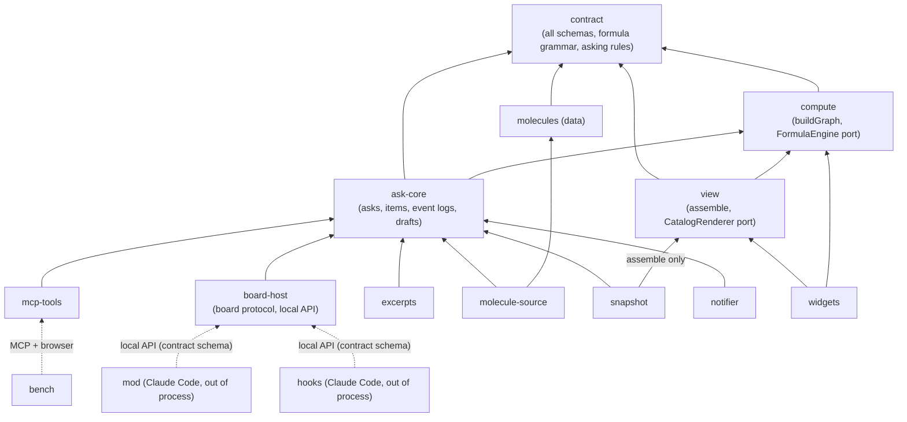
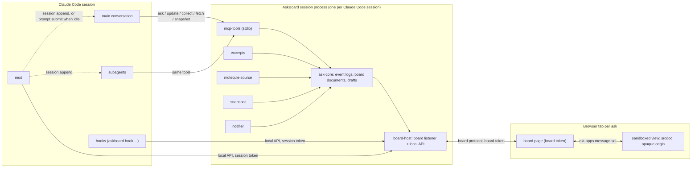
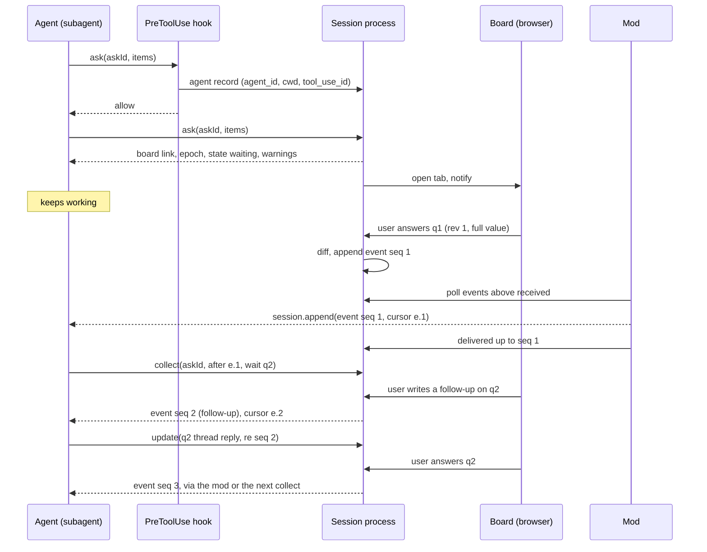
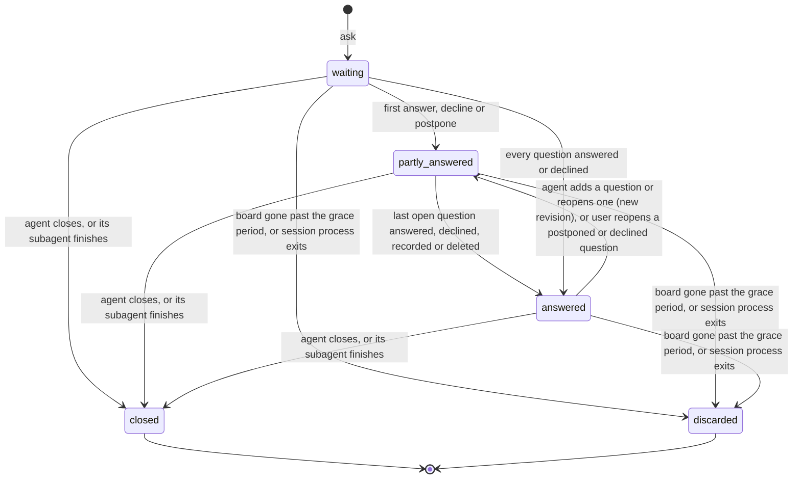
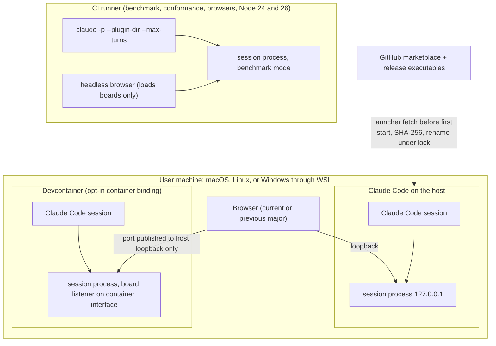

# Architecture Spine — AskBoard

The units below are the first-version building units. In the OpenSpec solution project each becomes a capability, and changes cite the `AD` IDs here. The research files of this folder travel with the spine, and `SOLUTION-DESIGN.md` restates the facts the ADs rest on and holds the spike criteria, so neither depends on this planning repository. Terms follow the PRD glossary (ask, item, board, answer, follow-up, Snapshot, molecule). **Session process** is defined in AD-2, **event** and **cursor** in AD-3, **board document** in AD-12, **revision** and **draft record** in AD-20.

## Design Paradigm

**Hexagonal architecture (ports and adapters) around an ask core, with a schema-first contract as the shared language.** The core owns asks, items, their lifecycle and one event log per ask. Everything that faces Claude Code, the browser, the file system or a third-party library is an adapter behind a port. The view is a separate deployable that renders from contract data alone.

| Layer | Units | Lives in |
| --- | --- | --- |
| Shared language | `contract` | `packages/contract/` |
| Domain core | `ask-core`, `compute` (runtime-neutral) | `packages/core/`, `packages/compute/` |
| Driving adapters (agent side) | `mcp-tools`, `mod`, `hooks`, `skills` | `packages/server/`, `packages/mod/`, `packages/hooks/`, `skills/`, `agents/` |
| Driven adapters (outside world) | `board-host`, `excerpts`, `molecule-source`, `snapshot`, `notifier` | `packages/server/` |
| View (browser, sandboxed) | `view`, `widgets` | `packages/view/`, `packages/widgets/` |
| Data | `molecules` (ready-made molecules in the input format) | `packages/molecules/` |
| Tooling | `bench`, `packaging` | `packages/bench/`, `.claude-plugin/`, `scripts/` |

## Invariants & Rules



Solid arrows are code imports, from dependent to dependency. Dotted arrows are run-time calls by out-of-process clients that import no server code.

### AD-1 — Hexagonal core, contract as the only shared language [ADOPTED]

- **Binds:** all units.
- **Prevents:** delivery paths, the renderer, the formula engine or Claude Code specifics leaking into the core; units coupling to each other's internals (PRD R2).
- **Rule:**
  - **Imports (code):**
    - `ask-core` imports only `contract` and `compute`.
    - Every adapter imports `ask-core` ports and `contract`, never another adapter.
    - The session process entry point (`packages/server/src/main.ts`, with the files beside it outside the server unit folders) composes the units: it may import `ask-core`, `contract`, every server unit and `hooks`, whose hook mode (`askboard hook <event>`) and local API client run from the same executable (AD-19), and no unit imports it.
    - `view` imports only `contract` and `compute`. `widgets` imports only `contract`, `compute` and `view`'s `CatalogRenderer` port. A server unit imports `view` only for `assemble` (AD-9).
    - `compute` and `ask-core` use no DOM, Node-only or Bun-only API.
    - CI fails on any import that crosses the dependency diagram.
  - **Run time:** `mod`, `hooks` and `bench` are out-of-process clients. They talk to the session process only through schemas in `contract` (AD-7).
  - **Degradation:** CI runs the conformance suite three times: with the mod and the hooks, with the mod disabled, and with the hooks disabled.

### AD-2 — One session process per Claude Code session [ADOPTED]

- **Binds:** `mcp-tools`, `board-host`, `ask-core`, `mod`, `hooks`, `packaging`; FR-5, FR-23, FR-25, NFR-2.
- **Prevents:** a shared daemon with state shared across sessions, version skew between sessions, lifecycle code, side effects from a short-lived protocol probe, a new board taking the front from a board the user is working on.
- **Rule:**
  - **Identity:**
    - The stdio MCP server that Claude Code starts for a session (the **session process**) is the only AskBoard runtime for that session. It hosts `ask-core` and serves that session's boards.
    - Every session process has its own `epoch`. Ask IDs are scoped to it, and FR-5's no-reuse rule holds within it.
  - **What session processes share:** files under `.askboard/`, the user configuration folder, the session-file folder, the executable cache and the port range (AD-14, AD-22). On a port collision, a session process tries the next port in the range.
  - **Start:** the session process has no side effects (no port, no session file, no notifier, no download) until it receives its first request other than `server/discover`. Claude Code sends `subscriptions/listen` right after the handshake, so the local API and the session file exist from connection, before the first ask's `PreToolUse` record needs them.
  - **Bringing a new board to the front:**
    - A board of the session is **working** while it has focus and has had a user input in the last 60 s, as its board page reports (AD-7).
    - For a new ask, the session process calls the browser opener only when no board of the same session is working. Otherwise it does not open the board, since the opener is an OS command that cannot open a background tab; the notification and the terminal link open it (FR-23).
    - Boards of other sessions never count: across sessions the browser behaves as usual.
  - **Exit:** it exits when its stdin closes or on SIGINT, SIGTERM or SIGHUP, after sending `discarded` to every live board, and removes its session file and its socket. Claude Code stops it with SIGINT. All its asks are then discarded (FR-25).

### AD-3 — Single writer, one append-only event log per ask [ADOPTED]

- **Binds:** `ask-core`, `mcp-tools`, `board-host`, `view`, `mod`, `hooks`, `snapshot`, `skills`; FR-4, FR-6, FR-7, FR-10, FR-18 to FR-22, FR-25.
- **Prevents:** two owners of ask state; answers lost or received twice when several delivery paths fire; a stop guard that loops.
- **Rule:**
  - **Writing:**
    - Only `ask-core` mutates asks, items, drafts and event logs; adapters and the board page submit commands.
    - An **event** records what the user or AskBoard caused: answer (a decline included, AD-20), postponed, question reopened by the user, follow-up, open-prompt text, edit choice (reload or ignore, FR-6), closed with reason `agent-finished`, discarded. The ask state these events cause (AD-10) is not an event of its own: every `collect` result, push and block reason carries it beside the ask's events. A change made by the agent's own tool call is reported in that call's result and not logged.
    - Every event concerns one ask and at most one item. Events are immutable and carry a per-ask `seq`, strictly increasing.
  - **Reading:**
    - A **cursor** is exactly `<epoch>.<seq>` and belongs to one ask. An event carries its `seq` only inside its cursor.
    - `collect` takes `{askId, after}` per ask and returns, for each ask, its ID, state and latest cursor and the events after `after`, each carrying the cursor that follows it. A push or a `SubagentStop` block reason carries, with every event, its `askId` and cursor.
    - Agents never build cursors: they pass the latest cursor they received for that ask. Acknowledgement is monotonic, so the highest cursor wins.
    - A cursor from another epoch returns `discarded` for the ask it was issued for, with no events.
  - **Delivery:**
    - Events are idempotent by (epoch, `seq`). Any path may repeat one, and the skills teach agents to ignore a `seq` they have seen.
    - Per ask, `ask-core` keeps a `received` watermark that only increases: the highest `seq` returned by `collect`, carried in a `SubagentStop` block, or reported delivered by a push adapter. The guard and the mod act only on events above it.
    - When `received` passes an answer's event, `board-host` tells the ask's board, which marks that answer delivered to the agent. This receipt claims delivery only, never that the agent read or acted on the answer, so it never reads the cursor the agent acknowledges. It travels over the board protocol and is not an event.

### AD-4 — Pull is authoritative, the mod is the push transport [ADOPTED]

- **Binds:** `mcp-tools`, `mod`, `skills`, `board-host`, `contract`; FR-10, FR-21, FR-22, FR-24, PRD R1.
- **Prevents:** a capability that works only when the mod runs; agents stalled where mods are disabled; a wait that blocks follow-ups; agent status mistaken for a user event; a push that auto mode refuses; a push that resumes a finished subagent; a failed report causing repeated wake-ups; an answer lost to push when the user interrupts a turn.
- **Rule:**
  - **Pull:**
    - Every capability works through the MCP tools alone (AD-6).
    - `collect` can wait for a given item. It returns as soon as the log gains any event for that item, or an event that changes the ask's state.
    - While waiting it sends progress at least every 60 s. It waits at most 20 minutes, then returns `open`. Both values live in `contract`.
  - **Push:**
    - The Claude Code **mod** is the default push transport. It appends with `$.session.append` to a running subagent, and to the main conversation while its turn runs; the agent reads the row at its next model request. It wakes an idle main conversation with `$.prompt.submit`. When a main turn completes, it submits again every event it appended after that turn's last model request, since no request carried it. It uses `$.session.send` only to wake an in-process agent-team teammate that waits idle, since an append starts no turn there; auto mode refuses a mod's send, and the row is then appended instead (PO decision of 2026-11-03).
    - It pushes only to an agent that is still running: never to a subagent that `$.agent.list()` no longer lists or shows as `completed`, `failed` or `killed`, since a message would resume it. After the user interrupts a turn, Claude Code drops every submit until the user's next input. The mod keeps each event so dropped and appends it when the next main turn starts; that turn reads it only from its second model request, so if the turn makes only one, the mod submits the event when the turn completes. Until then the event reaches the agent only through `collect`.
    - It pushes only events above `received` (AD-3) and reports what it delivered, which raises `received` and so the board's delivery receipt. An event counts as pushed once the push call is made: a report that fails is retried on its own and never causes another push. Its absence costs latency, never correctness: an answer's receipt then waits for `collect` or the `SubagentStop` guard.
    - Push goes only to the agent that owns the ask, in its own session, as a message attributed to the mod and never with `asUser`: an appended row names the plugin as its origin. `$.prompt.submit`, and an append without an agent ID, carry only events of asks owned by the main conversation.
    - Another push transport is added only as a further adapter over the same log.
  - **Agent status:**
    - Agent status (`agent-working`, `agent-waiting`) is presence, never an ask state or an event. `mcp-tools` sets `agent-waiting` while a waiting `collect` is pending, except once Claude Code has moved a main-conversation call to the background. When the mod runs, the agent's turn state decides as well: an owner with no turn running is waiting. A main-conversation call counts as moved to the background once it has been pending longer than Claude Code's threshold, `CLAUDE_CODE_MCP_AUTO_BACKGROUND_MS` (120 s by default).
    - `board-host` shows status changes on the board at once.

### AD-5 — Ownership and routing through agent records [ADOPTED]

- **Binds:** `ask-core`, `board-host`, `mod`, `hooks`, `excerpts`, `mcp-tools`, `contract`; NFR-2, FR-8, FR-24, AD-17.
- **Prevents:** an answer reaching the wrong agent; one agent changing, collecting or acknowledging another's ask; the mod and the hooks deriving identity differently; Claude Code identifiers leaking into the core.
- **Rule:**
  - **Records:**
    - A `PreToolUse` hook on every AskBoard tool sends the session process an **agent record**: `agent_id` (absent means the main conversation), agent type, `cwd`, `tool_use_id`, tool name, ask ID and a timestamp.
    - A record binds to the MCP call that carries the same `tool_use_id` when the call carries one. Otherwise it binds to the next call to that tool with that ask ID within the record timeout, a constant in `contract`. A record left unbound expires.
    - Claude Code identifiers stay in the local-API adapter's record table, keyed by ask ID. `ask-core` sees only an opaque `ownerKey`.
  - **Ownership:**
    - The agent of the first bound `ask` record owns the ask. A later record from another agent never changes the owner.
    - The session process refuses `update`, `collect`, `fetch` and `snapshot` from anyone but the owner. An ask with no bound record is unchecked, and its results say so.
  - **Origin of an ask:** `ask-core` holds per ask an `origin`, set once from the owning record: `ownerKey`, label, `cwd`, root (AD-12), branch and worktree. The context header, `excerpts` and the mod's routing read it from `ask-core` only.
  - **When the hook is missing:**
    - The hook never blocks the call.
    - An `ask` that arrives with no record means the session runs without hooks. Its result says that push, ownership checks and the stop guard are unavailable, and that the agent must collect before it finishes.
  - **Reaching the session process:**
    - `mod` and `hooks` reach the session process only through its local API (AD-11), found through the session file. When `$.http.fetch` is refused (an organization's policy, or a policy mod that hooks it), the mod reaches the same API through the AskBoard executable run as a client with `$.process.run`, for everything it sends: polls, delivery reports and the version report. Whether that client starts once per poll or stays up for the session is an implementation choice.
    - The session file is a `contract` module and schema: `{format, key, pid, epoch, apiAddress, sessionToken, projectDir, startedAt}`. It sits in a user-only runtime folder (0700, file 0600), `$XDG_RUNTIME_DIR/askboard` when that variable is set, else `${TMPDIR:-/tmp}/askboard-<uid>`, and is named by its `key`, the PID of the Claude Code process. That process is the parent of the session process and of every hook; the mod learns its PID once, at `session.start`, from one `$.process.run` of a command that prints its parent's PID. `CLAUDE_CODE_SESSION_ID` is not the key: after `--continue` or `/clear` the session process and the hooks see different values. No unit computes its path itself. A client that finds no candidate file, or more than one, reaches none and falls back as above.
    - The launcher keeps Claude Code as the parent: it replaces itself with the executable (AD-22).
    - Wherever the mod needs the session ID, it takes it from `$.session.id()`, never from its environment, which holds the launching session's ID when Claude Code runs inside another session.
    - The local API answers at once, with no long-poll. Each response body stays under 1 MiB and is paged by `seq`. The mod polls it with `$.clock.every`, started at `session.start`; the poll survives `/clear`, which fires `session.end` and no new `session.start`.

### AD-6 — Five consolidated tools with generic schemas [ADOPTED]

- **Binds:** `mcp-tools`, `contract`, `skills`; NFR-1, FR-5, FR-6, FR-8, FR-14, FR-20, FR-21, FR-26, PRD R5.
- **Prevents:** tool-surface sprawl that inflates the context loaded every session; per-widget schemas in tool definitions; skills drifting from the server's validation; cache invalidation mid-session; answers paid for twice.
- **Rule:**
  - **The tool list:**
    - The tools are exactly `ask`, `update`, `collect`, `fetch`, `snapshot`, listed in that fixed order. The list never changes during a session. A new tool needs a spine update.
    - `update` adds, changes, deletes and reopens items; records an answer on the user's behalf; appends a follow-up reply; and closes the ask.
    - Annotations:
      - all five tools: `openWorldHint: false`;
      - `collect` and `fetch`: read-only;
      - `ask`: idempotent (not relied upon over stdio);
      - `snapshot`: `destructiveHint: false`.
  - **Schemas and validation:**
    - Input schemas are generic JSON Schema 2020-12. Every item is `{type, id, props}`: a `type` discriminator, the item's ID and an object of props. A molecule reference is such an item (AD-9). There is no root `anyOf`/`oneOf`/`allOf`, and top-level property names are 1–64 characters from `[A-Za-z0-9_.-]`.
    - Per-widget schemas, the molecule reference and definition formats, and the asking-rule predicates exist only in `contract`. Each ready-made molecule's parameter schema is part of its definition, data in `molecules` written in `contract`'s definition format. Tool definitions never include any of them.
    - The skills' reference files, examples and asking-rule texts are generated from `contract` and `molecules` at build time. CI fails when a shipped file differs from its generated form, or when an example fails validation.
    - The server validates every request against `contract`.
      - A request the agent must fix returns `isError` text naming the item ID and the expected shape, under 4,000 characters, with the first problems first.
      - A problem confined to one item that leaves the board usable is a typed warning in a successful result: an unresolved pointer (FR-8), a formula error (FR-14).
  - **Re-sending an ask:**
    - `ask` with the ID of an open ask returns that ask's board only when the request is identical and comes from the owner. Identical means deep-equal after RFC 8785 canonicalization to the first accepted request. It then opens no tab and sends no notice.
    - Any other `ask` with the ID of an open, closed or discarded ask is refused, naming the ID as in use.
  - **Results:**
    - A result is one text block carrying JSON in its `contract` envelope. No tool uses `outputSchema` or `structuredContent` until the benchmark shows that the model reads only one representation.
    - A result stays under 30,000 characters. Answers carry only what changed (FR-20). `collect` pages with `more: true`.
    - `fetch` returns one item, or a range of it, with a continuation cursor, and omits excerpt text and image bytes.
    - Typed results that are not errors: `open`, `postponed`, `closed`, `discarded`, `unavailable`.

### AD-7 — The contract: AskBoard's own versioned schemas for every run-time message [ADOPTED]

- **Binds:** `contract` and every unit; FR-1, FR-3, FR-7, FR-11, FR-12, FR-17 (later), FR-18, FR-24, FR-31, FR-34, PRD R2, AXFX FR-40.
- **Prevents:** formats invented per unit or per pair of units; data coupled to a renderer; framework vocabulary in answers; each widget inventing its own anchors, IDs, dates or money.
- **Rule:**
  - **Schema sets:**
    - `contract` holds a JSON Schema 2020-12 set with its own semantic version for every message that crosses a unit boundary at run time. Each set has one owning unit:

      | Schema set | Owner |
      | --- | --- |
      | Input format: ask, area, question, item, primitive, widget props, formula, molecule | `contract` |
      | Output format: event, answer, outcome, warning, push message | `contract` |
      | Tool request and result envelopes | `mcp-tools` |
      | Board document (AD-12) | `ask-core` |
      | Board protocol: board page ↔ `board-host` | `board-host` |
      | View manifest: the board page script and each chunk's SHA-256, styles, dependencies and licence notices, which `board-host` reads to serve the chunks and to build the board page's CSP (AD-8, AD-9) | `view` |
      | Local API: `mod` and `hooks` ↔ session process | `board-host` |
      | Session file | `board-host` |
      | Configuration | `ask-core` |
      | Snapshot data block | `snapshot` |
      | Benchmark timing log | `bench` |

    - Only a change to a schema's owning unit alters it.
    - Every document and message names its schema version, except tool requests: the server and the skills that teach the input format ship in one plugin version, so a request cannot be skewed and names none, and every result names the versions it follows. A receiver that gets an unsupported major refuses it, saying why, and falls back as its AD says: the mod does not push, the hooks let the call through.
    - The local API is the only schema set where Claude Code identifiers appear, and agents never see it.
    - The board protocol carries each board page's working signal (AD-2): whether the board has focus and has had a user input in the last 60 s. It is presence only and never carries content.
    - Every unit validates with the one validator pinned in Stack.
  - **Wire format:** the input format is AskBoard's own lean JSON, not A2UI, written as the tools' native JSON arguments: descriptive camelCase keys, every record a keyed object, no positional rows and no abbreviated keys. The agent writes content and structure: questions, widgets with their data, excerpts and images by pointer, formulas and molecule references. AskBoard owns the layout. Any A2UI support comes later, as an inbound translator adapter to the input format.
  - **Optional ask fields:** the ask may carry the following, and each is optional so that a plain ask stays cheap (NFR-1):
    - `title` and `agentName`, the agent's display name. Without them, AskBoard derives the title from the first question and the name from the agent type that Claude Code reports (AD-5).
    - `expectedUser`, the user expected to answer (FR-19). Without it, `who` comes from the git user name, then the OS login name.
    - `presentation` (`sections`, `tabs` or `one-per-view`, FR-2) and `delivery` (`immediate` or `submitted`, FR-22). Without them the board shows sections and starts in immediate delivery.
    - `language` (`en-US` or `it-IT`, the user's preferred language) and `locale` (`en-US` or `it-IT`, the formats AskBoard ships, FR-34). Without `language`, the board uses the configured `defaultLanguage` (AD-14), then `en-US`. Without `locale`, the ask's language decides it. The language holds for the whole ask, and AskBoard translates nothing (FR-34). Language and locale govern display only; values keep the formats below (AD-13).
  - **Content:**
    - **Excluded:** neither format contains HTML, CSS, script or the geometry of the board's layout, nor any AXFX term.
    - **Positions:** positions relative to the content are data:
      - image regions as media-fragment selectors (`xywh=percent:`);
      - diagram anchors as node or edge IDs as written in the diagram source, else the quoted label;
      - diff anchors as side (`old` or `new`), file path and line on that side;
      - text anchors as quote or position selectors.
    - **Annotations:** they share one shape modelled on the W3C Web Annotation Data Model, a target (item ID plus selector) and a body. Its fields are fixed in `contract` before the first annotating widget is built: `{id, target: {selector}, body: {text}}`, the item ID being the key of the answer's `results`, with one selector type per kind of position above (`element` and `label` for diagrams and graphs, `region` for images, `line` for diffs, `quote` and `position` for text).
    - **Values:**
      - calendar dates are RFC 3339 `full-date` strings;
      - durations are integer days against the item's working calendar, which is optional and defaults to Monday to Friday with no holidays;
      - money is a decimal string plus an ISO 4217 code, which an item may declare once for all its amounts;
      - no unit converts a date through a zoned date-time.
    - **Questions:** a question's props hold its `text`, an optional `header`, its `options` and `multiSelect`; its widgets, excerpts and molecules go in its `items`, each an item as in AD-6. The agent sends no layout: an excerpt goes beside its question because of its type (FR-13).
    - **Areas:** an area is an item `{type: "area", id, props: {title, items}}` at the top level of an ask, whose `items` hold its questions. Areas do not nest, and either every top-level item of an ask is an area or none is; an ask without areas shows its questions as one group (FR-2). `update` adds a question to an area by naming the area as its parent.
    - **Widgets and the open prompt:** a widget either sits in a question, and so has the open prompt (FR-7), or is display-only and returns no answer.
    - **Widget types:** `contract` holds one registry of widget types. Per type it gives the props schema and checks, the element shape and `changes` schema when the user edits the agent's content, the result schema and checks when the widget gives a result, the derived declarations of AD-13, the agent-facing wording and an example item. Every unit that handles a widget item dispatches on the registry, so a widget is added by registering it; a widget's chunk gives the view what the shell needs of its type through the `CatalogRenderer` port (AD-9), so the shell does not grow with the catalogue.
    - **Diff review alternatives:** a Diff review item may give two alternative fixes as pointers to two patch files under the ask's root. They apply to the files under the ask's root as they stand at send time, never to a git revision, so the item names no base. The agent never writes diff text: AskBoard computes the diffs (AD-12). Branches and commits are not accepted in the first version, since a worktree's object store lies outside the ask's root.
  - **IDs:**
    - Ask IDs, item IDs and the IDs of child elements (tree nodes, table rows, Gantt tasks) are chosen by the agent and match `[A-Za-z0-9_-]{1,64}`.
    - Elements the user adds in a widget (a work package in a split, a tree node, a Graph state) get IDs the view makes, with a prefix reserved in `contract` that agent-chosen IDs may not use. View-made IDs, prefix included, still match `[A-Za-z0-9_-]{1,64}`.
    - Item IDs are unique within their ask, child IDs within their item.
    - Every collection the user can add to, reorder or delete from holds elements with a required ID.

### AD-8 — Agent content is data, shown in an isolated view [ADOPTED]

- **Binds:** `view`, `widgets`, `board-host`, `snapshot`, `notifier`, `molecules`; NFR-3, NFR-4, NFR-5, NFR-9, FR-3, FR-9, FR-11, FR-17 (later), FR-23.
- **Prevents:** script injection from agent or file content; a board reaching another board, a token or AskBoard itself; remote content loading from outside the machine; command injection through notices or the editor launch; agent content starting a local process.
- **Rule:**
  - **Content:**
    - Agent content is rendered only as text and data through the catalog. Only the view renders Markdown, and only through a sanitizer. No raw agent HTML reaches any page.
    - Script runs only in code bundled with AskBoard. A molecule or ask that carries code is refused. No view code creates a script element with a URL: a diagram renderer that loads resources that way gets a loader that refuses them, since Firefox runs a relative `<script src>` from a Snapshot opened from `file://` despite a hash-only `script-src`.
    - Remote URLs in agent content are shown as links, never loaded.
  - **The view sandbox:**
    - The board page builds the view's iframe from `srcdoc` through `assemble` (AD-9), with exactly `sandbox="allow-scripts"`: no `allow-same-origin`, `allow-popups`, `allow-top-navigation*`, `allow-forms` or `allow-modals`. The view therefore has an opaque origin and makes no request to the session process.
    - The view's CSP comes as a meta tag in the srcdoc, and it applies together with the board page's CSP, which the srcdoc inherits:
      - `default-src 'none'`;
      - scripts and styles only by the hashes of the inlined chunks;
      - `img-src data: blob:`, `font-src data:`;
      - `connect-src`, `object-src`, `frame-src`, `form-action` and `base-uri` all `'none'`;
      - never `'wasm-unsafe-eval'`, `'unsafe-eval'`, `'unsafe-inline'` or `'unsafe-hashes'`;
      - no storage.
    - Diagram SVG is shown as ``. The view never holds a token.
    - Styles reach the view only by hash or through the CSSOM: `style.cssText`, `insertRule` and constructed stylesheets (`adoptedStyleSheets`), which a hash-only `style-src` allows. Where a library writes a `style` attribute or adds a `<style>` element at run time, or parses markup that holds `style` attributes, AskBoard's view code routes the write through the CSSOM instead: the diagram renders, the modal dialogs and Diff review. The policy never gains `'unsafe-inline'` or `'unsafe-hashes'`.
  - **Pages on the board origin:**
    - The board page and source views render agent and file content only as text (`textContent`, or highlighting built from text).
    - A source view is a page AskBoard builds, never the file served with its own content type. It is served with `X-Content-Type-Options: nosniff` and the CSP `default-src 'none'`, styles by hash, `img-src data:`, `frame-ancestors 'self'`, `base-uri 'none'`, `form-action 'none'`: only a board page of the same origin may frame it, in its reading panel. It holds no script, and it serves only a pointer excerpt or pointer reference of its ask's current board document, named by item ID.
    - The board page's CSP allows scripts and styles by hash, the view chunks' hashes, `connect-src 'self'` and `frame-src 'self'`, which serves only the reading panel's same-origin source view. It also allows the view's own media sources, `img-src data: blob:` and `font-src data:`: the srcdoc inherits this policy, which would otherwise block the view's diagram images and inlined fonts, and the view's own policy cannot widen it. It allows a base URL only on its own origin, `base-uri 'self'`, for the board page's static `<base href="/">`: a srcdoc document takes its base URL from the board page, whose link carries the token, so without that element the view's `document.baseURI` would hold the token. It allows no form post (`form-action 'none'`) and no page framing the board (`frame-ancestors 'none'`); everything else falls to `default-src 'none'`.
  - **Talking to the outside:**
    - The view talks to the board page with the ext-apps 2.x message set and its `App` and `AppBridge` classes. The board page is not a conforming MCP Apps host and implements no sandbox proxy.
    - A reference leaves the view only as an open-link message. The board page opens only `http:` and `https:` URLs, in a new tab with `noopener` and `noreferrer`.
    - A project-file reference opens a reading panel on the board page, which frames the token-gated source view that `board-host` serves at the anchor, confined by AD-12. The frame carries an empty `sandbox` attribute and `referrerpolicy="no-referrer"`, so the source view has an opaque origin and runs nothing.
    - **Editor launch:** the reading panel's "Open in editor" asks `board-host` to open the file at that line in the user's editor.
      - Only an explicit user click on the board page launches it, never agent content.
      - The command comes only from the `editor` key of the user-level configuration (AD-14), never from an ask. A project file can be written by an agent, so a project-level `editor` is ignored, with a warning: agent content never chooses a command a click runs.
      - The path enters the argument vector as its absolute real path, resolved and confined again under AD-12 at the click. The line enters as an integer that AskBoard derives. Neither is truncated, and no other agent text enters the vector.
      - The `editor` key is itself an argument vector, a list of strings whose first is the program. AskBoard replaces exactly `{file}` and `{line}` wherever they occur inside an argument and expands nothing else; a command with no `{file}` gets the path as its last argument.
    - The notifier, the browser opener and the editor launch start OS commands with an argument vector, never through a shell or a script string. So does the session process's one read of its parent's command line, `ps` on macOS (`/proc` on Linux), which keeps only an agent-team teammate's `--agent-id`, `--agent-name` and `--team-name` and logs nothing of it. Apart from the editor launch's path and line, agent text is passed as a plain, truncated argument.

### AD-9 — Catalog composition, view build and molecules [ADOPTED]

- **Binds:** `view`, `widgets`, `molecules`, `molecule-source`, `ask-core`, `compute`, `snapshot`, `bench`; FR-11, FR-13, FR-14, FR-15, FR-26, FR-33, SM-C2.
- **Prevents:** widgets coupled to one renderer library; widgets that fetch data, need a server, keep private state or can't be measured; board and Snapshot built differently; molecules expanded in two places or colliding on IDs.
- **Rule:**
  - **Components:**
    - Atoms, layouts and widgets are catalog components registered through one `CatalogRenderer` port. No widget imports the renderer behind the port, which is AskBoard's own.
    - A component renders from the board document, the draft record (AD-20) and the compute graph alone, with no network and no server call. It keeps no edit state of its own: every edit goes into the draft record. An edit that the board's links carry into another item of the same question, such as a work package added in a WBS that a Gantt plan schedules, goes into the draft record for both items in one update.
    - User actions leave a component only as typed view messages, which the board page turns into board-protocol commands.
    - A component is ready when its asynchronous work has settled and its content has been laid out once. A question counts as visible when all its items are ready. A container that hides items, such as Tabs, still mounts them, hidden, so they report ready.
    - Each item renders inside an error boundary. An item that throws shows an error state and reports the error to the board page, and its question never counts as visible (AD-10).
  - **Build and assembly:**
    - At build time, `view` publishes a manifest: a shell chunk, library chunks for code that several components use, and one chunk per catalog component, each with its SHA-256, its styles, the licence notices of the code it contains and the chunks it needs. The widgets in `packages/widgets` are catalog components like the atoms in `view`: the view build bundles each as a component chunk of the same manifest, and a widget imports from `view` only the `CatalogRenderer` port. Nothing is bundled at run time. Every chunk is a classic script, so a chunk that holds `import.meta` fails the build.
    - One pure function exported by `view`, `assemble(boardDocument, manifest)`, builds both a board's srcdoc (called by the board page) and every Snapshot (called by `snapshot`), with its CSP. It inlines the shell and the chunks the board's items need, with the library chunks those need in turn.
    - In a Snapshot, `assemble` carries each diagram that has a kept render as its light and dark SVG, which a small chunk shows as a `blob:` image, and leaves that diagram's renderer chunk out. A diagram with no kept render gets its renderer chunk.
    - The view renders each diagram in both themes and sends the SVG text to the board page as a typed view message. `board-host` keeps the latest render per item and board revision, as data: it never serves one as a page (AD-8).
    - The view boots from the `askboard-data` block when there is one. It starts the view-protocol handshake only when it has a parent host. A Snapshot, which has none, carries no view-protocol code (ext-apps' `App`).
  - **Molecules:**
    - Ready-made molecules are input-format data, not code.
    - A molecule reference is an item `{type: "molecule", id, props: {molecule, version, data}}`, with `version` optional. A molecule's definition names the version of the definition format it follows, and declares its parameters as JSON Schema, its composition and, for each parameter, the JSON Pointers in its composition that the parameter fills. A fill copies the parameter's value or applies one of the format's declarative forms: naming an item of the ask, turning an object's values into entries of one field, or leaving out named keys. No fill evaluates anything. `contract` holds the format; `molecules` holds the ready-made definitions.
    - `ask-core` expands a reference when the ask or update is sent, through the `MoleculeSource` port. Expansion prefixes every internal item ID with `<id>__` and rewrites the molecule's references to match: a parameter that names a molecule reference of the ask names that reference's expanded item. It refuses an expansion whose IDs exceed 64 characters or repeat an item ID of the ask, or whose expanded items fail their widgets' checks. The board document holds the expanded items, never the reference; `ask-core` keeps, beside it, which expanded item belongs to which reference.
    - Answers, warnings and `fetch` results address a molecule's content through the reference's ID and the child IDs of its data (`wbs.portal.label`), never through the expanded IDs, and carry no `molecule` field: `ask-core` maps between the two. `fetch` of a reference returns its expanded item, as the user left it, under the reference's ID, with each value the expansion filled with an expanded ID naming the reference again. In the first version of the format a composition holds one item, whose addresses are its reference's. A reference without `version` gets the highest shipped version of the current major; one with a version, the shipped version of that major at or above it. AskBoard ships one version per major of a molecule.
    - The sales-estimate-review molecule takes an optional `minimumMargin`. Without it, the project default `defaultMinimumMargin` applies (AD-14); with neither, the board shows no margin warning.

### AD-10 — Fail closed [ADOPTED]

- **Binds:** `ask-core`, `mcp-tools`, `view`, `widgets`, `mod`, `hooks`, `bench`, `board-host`; NFR-10, FR-3, FR-4, FR-22, FR-24, FR-25, AXFX FR-40.
- **Prevents:** an answer the user never gave reaching the agent; a missing answer read as "not yet"; answers sent to an agent that no longer exists; scripted answers in normal use.
- **Rule:**
  - **What becomes an answer:**
    - An answer event comes only from an explicit user action on its question on the board. An answer the agent records on the user's behalf with `update` (FR-19) is held by `ask-core` as that question's answer, marked recorded, with `who` and the core's time, and reported in that call's result; like every change the agent's own call makes, it is not logged (AD-3): no event carries it, so neither push nor `collect` delivers it; `fetch` returns it marked `recorded`.
    - Choice and input widgets start with nothing chosen and no value set, whatever the agent marks as recommended or default. A recommended option is only labelled.
    - Submit sends only answers created by user actions. A review widget (Table, Tree, Gantt, Form over agent content) reports untouched content as unchanged, never as a chosen value.
    - Unsent work never reaches the agent until the user sends it (AD-20).
  - **Epochs and states:**
    - Every tool result carries the session process's `epoch`. An ask unknown to the current epoch is reported as `discarded`, never as "no answer yet".
    - Ask states are `waiting`, `partly-answered`, `answered`, `closed`, `discarded`. Question states are `open`, `answered`, `postponed`, `declined`. Closing carries a reason (`agent`, `agent-finished`).
    - `declined` is a terminal question state like `answered`: a decline closes its question (AD-20). An ask is `answered` when every question that is not postponed is answered or declined.
    - An `answered` ask returns to `partly-answered` when the agent adds or reopens a question, or when the user reopens a postponed or declined question with the event "question reopened by the user" (AD-20).
  - **Subagents:**
    - A `SubagentStop` hook blocks a subagent from finishing only while an ask it owns, open or discarded, holds events above `received`, and only when the hook input's `stop_hook_active` is false. A discarded ask's tombstone is delivered as AD-21 says; a closed ask never blocks. It never blocks twice for the same event (PO decision of 2026-11-03).
    - The block's reason carries those events with their cursor and lists the subagent's open asks.
    - Whenever the guard lets a stop through, it tells the session process, which closes the subagent's open asks with reason `agent-finished`. Their boards show it and accept no more answers.
    - A stop is let through for an ask with no bound owner, and, without an error, for an agent the session process has no record of, such as Claude Code's own side agents (empty `agent_type`).
  - **Benchmark mode:**
    - Benchmark mode starts only when the session process finds a per-run secret in its environment that matches the run file `bench` writes under `.askboard/bench/`. Its answers are marked as scripted.
    - The scripted AskUserQuestion answerer is registered only in `bench`'s run settings, never in the plugin's `hooks.json`.

### AD-11 — Local machine only, a token on every request [ADOPTED]

- **Binds:** `board-host`, `mod`, `hooks`, `notifier`, `packaging`; NFR-3, NFR-4, NFR-9.
- **Prevents:** remote access, DNS rebinding, CSRF from other local pages, one credential opening another channel, data leaving the machine.
- **Rule:**
  - **Binding:**
    - The board listener binds `127.0.0.1` only, on a port from a configurable range.
    - In a devcontainer, binding the container interface happens only on explicit opt-in. The devcontainer guide publishes the port as `127.0.0.1:<port>:<port>`, and the session process warns on stderr whenever it binds a non-loopback interface. Without the `127.0.0.1:` prefix Docker publishes the port on every host interface, so the guide never drops it. The host-side address in printed links is configured as host and port, since the published port can differ from the container's.
    - The local API listens on a Unix socket, set to 0600 explicitly rather than left to the umask, in the session-file folder (0700), never on a network interface. The socket's path stays within the platform limit (104 bytes on macOS).
  - **Board requests:**
    - Each board has its own random token of at least 128 bits. The token travels in the URL of the two pages AskBoard serves on the board origin, the board page and a source view (AD-8), since a frame's navigation carries no header, and on every other request only in a request header or the first WebSocket message. AskBoard sets no cookies.
    - `Host` must be a loopback name, on any port.
    - When a request carries `Origin`, it must equal `http://` plus its `Host`. WebSocket upgrades and every request other than GET or HEAD must carry a matching `Origin`. A GET or HEAD without `Origin` is served only with a valid token.
    - The board page sends changes only through `fetch` or WebSocket, never as form posts. Responses send `Referrer-Policy: no-referrer`.
  - **Local API requests:** the local API has its own session token of at least 128 bits, held only in the session file, and the socket's file permissions admit only the user. It refuses requests that carry a browser `Origin`; the mod's `$.http.fetch` sends none.
  - **Credential separation:** a board token never opens the local API, and the session token never opens a board. Diagnostics never print a token.
  - **No outbound traffic:**
    - AskBoard's own code makes no outbound network connection: no telemetry, and no fetching of references. Web, GitHub and Atlassian references open in the user's browser.
    - The one exception is the launcher fetching the pinned executable before the session process starts; a first download that outlasts the launcher's 25 s budget continues detached and serves the next start. The fetch carries no user data. The file is written under a temporary name, checked against a SHA-256 shipped in the plugin, and renamed into place under a lock. Hooks never fetch.

### AD-12 — The board document: resolved and confined at send time [ADOPTED]

- **Binds:** `ask-core`, `excerpts`, `molecule-source`, `board-host`, `view`, `snapshot`, `mcp-tools`, `packaging`, `skills`; FR-8, FR-9, FR-11, FR-15, FR-26, NFR-1, NFR-5.
- **Prevents:** pointers or references reading files outside the project; excerpts resolved against the wrong worktree; Snapshots missing excerpts or images; images sent as payloads or loaded remotely; Markdown rendered in two places.
- **Rule:**
  - **The root:**
    - An ask's root is the git worktree of the owning agent's `cwd` (AD-5) when that worktree belongs to the project's repository. Otherwise it is the session project root, the realpath of `CLAUDE_PROJECT_DIR`.
    - For an `isolation: worktree` subagent, that `cwd` is its own worktree, which Claude Code removes when the subagent finishes with no change. AskBoard reads files under a root only at send time, so its boards and Snapshots keep their content.
    - `packaging` also passes `CLAUDE_PROJECT_DIR` in the server entry's `env`. On a host that does not set it, pointers resolve as unresolved and project settings are not read.
  - **Resolving:**
    - When an ask or update is sent, `ask-core` resolves every excerpt pointer, media reference and molecule through its ports. It stores the result as that revision's **board document**, a `contract` schema.
    - In the board document, each excerpt carries its pointer, status (`resolved` or `unresolved`), source text, media type and line range. Each image carries its bytes, media type and pointer.
    - Paths resolve read-only, and only inside the root. A path that escapes through `..` or a symlink resolves as unresolved.
    - Diff review's patch files (AD-7) resolve the same way: at send time `ask-core` reads them through its ports, parses them and computes each alternative's diff against the files under the root as they stand at send time, never a git revision, so AskBoard needs no git access.
    - Every path a patch names resolves as a pointer does: read-only, only inside the root, unresolved through `..` or a symlink. A patch file that does not resolve, names such a path, does not parse or does not apply is unresolved, with a warning (AD-6).
    - AskBoard never searches for a bare ID (FR-9 out of scope).
  - **Reading:**
    - The view, `fetch` and Snapshots read only board documents. `board-host` ships them, image bytes included, over the board protocol. The view shows images only through `blob:` or `data:` URLs.
  - **Images:** images enter a board only as a pointer to a file under the root. The shipped skills tell agents to save screenshots under `.askboard/media/`, and Diff review patch files under `.askboard/patches/`. No base64 image in tool input, no remote image URL.

### AD-13 — One compute graph per board, built from the board document [ADOPTED]

- **Binds:** `compute`, `widgets`, `molecules`, `contract`, `ask-core`, `view`; FR-12, FR-14, FR-15, PRD R6, NFR-6.
- **Prevents:** widgets computing privately or defining their own fields; a send-time check that disagrees with the board; the agent computing derived values; lock-in to a formula engine; reliance on paid component features.
- **Rule:**
  - **Declarations in `contract`:** per widget type:
    - its addressable fields;
    - how its children are addressed;
    - each built-in derived field, as an expression over whitelisted functions. The whitelist is the operators `+ - * /`, unary minus, `^` and `= <> < <= > >=`, and the functions `SUM`, `MIN`, `MAX`, `IF`, `ROUND`, `AND`, `SQRT`, `SUMSQ`, `SUMPRODUCT`, `ROUNDUP` and `WORKDAY`, with Excel's semantics. `contract` holds the list, and `compute` holds fixtures for each entry. PERT, roll-ups, CPM scheduling and scores are written with them; `compute` writes the expressions of PERT and CPM scheduling, whose number of terms depends on the tree and the dependencies, and checks them against the whitelist like any other formula.
  - **References:**
    - A reference is the item ID, then at most one child ID, which is unique within its item (AD-7), then a `*` for each further child level, then the field: `[wbs.ux.optimistic]`, `[wbs.design.*.expected]`, `[wbs.*.expected]`. A `*` stands for the children of the node before it, in document order. A Tree move does not change a reference. Spreadsheet cells are `[item-id.A1]`, which no field name may match. A range of cells is `[item-id.A1:B3]`: it reads row by row and holds at most 65,536 cells. The grammar lives in `contract`.
  - **The graph:**
    - `compute` builds a board's whole graph from the board document alone: `boardGraphSource` maps the board's items onto a graph source, which `buildGraph` reads. The view builds it from the board document with the draft record's values in place of the items the user edited, and after each edit builds it again or, where the edit changes only input values the graph already holds, recalculates it in place. The Gantt plan's baseline is the same graph built from the board document as sent.
    - Widgets read and write graph values and define no node. A node exists whether or not its widget is mounted.
    - `ask-core`'s send-time check calls the same `buildGraph`. A missing reference, a wildcard that matches no node, or a cycle does not refuse the ask: the result lists it as a warning naming the item ID (AD-6), and the board shows that formula as an error (FR-14).
  - **Formulas:**
    - Formulas are Excel-style expressions that use only the reference syntax and the function whitelist.
    - `contract` holds limits on a formula's length, its nesting depth and a range's size. The graph checks them, with the grammar and the whitelist, before any engine runs; a formula over a limit is a formula error.
    - The engine is AskBoard's own restricted evaluator, in `compute`: its own parser, a topological sort, and the whitelisted functions written as code. It runs no `eval` or other dynamic code, and looks names up only in its own tables. It sits behind a `FormulaEngine` port and never sees ask or item IDs; the adapter maps each reference to an engine name.
    - Molecules use only the whitelist and the built-in derived fields.
  - **Determinism:**
    - Derived values ignore locale and timezone; money is rounded only for display, to the currency's minor unit. The graph checks currencies before any engine runs: a formula over amounts in more than one currency is a formula error, and so is a formula that reads it.
    - CI runs the `compute` and `view` fixtures under `TZ=Pacific/Kiritimati` and `TZ=America/Adak`, and under the locales `en-US` and `de-DE`, and compares the results.
    - Answers carry derived values as they stood (FR-12).
  - **In-house computations:** critical path and rescheduling are AskBoard's own code.

### AD-14 — Persistence and configuration [ADOPTED]

- **Binds:** all units; FR-25, FR-27, FR-30, FR-32, FR-34, FR-35.
- **Prevents:** state that survives a session by accident; units choosing their own storage locations; two readers of one config file applying precedence differently; a board writing a command to run.
- **Rule:**
  - **What stays in memory:** asks, events, board documents, draft records and agent records live in the session process's memory.
  - **Configuration:**
    - Both configuration files follow the configuration schema in `contract`:
      - project: `.askboard/config.json`;
      - user: `$XDG_CONFIG_HOME/askboard/config.json`, by default `~/.config/askboard/`. A relative `XDG_CONFIG_HOME` is ignored, as the XDG specification says; without an absolute `HOME` either, no user file is read.
    - Each file names its `version`, `major.minor`, as every document does (AD-7).
    - The schema names these keys, and the board's settings panel shows the presentation and behaviour ones (FR-35):
      - presentation: `theme`, `density`, `contextPlacement`;
      - behaviour: `defaultLanguage` (`en-US` or `it-IT`, FR-34), `askingRule` (FR-30, AD-16), `snapshotFolder` (FR-27), `editor` (AD-8);
      - molecule defaults: `defaultMinimumMargin`, the project default for the sales-estimate-review molecule's `minimumMargin` (AD-9).
    - Only the session process reads them, through one `Config` port in `ask-core`: once at start, and the user configuration's presentation keys again whenever it opens a board. Start is the first time it needs a setting, never before its first request after `server/discover` (AD-2). It merges them key by key, project keys winning, and changes take effect from the next session, except the board's presentation writes below.
    - **Presentation keys:**
      - The board page may change `theme`, `density` and `contextPlacement` over the board protocol. The session process writes the value to the user configuration and applies it at once, to that board and to later ones.
      - The write re-reads the file, changes only that key and replaces the file atomically (a temporary file, then a rename).
      - Each session process reads the presentation keys from the user configuration again whenever it opens a board, so later boards of every running session open with the change.
      - A presentation key set in the project configuration wins and shows read-only.
    - The session process accepts a settings write only for `theme`, `density` and `contextPlacement`, with a value the configuration schema allows, and refuses any other key, so the board never writes a command to run. Behavioural settings show read-only, with their file and key, and keep the next-session rule.
    - `editor` is the one key read only from the user configuration, an exception to the merge: a project-level `editor` is ignored, with a warning (AD-8).
    - `hooks` and `mod` read effective settings only through the local API.
    - An unknown key is a warning. A file with an unsupported major version is ignored, with a diagnostic, and so is a file that cannot be read, is not JSON or fails the configuration schema: none of its keys applies, never part of them, and the settings panel shows the file as not applied, with the problem. The session process never writes a presentation key into a user configuration that fails its check.
  - **Project folders:**
    - `.askboard/` holds `config.json`, `snapshots/` (the default Snapshot folder, changeable with `snapshotFolder`), `media/` and `patches/` (written by agents, only read by AskBoard) and `bench/` (benchmark mode only).
    - At a session's first ask, the session process creates `.askboard/` under the session project root, with `snapshots/`, `media/` and `patches/` when missing; `bench/` is created only by `bench`. It writes `.askboard/.gitignore`, listing `snapshots/`, `media/`, `patches/` and `bench/`, only when it creates that file, so a user's choice to commit holds (FR-27). It creates nothing in another root: an `isolation: worktree` subagent's worktree is removed only while it holds no change (AD-12). A failure is a diagnostic and never refuses the ask.
  - **Roots:**
    - Configuration, `snapshots/` and `bench/` resolve against the session project root; `media/` and `patches/` against the ask's root (AD-12).
    - A configured Snapshot folder outside the project root is replaced by the default, with a warning.
  - **User folders:** the session-file runtime folder (AD-5) and the executable cache (AD-22).
  - **Later:** molecule storage (FR-16, FR-17) is decided with those features.

### AD-15 — Snapshots: assembled from the board document and the log [ADOPTED]

- **Binds:** `snapshot`, `view`, `widgets`, `mcp-tools`; FR-26, FR-27, NFR-6.
- **Prevents:** Snapshots that need a running AskBoard or the network; Snapshots exposing drafts to the agent; Snapshots overwriting each other or written anywhere.
- **Rule:**
  - **Content:**
    - A Snapshot is one HTML file built by `assemble` (AD-9).
    - The `askboard-data` block, `<script type="application/json" id="askboard-data">`, comes before every style and script, after the charset declaration and the view CSP meta tag, with `<` escaped. It holds the Snapshot's own record (when it was taken, by the agent or by whom, and whether a board's Snapshot left unsent work out); the current board document and every earlier revision an event names (AD-12); the board state the live board receives, with each question's state, current and previous answer, whether it was recorded, its receipt and its follow-up thread; the ask's origin (AD-5); every event in the ask's log, each answer carried with the full edited values `ask-core` keeps for it and, for an answer logged `tooLarge`, the results and derived values it kept apart (AD-20); the molecule expansion map; and the kept light and dark render of each diagram (AD-9). The board document, revisions and board state use expanded IDs, as the view renders them; events and their values use the molecule references, as `collect` returns them.
    - After the data block come the styles and scripts of the chunks the board uses, then the licence notices of the inlined code, as the JSON block `<script type="application/json" id="askboard-licences">`, with `<` escaped. A diagram whose renders the data block holds needs no renderer chunk.
    - A Snapshot never includes a draft record. A Snapshot taken from the board says so when unsent work exists.
  - **Writing:**
    - The `snapshot` tool takes no path. AskBoard writes into the configured Snapshot folder (AD-14) under a name it chooses, `<ask-id>-<YYYYMMDDTHHMMSSZ>-<6 characters from [a-z0-9]>.html`, with no colon, and never overwrites a file.
    - The tool returns the file's absolute path, not the content.

### AD-16 — Asking rules enforced by a hook [ADOPTED]

- **Binds:** `hooks`, `skills`, `contract`; FR-29, FR-30, NFR-8.
- **Prevents:** asking rules that hold only when the agent follows a skill; the skill and the hook judging a question differently; an agent left with no way to ask.
- **Rule:**
  - **The rules:**
    - Asking rules are a closed set defined in `contract`: `none`, `always`, `with-references`. Each has one predicate over an AskUserQuestion input, implemented once in `hooks`; the skills' texts are generated from `contract` (AD-6).
    - `with-references` sends a call to AskBoard when any question's `question` or `header`, or any option's `label`, `description` or `preview`, holds an `http:` or `https:` URL or a project-file pointer: a relative path ending in a file extension that holds a `/` or is followed by `#` and an anchor or by `:` and a line. `contract` holds both patterns.
    - The effective rule comes from the session process (AD-14).
  - **Enforcement:**
    - A `PreToolUse` hook on AskUserQuestion refuses it, with a reason pointing to AskBoard, whenever the rule sends the question there. It does so only while the session process is reachable and reports that it can show boards; otherwise it lets the call through.
    - Without hooks the rule is only advisory, through the skills, and the `ask` result says so.
  - **Subagents** always use AskBoard.

### AD-17 — Measurement built in, only in benchmark runs [ADOPTED]

- **Binds:** `bench`, `board-host`, `view`, `hooks`, `ask-core`; FR-32, FR-33, NFR-1, NFR-9, SM-1 to SM-4, SM-C1, SM-C2.
- **Prevents:** a time-to-show that ends before the whole question is visible; timing keys that cannot be joined; two scripted-answer paths; measurement leaking into normal use.
- **Rule:**
  - **Setup:**
    - A benchmark run loads AskBoard with `--plugin-dir` as the plugin under test, inside the isolated configuration, and passes `--max-turns`. The isolated configuration leaves out `--strict-mcp-config`, which drops plugin servers. AskBoard's server, hooks and mod are then the only plugin extensions loaded; the account's connectors may still connect, behind tool search. The report says how AskBoard was loaded and lists the MCP servers connected, and arms are compared by their differences.
    - In the AskUserQuestion arm, the scripted answerer from `bench`'s run settings answers AskUserQuestion (AD-10). The run sets the asking rule so that AD-16's hook lets AskUserQuestion through, and the report states both.
  - **Scripted answers:**
    - The headless browser only loads boards, and in benchmark mode the view mounts every area.
    - After `board-host` has recorded a question as visible, `ask-core` appends its scripted answer, marked `scripted`, through the same command port the board page uses.
  - **Timing:** `board-host` records when each question becomes visible (AD-9). The agent record's `tool_use_id` (AD-5) is the join key for the session process's receive and visible times, and joins the transcript for the request's start and the tool call.
  - **Counting:**
    - `bench` applies the PRD's counting rules and cost model (FR-32), runs each case 5 times and compares medians.
    - It reports cold, warm and subagent runs separately, and reports the context AskBoard adds before the first ask.
  - **Output and scope:** reports and logs go under `.askboard/bench/`. Outside benchmark mode AskBoard measures nothing (FR-33 out of scope).

### AD-18 — Standards and supported Claude Code [ADOPTED]

- **Binds:** `mcp-tools`, `skills`, `mod`, `hooks`, `packaging`; NFR-8, NFR-11, AXFX FR-36.
- **Prevents:** units targeting different protocol revisions or Claude Code feature sets; an agent stuck when no board can be shown.
- **Rule:**
  - **MCP:** AskBoard targets revision 2026-07-28 through the v2 TypeScript SDK, and keeps the SDK's default serving of 2025 openings. CI includes a run with `MCP_PROTOCOL_NEGOTIATION=legacy`.
  - **Skills:** they conform to the Agent Skills specification: `name` of 64 characters at most, lowercase with hyphens, matching its directory; `description` of 1,024 characters at most.
  - **Claude Code versions:**
    - AskBoard declares one minimum Claude Code version for all units. Release waits until the `stable` channel reaches it.
    - The session process learns the client version from the protocol's client information when present, else from the mod's report through the local API. When neither is known, it allows the ask and writes a diagnostic to stderr. Below the minimum, it refuses the ask with an error naming the minimum and the version found, and creates nothing.
    - CI runs against the declared minimum, `stable` and `latest`. On `latest` it checks that the AskUserQuestion input still matches FR-3's list.
  - **When no board can be shown:**
    - When AskBoard cannot show a board (no browser can reach it, or a remote host, AD-22), `ask` returns the typed result `unavailable` with its reason. That check is made before the ask is created.
    - The check, in order: a remote host (`SSH_CONNECTION`, `SSH_TTY`, `CODESPACES`) is `unavailable`; a container (`/.dockerenv`, `/run/.containerenv`, `REMOTE_CONTAINERS`, `DEVCONTAINER`) is `unavailable` without the opt-in binding and gets the terminal link only with it; a CI runner (`CI`, `GITHUB_ACTIONS`) without `BROWSER` is `unavailable`; otherwise a board is reachable through `BROWSER`, `open` on macOS, `wslview` or `explorer.exe` under WSL, or `xdg-open` with `DISPLAY` or `WAYLAND_DISPLAY` on Linux, and `unavailable` when none is present.
    - On `unavailable`, or when AskBoard's tools are absent, the main conversation asks through AskUserQuestion. A subagent ends its turn and returns the question to its caller.

### AD-19 — One plugin, shipped as a Bun executable [ADOPTED]

- **Binds:** `packaging`, `hooks` and every shipped unit; FR-28, FR-31, NFR-6, NFR-7, AXFX NFR-1, AXFX NFR-2.
- **Prevents:** a split installation; an undeclared runtime prerequisite; dependencies outside the licence policy; any dependency on AXFX.
- **Rule:**
  - **Bundle:**
    - AskBoard is released under the MIT licence.
    - One Claude Code plugin from a GitHub marketplace carries the MCP server, the skills, any shipped agents and `hooks/hooks.json`. That file declares both the settings hooks and the mod as the plugin's hooks module. The plugin installs at user or project scope (FR-28).
  - **Executable:**
    - The session process ships as a Bun-compiled executable for macOS and Linux on x64 and arm64, with Linux builds for glibc and musl.
    - No unit uses a Bun-only API: Bun is the build tool and the embedded runtime. CI also runs the session process on Node 24 and Node 26.
  - **Hooks:**
    - Every hook runs the same executable in hook mode, `askboard hook <event>`, through the launcher.
    - When the executable is missing, or the session process can't be reached, the hook exits 0 with no decision and writes one stderr line saying why. Each hook declares a timeout of 5 s.
  - **Browsers:** the supported browsers are the current and previous major versions of Chrome, Edge, Firefox and Safari. The bundler targets that baseline.
  - **Dependencies:**
    - Every dependency meets the adoption rule in the PRD addendum, and CI fails on a licence outside it or an archived dependency. A named exception waives only the stars criterion.
    - A licence exception exists only through a PRD change, and the first one rests on it: the LGPL components the Bun executable links. These are Bun's patched JavaScriptCore/WebKit (LGPL-2) and tinycc (LGPL-2.1), both present in every compiled target.
    - Each release:
      - ships their licence texts and Bun's notices;
      - names the exact Bun version;
      - links the matching WebKit source;
      - publishes the plain JavaScript bundle, so a user can run AskBoard on another runtime.
    - The exception holds once the PRD change to NFR-6 is applied and AXFX NFR-1 is confirmed to admit it. Until then, and if either is refused, AskBoard ships as the plain JavaScript bundle on Node 24.22.1 or later.
  - **Independence:** nothing in AskBoard requires or names AXFX, except where documentation names it as a user.

### AD-20 — Revisions, answers and drafts [ADOPTED]

- **Binds:** `ask-core`, `view`, `widgets`, `mcp-tools`, `snapshot`, `board-host`, `contract`, `skills`; FR-4, FR-6, FR-7, FR-10, FR-18, FR-20, FR-22, FR-25, AXFX FR-40.
- **Prevents:** diffs, `fetch` results and Snapshots applied to the wrong version; widget-specific diffs the core cannot apply; a verdict changed silently after a gate recorded it; follow-up replies that trigger edit conflicts; work lost on reload; units disagreeing on what submitted delivery holds back.
- **Rule:**
  - **Revisions:**
    - A revision `rev` belongs to each question and to each top-level item outside a question. Any change to a question, or to an item inside it, increments the question's `rev`. A follow-up reply does not.
    - Answer and edit-choice events name the question's `rev`. `ask-core` refuses an answer whose `rev` is not current, unless the log holds an `ignore` edit choice for the current `rev` that names that older `rev`; the board page then shows the edit choice.
    - An `update` that changes a question whose answer is in the log is refused, naming that answer's `seq`, unless it reopens the question, which starts a new revision with no answer.
    - `ask-core` keeps every revision that an event names, until discard.
  - **Answers:**
    - A view answer message carries the item's full edited value in its input-format shape, plus its derived values. What a widget gives that is not an edit of the agent's content (a decision, a value, an order, annotations, highlights) is its result, held apart from its edited value; the message carries it in `results` by item ID, and `ask-core` checks it against the result its type declares in `contract` (AD-7) and logs it in the answer's `results`.
    - `ask-core` alone computes the answer's `changes`, with one generic diff defined in `contract` (`add`, `remove`, `move`, `set`) that addresses elements by ID, never by array index. `contract` holds both the format and the pure function that computes it from the sent and the edited value, generic over ID-keyed elements in a flat list, a tree or an object keyed by element ID, each widget declaring only its shape; `ask-core` is the only unit that calls it at run time. Each operation's target uses AD-13's reference syntax without brackets (`item.child.field`), and `add` and `move` name the parent and the preceding sibling, each omitted when there is none: the top level, the first position. Elements in an object keyed by element ID change only by `set`s, one per changed field, with `null` for a field or an element that is gone. Widgets never emit diffs.
    - `ask-core` stores the full edited value and the results; `fetch` and Snapshots read them. It computes an answer's `changes` once, when it appends the answer, from the revision the answer names, so a revised answer's `changes` are again from what the agent sent, never from the answer it replaces. An answer whose `changes`, results and derived values would not fit one result is logged without them, marked `tooLarge`, and `fetch` returns them (FR-20).
    - A later answer to the same question is a new event that names the `seq` it replaces. The latest answer per question wins.
    - **Decline:** `declined` is an answer kind, carrying the optional reason from the question's open prompt. Like an answer, it closes the question (AD-10), names the question's `rev`, follows the delivery mode and is superseded by a later answer or decline. The shipped skills tell the agent not to ask a declined question again within its task; nothing about it outlives the ask (AD-14, FR-25).
    - **Reopening:** undoing a postpone or a decline that has been sent (it is in the log) appends the event "question reopened by the user", which `collect` and the mod deliver like any other (AD-3). Undoing one still held only removes it from the draft record.
  - **Follow-ups and the open prompt:**
    - The agent replies to a follow-up with an `update` that appends a reply to that question's thread and names the follow-up's `seq`. Appending a reply never counts as changing a question that holds unsent work (FR-6).
    - Open-prompt text becomes an event only on an explicit send action on that prompt, or as a field of the answer it accompanies; never on typing or blur.
  - **Delivery modes:**
    - In submitted delivery the view holds answers, declines, postpones, their undos and open-prompt text until the user submits. Follow-ups and edit choices always go at once.
    - A submit appends one event per held action, in the order the user produced them, as one atomic append that `collect` pages never split.
    - Every board command carries an action ID that the board page makes. `ask-core` applies each action ID once per ask, so a command resent after a dropped connection, a submit or a revision included, is never appended twice.
    - Switching to immediate delivery sends what is held, the same way.
  - **Drafts:**
    - Unsent work is a per-ask **draft record**. Per question it holds the edited values, the widgets' results, held answers, declines, postpones, held undos and open-prompt text, keyed by item ID and `rev`, and also the question's context placement, the text in its follow-up composers and the user's notes on options. For the board it holds the delivery mode and the open tab or the question in view.
    - The board page mirrors the draft record to `ask-core` over the board protocol. `ask-core` holds it apart from the log and never exposes it to `collect`, `fetch`, Snapshots, the mod or the local API.
    - A reconnecting or taking-over board restores it from `ask-core`. No AskBoard page uses Web Storage, IndexedDB or cookies.

### AD-21 — Board connection and discard [ADOPTED]

- **Binds:** `board-host`, `ask-core`, `view`, `mcp-tools`, `mod`, `hooks`; FR-23, FR-24, FR-25, NFR-10.
- **Prevents:** an ask discarded by a reload, sleep or dropped port forward, or before the user ever opened it; two timers racing; two live boards of one ask; answers lost on discard; traces of a discarded ask.
- **Rule:**
  - **Connections:**
    - Each ask has at most one live board connection. A new connection for the same ask takes over, restoring the draft record. The older tab shows that the board moved, and closing it discards nothing.
    - `board-host` reports connections and disconnections to `ask-core`, which alone runs the grace timer, and only after a first connection.
    - An ask that has never connected stays `waiting` until the agent closes it or the session process exits.
  - **Discard:**
    - An ask is discarded when its live board disconnects and does not reconnect within the grace period, or when the session process exits. A reload reconnects within the grace period and keeps the ask and its draft. Closed asks are never discarded.
    - On discard, `ask-core` appends a final `discarded` event, with reason `board-closed` or `session-exit`, and wakes every waiting `collect` on the ask. It then drops the ask's board documents and draft record.
    - A tombstone keeps the ID, the epoch, the owner, `received` and the events the agent has not acknowledged, until the agent acknowledges them or the session process exits. `collect`, the mod and the `SubagentStop` guard deliver them like any other events. `fetch` and `snapshot` answer `discarded`.
    - The board token stops working, and the board URL shows only that the ask was discarded. A board page that can't reconnect, or whose token is refused, shows the ask as discarded and accepts no more answers.

### AD-22 — Operations [ADOPTED]

- **Binds:** `packaging`, `board-host`, `hooks`, `mod`; FR-28, NFR-3, NFR-7, NFR-8.
- **Prevents:** stale executables or session files left behind; sessions running mixed versions mid-session; undeclared launcher prerequisites; support requests with no way to see AskBoard's state; unsupported environments failing silently.
- **Rule:**
  - **Executables:**
    - Executables are cached under `${CLAUDE_PLUGIN_DATA}/bin/<version>/`. When that variable is unset, empty or not substituted (a plugin loaded with `--plugin-dir` [F50]), the cache is `${XDG_CACHE_HOME:-$HOME/.cache}/askboard/bin/<version>/`. Each session runs the version its plugin pinned when the session started.
    - At start, versions the installed plugin no longer pins are pruned, along with session files whose process is gone.
    - The launcher sits in `scripts/` and fetches the executable from the release the plugin pins. It takes a lock by `mkdir`, breaks a lock whose owner is gone, removes partial files left by killed launchers, downloads to a temporary name, checks the SHA-256 shipped in the plugin, renames the file into place and `exec`s it, so Claude Code stays the parent of the session process.
    - Waiting for another session's download and downloading share one 25 s budget, so the handshake is always answered within `MCP_TIMEOUT`. A first download still running when the budget ends continues detached, holding the lock, and the launcher answers as on a failed start that AskBoard is downloading; the next start uses the file.
    - Each release publishes every executable both raw and gzip-compressed; the launcher fetches the compressed asset when `gzip` is present.
    - The launcher needs POSIX `sh`, `curl` or `wget`, and one SHA-256 tool (`sha256sum`, `shasum` or `openssl`). On musl Linux the executable also needs `libstdc++` and `libgcc`, which Claude Code requires there too. The launcher checks them before taking the lock and names the missing one.
    - When the launcher cannot start the executable (no download tool or SHA-256 tool, a failed fetch, a checksum mismatch, an unsupported platform, native Windows), it does not exit: it answers the MCP handshake with the reason in its instructions and one `ask` tool that returns `unavailable` with that reason, until stdin closes. Claude Code skips a plugin server whose start failed for 15 minutes across sessions [F48].
    - Offline, AskBoard starts from an executable copied into the cache, from a mirror named in configuration (`http` or `file://`, the checksum still checked), or as the plain bundle on Node 24.22.1 or later. Otherwise the launcher answers as on a failed start.
  - **Diagnostics:**
    - `askboard doctor` prints the AskBoard and Claude Code versions, the port, the session file and whether the session process is reachable, never a token.
    - Diagnostics go to stderr, at the log level set in configuration.
  - **Environments:**
    - Claude Code running on a remote host (SSH, Codespaces) is out of the first version, and `ask` returns `unavailable` there (AD-18).
    - On native Windows, where Claude Code runs the launcher through a POSIX `sh` (Git Bash, MSYS2, Cygwin), the launcher answers the handshake with a message naming WSL, as on a failed start. Without one, Claude Code reports that the server failed to start, the shipped skills fall back to AskUserQuestion (AD-18), and the README names WSL.
    - Uninstalling the plugin from its last scope deletes `${CLAUDE_PLUGIN_DATA}`, and the executable cache with it, unless `claude plugin uninstall --keep-data` [F49]. It leaves `.askboard/` in projects and the session-file folder. The documentation lists all three, with the `--keep-data` case.

## Consistency Conventions

| Concern | Convention |
| --- | --- |
| Unit and package names | Kebab-case unit names as in the paradigm table; packages `@askboard/<unit>`. |
| MCP names | Plugin `askboard`, server `askboard`. Full tool names `mcp__plugin_askboard_askboard__<tool>`; hook matchers also accept `mcp__askboard__<tool>`. |
| Plugin server entry | `env` passes `CLAUDE_PROJECT_DIR`. No per-server `timeout` below `collect`'s longest wait (AD-4). |
| JSON field names | camelCase in every schema set except the local API's Claude Code fields, which keep Claude Code's names. Event, state and reason values in kebab-case (`partly-answered`, `follow-up`, `agent-finished`). |
| IDs and references | As in AD-7 and AD-13. The skills teach ask IDs made of a task slug plus a short random suffix. |
| Time and identity | RFC 3339 timestamps in UTC. `when` is the time of the user's answer action, stamped by the view; for an answer the agent records, the core's time. `who` is declared: the ask's named user, else the git user name, else the OS login name (FR-19). |
| Locale formats | The en-US and it-IT formats for numbers, money, percentages, dates and times, and number and date entry, are AskBoard's own tables and pure functions in `contract`, used by the view, the board page, the widgets and Snapshots. Nothing formats through `Intl`, `toLocaleString` or the runtime's locale. A calendar date never passes through a time zone; a time shows in the viewer's time zone. Strings live in the view's catalogue, one table per language, and every string exists in both (FR-34). |
| Versions | Packages, plugin and every schema set follow semantic versioning (AD-7). |
| Errors, warnings, typed results | As in AD-6. |
| Process output | Stdout carries only MCP protocol. Diagnostics go to stderr, without agent content by default and never with a token. |
| Board link and notice | `http://<loopback host>:<port>/b/<ask-id>?t=<token>`, computed once by a `BoardAddress` port that `board-host` implements and `ask-core` holds. The `ask` result returns it. A `PostToolUse` hook on `ask` shows it to the user as a system message for the main conversation's asks, with or without the mod, as "AskBoard · <title> · <link>"; for a subagent's ask it returns nothing, since Claude Code would file the message in the subagent's transcript, out of the user's sight. The mod shows a subagent's link as a toast when the ask arrives, and draws the pending asks in a band above the prompt, under "🙋 AskBoard · <n> pending" in its accent colour: one row each, "🙋 AskBoard › <title>", the title a link to the board in the terminal's link style and only the title cut on a narrow band, redrawn whenever the list changes and empty when no ask is pending; a status entry of one line, "🙋 AskBoard › <first title> · +<n> more", only while the session also draws on a surface without that band (FR-23; PO decisions of 2026-11-03, since a terminal draws the status entry as one line). With mods off, a subagent's ask has the browser and the system notification only. The shipped skills forbid agents from opening or answering boards. |
| Excerpts and media | Pointer = one string: a root-relative path, `#` and an anchor, `L<start>-L<end>` for a line range, otherwise a heading, then an ID (`docs/prd.md#Billing`, `src/retry.ts#L40-L62`). The first `#` ends the path; a path with an empty, `.` or `..` segment, a leading `/`, a backslash or a control character is unresolved. A heading or an ID resolves only in a Markdown file: the first ATX heading outside fenced code whose text equals the anchor, else the first that holds it as a whole word; the excerpt is that heading's section. An excerpt's pointer needs an anchor, a reference's may omit it, an image's has none. Agent-written excerpts are text. Images by pointer only (AD-12). |
| Shipped agents | Declare no frontmatter hooks, MCP servers or permission mode; the plugin's hooks cover them. |
| Dependencies | Adoption rule from the PRD addendum, exceptions named in the solution design (AD-19). Versions pinned exactly. Tools that need a TypeScript compiler API use `@typescript/typescript6` as an npm alias, since TypeScript 7 ships none. |
| Tests | **CI failures:** imports that cross the dependency diagram (AD-1); generated skill files that drift (AD-6); a tool description or the server instructions over 4,096 characters; a full tool name over 128; a schema that is not valid JSON Schema 2020-12 or has a root combinator; a changed `tools/list` order; a view chunk that grows past a set margin over the previous build without the change saying so, or that holds `import.meta`, an elkjs input or an elkjs identifier; a licence outside the adoption rule (AD-19); any CSP violation in a browser test, a caught `eval` probe included, collected from the view, the board page and the console's CSP lines (zod's `jitless` is set before any module that uses zod loads). **CI runs:** the conformance suite with and without mod and hooks (AD-1), the hooks as processes of the built executable and the mod in a stand-in host of the mod API; one live call per supported model that loads the five tool definitions; the legacy-negotiation run (AD-18); the formula fixtures, with Excel's values, and the timezone and locale fixtures (AD-13); browser tests in Chromium, Firefox and WebKit (cold load, reload, takeover, source view, `self.origin === "null"` inside the view, a view `fetch` that fails, an item's box unchanged 1 s after its question is visible, and PlantUML's images for an empty source and a syntax error turned into render errors); a board and a Snapshot rendered in all three engines; macOS and Linux; Node 24 and 26. **CI reports:** per model, the token count of tool definitions, instructions, skill and agent descriptions, flagging anything above about 2,100 tokens (PRD R5). |

## Stack

| Name | Version |
| --- | --- |
| TypeScript | 7.0.2 |
| `@typescript/typescript6` (npm alias for tools that need a compiler API) | 6.0.2 |
| Bun (toolchain, runtime, `bun build --compile`, build-time bundler) | 1.4.4 |
| Biome (formatting and linting) | 2.6.4 |
| Node.js (fallback runtime; CI runs 24 and 26) | 24.22.1 or later |
| MCP specification revision | 2026-07-28 |
| `@modelcontextprotocol/server` (MCP TypeScript SDK v2) | 2.4.0 |
| `@modelcontextprotocol/ext-apps` (view message set, `App`, `AppBridge`) | 2.0.4 |
| React (view and widgets) | 19.3.1 |
| `@dagrejs/dagre` (Graph widget initial layout and auto-layout; elkjs stays excluded) | 3.1.3 |
| `radix-ui` (view primitives: Radio Group, Checkbox, Switch, Tabs, Slider, Toggle Group, Popover, Dialog, Alert Dialog, Dropdown Menu; not Select) | 1.8.1 |
| `react-day-picker` (the Date Picker's calendar) | 10.0.2 |
| `markdown-it` (Markdown, `html: false`) | 15.0.3 |
| `dompurify` (the Markdown sanitizer) | 3.4.17 |
| `katex` (LaTeX) | 0.19.1 |
| `@tanstack/react-table` (Table, Tree, Spreadsheet, the Gantt's grid) | 9.3.1 |
| `@atlaskit/pragmatic-drag-and-drop` (Ranking, Kanban, Tree) | 4.0.0 |
| `echarts` (Chart, canvas renderer) | 6.1.0 |
| `@xyflow/react` (Graph) | 12.12.0 |
| `mermaid` (Diagram; built without elkjs) | 12.2.0 |
| `@plantuml/core` (Diagram; the MIT npm tarball, `plantuml.js` only) | 1.2026.9 |
| `@pierre/diffs` (Diff review) | 1.6.2 |
| `@rjsf/core`, `@rjsf/utils` (Form) | 6.11.0 |
| `tailwindcss`, `@tailwindcss/cli` (build-time styles) | 4.3.3 |
| `@modelcontextprotocol/core`, `@modelcontextprotocol/client` (ext-apps' peers) | 2.4.0 |
| `zod` (ext-apps' peer, with `jitless` set first) | 4.6.7 |
| `@fontsource-variable/inter` or `@fontsource/inter`, `@fontsource/jetbrains-mono` (DESIGN.md's faces; Fontsource's stars exception) | 5.3.0 |
| JSON Schema dialect | 2020-12 |
| Ajv (the one validator; standalone validators generated at build for the view) | 8.20.0 |
| `ws` (`board-host`'s WebSocket server, on `node:http`) | 8.22.0 |
| `playwright` (browser tests in Chromium, Firefox and WebKit; tests only) | 1.64.1 |
| `@types/node` (`server`'s types, at the Node floor's major) | 24.19.2 |
| `@types/react`, `@types/react-dom` | 19.3.0 |
| `@types/ws` | 8.18.2 |
| Claude Code minimum (confirmed by the mod delivery spike: 2.1.308 fires `SubagentStop` while a subagent works; `stable` was still 2.1.308 on 2026-10-29, so release waits) | 2.1.311 |

`@types/bun`, which only tests and repository tools use, follows the Bun pin. The other `@types` packages follow their runtime: `@types/node` the major of the Node floor, `@types/react` and `@types/react-dom` React's minor, `@types/ws` the major of `ws`.

## Structural Seed

**Containers and data flow**



**Answer delivery to a subagent (AD-3, AD-4, AD-5, AD-20)**



**Ask lifecycle (FR-24, FR-25, AD-10, AD-20, AD-21)**



**Deployment and environments**



**Source tree**

```text
askboard/
  .claude-plugin/        # plugin manifest
  hooks/hooks.json       # settings hooks (askboard hook <event>) and the mod as hooks module
  packages/
    contract/            # every schema set (AD-7), formula grammar and whitelist, asking rules, constants, session-file module, generated types
    core/                # ask-core: asks, revisions, board documents, event logs, drafts, ports (BoardAddress, MoleculeSource, SourceFiles, Config, SnapshotWriter, FormulaEngine use)
    compute/             # buildGraph, FormulaEngine port and adapter, PERT, CPM scheduling
    server/              # session process: mcp-tools, board-host (board listener, local API), excerpts, molecule-source, snapshot, notifier, hook mode
    view/                # board page, assemble, view shell, CatalogRenderer port, atoms, layouts
    widgets/             # the 18 catalogue widgets as catalog components
    molecules/           # ready-made molecules as input-format data
    mod/                 # Claude Code mod: push transport, pending-asks status
    hooks/               # Claude Code hooks: out-of-process client of the local API (AD-1, AD-16)
    bench/               # benchmark runner, scripted answerer, report, cost model
  skills/                # Agent Skills: SKILL.md and its references, all generated from contract and molecules
  agents/                # shipped agents (none in the first version; Deferred)
  scripts/               # launcher: platform executable fetch, checksum, rename
  tools/                 # repository checks: import boundaries (AD-1), licences (AD-19)
```

## Capability → Architecture Map

| Capability / Area | Lives in | Governed by |
| --- | --- | --- |
| Asking: many questions, areas, AskUserQuestion parity, postponing and declining, IDs, changes, open prompt (FR-1 to FR-7; AXFX FR-36) | `contract`, `ask-core`, `mcp-tools`, `view` | AD-3, AD-6, AD-7, AD-10, AD-20 |
| Context: excerpts, references, follow-ups (FR-8 to FR-10; AXFX FR-37) | `excerpts`, `board-host`, `ask-core`, `mod` | AD-3, AD-4, AD-8, AD-12, AD-20 |
| Widget catalogue and derived values (FR-11, FR-12; AXFX FR-38) | `widgets`, `view`, `compute` | AD-7, AD-8, AD-9, AD-13 |
| Atoms, layouts, formulas, molecules (FR-13 to FR-15; AXFX FR-39) | `view`, `compute`, `molecules`, `molecule-source`, `contract` | AD-7, AD-9, AD-13 |
| Typed answers, who and when, only what changed (FR-18 to FR-20; AXFX FR-40) | `contract`, `ask-core`, `mcp-tools` | AD-3, AD-6, AD-7, AD-10, AD-20 |
| Question lifecycle: non-blocking, delivery mode, notice, tab and context header, transient asks (FR-21 to FR-25) | `ask-core`, `mcp-tools`, `mod`, `hooks`, `board-host`, `notifier` | AD-2, AD-3, AD-4, AD-5, AD-10, AD-20, AD-21 |
| Snapshots (FR-26, FR-27) | `snapshot`, `view` | AD-9, AD-12, AD-14, AD-15 |
| Setup, skills, asking rules, independence (FR-28 to FR-31; AXFX FR-41) | `packaging`, `skills`, `hooks` | AD-14, AD-16, AD-18, AD-19, AD-22 |
| Benchmark and time to put a question up (FR-32, FR-33) | `bench`, `board-host`, `view`, `hooks` | AD-9, AD-10, AD-17 |
| Languages and settings: UI languages, per-ask language, settings panel (FR-34, FR-35) | `contract`, `ask-core`, `board-host`, `view` | AD-7, AD-14 |
| Cheap asking and parallel agents (NFR-1, NFR-2) | `mcp-tools`, `skills`, `ask-core`, `hooks` | AD-2, AD-5, AD-6, AD-17 |
| Local only, tokens, isolation, no telemetry, fail closed (NFR-3 to NFR-5, NFR-9, NFR-10; AXFX NFR-3, NFR-5, §7 local web UIs) | `board-host`, `view`, `ask-core`, `hooks` | AD-8, AD-10, AD-11, AD-12, AD-21 |
| Licence, platforms, CLI, standards, operations (NFR-6 to NFR-8, NFR-11; AXFX NFR-1, NFR-2, NFR-8, §7 open source and Claude Code only) | `packaging`, all units | AD-18, AD-19, AD-22 |

## Deferred

Spike exit criteria are in `SOLUTION-DESIGN.md` (Spikes). All spikes run in the solution project.

| Item | Why it can wait | Revisit when |
| --- | --- | --- |
| The session-file key (the Claude Code PID) on Linux | Passed on macOS; AD-5 fixes the rule | Task 4.1 of the mod delivery spike, in a devcontainer |
| Packaging checks left to the product owner: the WSL notices and `$BROWSER`, native Windows, a GitHub-hosted runner (x86-64 Linux, so far run only under emulation), Chrome's Memory Saver and Safari on a background board tab, model runs of a failed start and of the `command` source's background re-run | The packaging spike settled the delivery path and the detection rule (AD-18, AD-19, AD-22); these runs confirm them | The product owner's runs (`spike-packaging` tasks 4.4 and 7.1 to 7.5) |
| Default port range, the container opt-in setting, the host-side address and port in printed links, whether VS Code Dev Containers' `BROWSER` helper and port forwarding make the container opt-in unnecessary there | AD-5, AD-8 and AD-11 fix the rules; the keys are named in the configuration schema. The reconnect grace period is a `contract` constant of 120 s (OpenSpec change `ask-lifecycle`), above the 90 s floor of SOLUTION-DESIGN §8 | Implementation |
| `alwaysLoad` for the `ask` tool | No context budget in the PRD; decided by data | First benchmark run |
| Final benchmark question set (seed in `SOLUTION-DESIGN.md`) and the benchmark's browser driver on the user's machine | AD-17 fixes what is measured; AD-19 requires prerequisites to be declared | Benchmark epic |
| A2UI inbound translator | Preference, not requirement (PRD OQ5) | A2UI v1.0 final with renderers and a table |
| Table encoding for long lists in the input format (column names once, rows as arrays) | Lean JSON is simpler and more robust; the review of the model contract measured its cost on a 200-node WBS (AD-7) | The benchmark shows rich questions over the SM-1 target |
| Molecule registry, export and repository (FR-16, FR-17); full benchmark settings | Out of the first version | Next version planning |
| Shipped agents (FR-29) | Subagents load the plugin's skill through the Skill tool, and no first-version task needs an agent of its own; each agent's description would load every session (PRD R5). A dialogue delegated to a subagent is no use for one: the skill advises against it (OpenSpec change `skill-no-delegated-asks`, which rejects the support-agents evaluation's candidate C). | In the benchmark, more than 1 of 5 S6 subagent runs call `ask` without loading the skill or need an `isError` retry |
| MCP Apps rendering inside Claude hosts (needs a conforming host with a sandbox proxy); Claude Code surfaces other than the CLI; native Windows; remote hosts | Out of the first version (NFR-7, NFR-8, AD-22) | The Claude Code CLI renders MCP Apps, or the product adds a surface |
