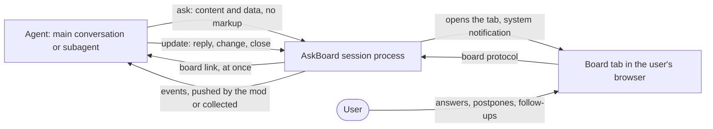
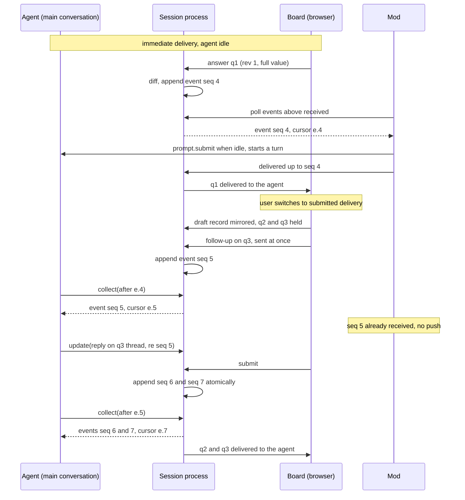
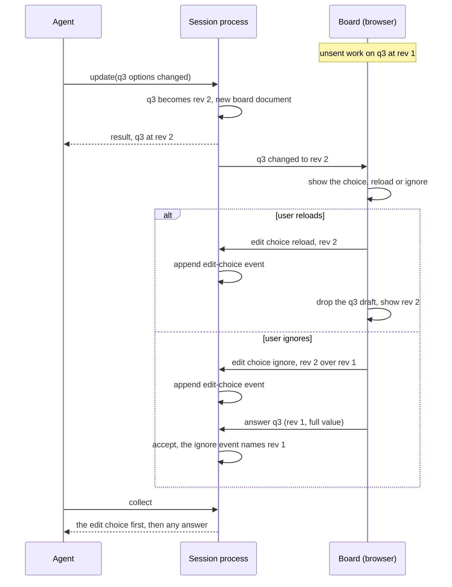
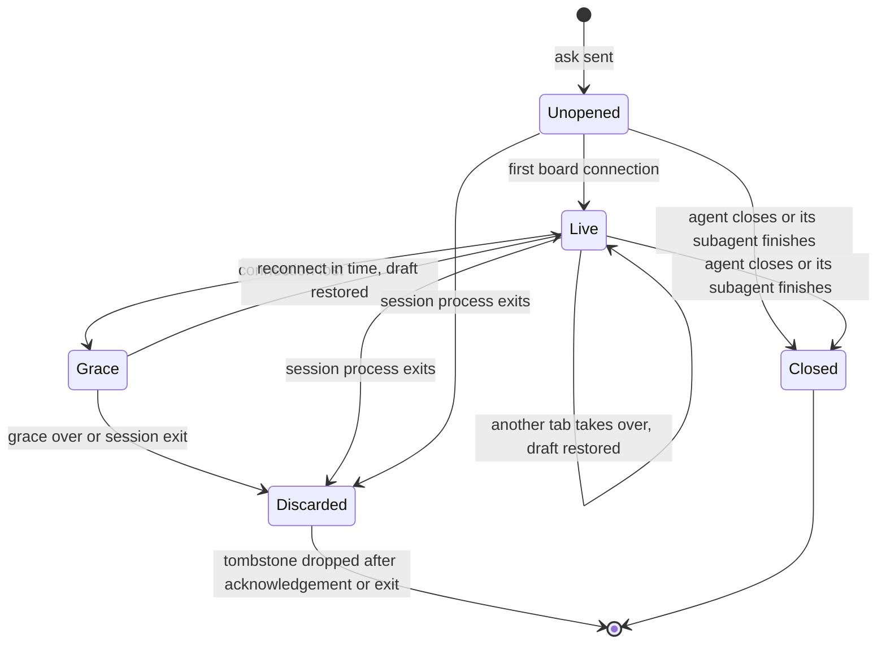

# Solution design: AskBoard

## 1. Purpose and how to read

This document explains AskBoard's architecture to whoever builds it, people or agents, in the OpenSpec solution project. It travels with `ARCHITECTURE-SPINE.md`, the two research files, the PRD and its addendum, and the UX documents, and restates the rationale, facts and spike definitions kept in the planning repository.

- **The spine binds; this document explains** why its rules exist, what was weighed, which facts they rest on (§13) and how open items close (§10, §12). It adds no rules; where the two seem to differ, the spine wins. AD-9 and AD-14 have no section of their own: they are explained within §4.4, §4.6, §5.6 and §8.
- **The PRD** (final, updated 2026-10-28) is cited by FR, NFR, SM, R and OQ IDs. §11 lists the PRD changes the architecture requested, with the status of each; a refused request reopens the ADs that rest on it (AD-19 states its fallback).
- **The UX documents** (`DESIGN.md`, `EXPERIENCE.md` in `ux-askboard-2026-10-27/`) are final (2026-10-28). They settle atoms and layouts, widget components, the forms library and visual design, within AD-7 to AD-9 and the adoption rule (§9).
- **OpenSpec.** Units group into capabilities; specs and changes cite the stable AD IDs; epics are OpenSpec changes, and the spikes (§10) run there. §3.1 maps capabilities to units.
- **Terms** follow the PRD glossary, plus §14.

## 2. AskBoard in one page

AskBoard turns a complicated question from a Claude Code agent into a board in the user's browser, on the user's own machine. The board holds widgets to work on (a diagram to correct, a Gantt chart, a WBS with estimates, a diff) and the context beside the question as excerpts, and it sends typed answers back to the agent (PRD §1). It is for engineers, power PMs and power sales people who work in Claude Code (PRD §2), in any project, with no dependency on AXFX (FR-31).

1. An agent, in the main conversation or a subagent, calls `ask` with an ask ID, questions and items (FR-1, FR-5). The call returns at once with the board link (FR-21).
2. The board opens in its own tab, with a system notification and a terminal link (FR-23, FR-24).
3. The user answers, postpones, edits and writes follow-ups; AskBoard recomputes derived values as they edit (FR-4, FR-10, FR-12).
4. Each answer or follow-up reaches the agent as an event, pushed by the Claude Code mod or collected by the agent (FR-21, FR-22).
5. The agent replies, changes items, closes the ask or takes a Snapshot (FR-6, FR-26).

What sets it apart:

- **A data-only contract.** The agent never writes markup. In the PRD's local sample, a freehand HTML page cost a mean of 16,254 output tokens and about 111 s; an AskUserQuestion question cost a mean of 967 tokens (addendum, "Baselines").
- **Cost as a selling point,** measured by a shipped benchmark against AskUserQuestion (SM-1 to SM-4, FR-32).
- **Interactivity.** The user works on the question and asks follow-ups while the agent keeps working.

## 3. Architecture overview

### 3.1 Paradigm and units (AD-1)

AskBoard is hexagonal around an ask core, with one versioned contract as the shared language (AD-1). The core owns asks, items, their lifecycle and one event log per ask; whatever touches Claude Code, the browser, the file system or a library is an adapter. The delivery path, renderer, formula engine and Claude Code itself (PRD R2) change on their own schedules and must stay out of the core. The spine's paradigm table lists the layers.

| Capability | Units | Responsibility | Main ADs |
| --- | --- | --- | --- |
| contract | `contract` | All run-time schemas, formula grammar and whitelist, asking rules, constants | AD-7, AD-13, AD-16 |
| core | `ask-core` | Asks, revisions, board documents, event logs, drafts, ownership, grace timer | AD-3, AD-5, AD-10, AD-12, AD-14, AD-20, AD-21 |
| compute | `compute` | `buildGraph`, the `FormulaEngine` port, PERT, CPM | AD-13 |
| MCP adapter | `mcp-tools` | The five MCP tools over stdio: `ask`, `update`, `collect`, `fetch`, `snapshot` | AD-4, AD-6, AD-18 |
| board host | `board-host`, `excerpts`, `molecule-source`, `notifier` | Board listener and protocol, local API, session file; pointers and images inside the root; ready-made molecules; browser tab and notification | AD-8, AD-11, AD-12, AD-21 |
| view and widgets | `view`, `widgets` | Board page, `assemble`, sandboxed view, `CatalogRenderer`; the 18 widgets | AD-8, AD-9, AD-13 |
| mod | `mod` | Push inside Claude Code (out of process); pending-asks list | AD-4, AD-5 |
| hooks | `hooks` | Agent records, asking rules, board notice, stop guard (out of process) | AD-5, AD-10, AD-16, AD-19 |
| skills and agents | `skills`, shipped agents | Teach agents to ask; references generated from `contract` | AD-6, AD-16, AD-18 |
| Snapshot | `snapshot` | Snapshot files through `assemble` | AD-9, AD-15 |
| benchmark | `bench` | Benchmark and scripted answerer | AD-17 |
| packaging | `packaging` | Plugin, hooks file, launcher, release | AD-19, AD-22 |
| molecules | `molecules` | Ready-made molecules, as data | AD-9 |

The architecture run named the first eleven capabilities; how the finer units group under them is only a suggestion, and the solution project decides where `packaging` and `molecules` go. Build order: the widgets AXFX needs first (Tree with the WBS-with-PERT molecule, and Gantt with the Gantt plan; AXFX FR-38) are built first, so AXFX is covered if the first version slips.

### 3.2 Process topology (AD-2)

| Option | Outcome |
| --- | --- |
| **A. One session process per Claude Code session** (chosen by the product owner): the session's stdio MCP server also serves its boards on its own loopback port | When the session ends, stdin closes, the process exits and its asks are discarded (FR-25), and AskBoard needs no lifecycle code. Each session has its own process, port, tokens and epoch (NFR-2) and runs the version pinned at its start (AD-22) |
| B. A shared per-machine daemon plus a per-session stdio shim | Rejected: cross-session state, version skew between sessions, code to start, stop and upgrade the daemon |
| C. A service reached over MCP HTTP | Rejected: a 5-minute idle timeout instead of stdio's 30, a first byte due within max(60 s, tool timeout) [F18], a service that something must start, and B's shared state |

A's price is coordination through shared files, the executable cache and a port range (AD-2). One complication: the SDK's stdio client probes the protocol revision on a short-lived sibling process (the probe sibling) [F15], which would leave stale state if start-up had side effects. So nothing happens before the first request other than `server/discover` (AD-2), and the mod delivery spike counts processes (§10.1).

The session process also decides when a new board comes to the front. The browser opener is an OS command that cannot open a background tab, so calling it while the user works on another board would take the front from them. A board is **working** while it has focus and has had a user input in the last 60 s, as its board page reports over the board protocol, presence only (AD-2, AD-7). For a new ask, the session process calls the opener only when no board of its session is working; otherwise the notification and the terminal link open the board (FR-23). Boards of other sessions never count, since under A each session process knows only its own boards: across sessions the browser behaves as usual.

### 3.3 Dependency rules (AD-1)

The import rules are the spine's, and CI fails on any import that crosses them. Their reasons: `compute` and `ask-core` avoid DOM, Node-only and Bun-only APIs because `compute` runs in both the browser and the session process, and the session process must also run on Node (§4.10). `mod`, `hooks` and `bench` run out of process and speak only `contract` schemas, so CI can run the conformance suite with the mod and the hooks, without the mod, and without the hooks; that tests that the mod costs latency, never correctness.

## 4. Load-bearing decisions and their trade-offs

### 4.1 Answer delivery: pull is authoritative, the mod pushes (AD-4)

Answers and follow-ups must reach a working agent where Claude Code allows it, else the agent collects them (FR-21). Subagents need this most: they cannot use AskUserQuestion [F7]. When the PRD was written, no path was both generally available and able to reach subagents (PRD R1).

**Decision (AD-4).** Every capability works through the MCP tools alone, with `collect` as the authoritative pull path. For push, the product owner chose the Claude Code mod (OQ1), because it is cleaner and faster than a Monitor watch or a hook. The mod delivery spike (§10.1) settled its paths: `$.session.append` reaches a running subagent, and the main conversation while its turn runs, at the agent's next model request; `$.prompt.submit` wakes an idle main conversation; `$.session.send` is not used, because auto mode refuses it for a mod [F9]. Pull stays authoritative because organizations can switch mods off, mods skip Desktop WSL sessions [F8], and the mod relies on behaviour the spike observed but no documentation states [F9, F12].

A waiting `collect` returns when an event arrives for its item or the ask state changes, sends progress at least every 60 s, and returns `open` after 20 minutes. The reasons: a subagent's call is never backgrounded, so a wait blocks it; idle stdio calls time out after 30 minutes unless progress resets them [F18]; and a wait that ended only on the answer would deadlock follow-ups.

| Candidate (2026-10-27) | Reaches a subagent | Outcome |
| --- | --- | --- |
| `collect` with a wait | Yes, blocking it | Kept, bounded, as pull |
| Mod: `$.session.append`, `$.prompt.submit` | Yes, while running [F9]; `$.session.send` refused under auto mode | **Chosen push;** on by default since 2.1.287 [F8]; confirmed by the mod delivery spike (§10.1) |
| Monitor watch (`askboard watch`) | Background subagents have it; routing implied [F25] | Fallback adapter, not built: the mod reaches every kind of agent (§10.1); re-arm after 5 min (30 max); Bash permissions |
| `PostToolUse` `additionalContext` | Yes, with `agent_id` [F4] | Fallback adapter, not built (§10.1); lands only at the next tool call |
| Background Bash `askboard wait` | Background only [F25] | Set aside: one notification per exit |
| `asyncRewake` hook | Undocumented [F26] | Set aside: exit-code-2 failure semantics |
| `SubagentStop` block | Yes [F3] | Stop guard only (AD-10): fires only at stop |
| MCP Tasks | No [F24] | Set aside: not in SDK v2 |
| Channels | No (secondary) [F24] | Set aside: preview, development flag, not in protocol revision 2026-07-28 |
| URL or form elicitation | Undocumented [F26] | Set aside: form answers in the terminal; URL needs consent per open, caps at about 8,000 characters, returns only accept, decline or cancel, blocks backgrounding |
| Session inbox socket | No [F26] | Set aside: session-wide, undocumented format |

Push goes only to the ask's owner, attributed to the mod and never `asUser`, so AskBoard never sends a session anything but answers and follow-ups (PRD §6). The plugin carries the mod as its hooks module, with no separate installation [F8]. Agent status is presence, not an event: if it were an event, the status change from starting a wait would itself end that wait.

### 4.2 One event log, cursors and the received watermark (AD-3)

`collect`, a mod push and a `SubagentStop` block can all deliver the same answer. One append-only log per ask, written only by `ask-core`, keeps them from losing or duplicating it (AD-3).

- **Cursors** are `<epoch>.<seq>` for one ask, carried with every event; agents pass the latest they received, and the highest wins because Claude Code runs read-only calls such as `collect` in parallel [F20].
- **Idempotence.** Any path may repeat an event; the skills teach agents to ignore a seen `seq`. That is cheaper than exact coordination.
- **The received watermark** (`received`), per ask, is the highest `seq` collected, carried in a stop block or reported as pushed; the guard and the mod act only above it. Without it, a subagent that had collected would be blocked again with answers it already had.
- **The agent's own changes are not events,** so the mod never wakes a conversation for news it caused.
- **The delivery receipt.** When `received` passes an answer's event, `board-host` tells the board, which marks the answer "delivered to the agent" (FR-22). `received` already records delivery by every path, so the receipt needs no path of its own; without the mod it waits for `collect` or the `SubagentStop` guard (AD-4). It claims delivery only, never that the agent read or acted on the answer, so it never reads the cursor the agent acknowledges. It travels over the board protocol and is not an event, so it never reaches the agent.
- **Epoch.** A restarted process has a new epoch, and an old cursor returns `discarded`; hence FR-5's no-reuse rule holds per process (§11).

### 4.3 Ownership and agent records (AD-5)

MCP calls carry no agent identity, and a session's subagents share one process. Yet two subagents running one skill may pick the same ask ID, and the mod needs a subagent's ID, the guard an owner, and the board header a `cwd` (FR-24). One source feeds them all (AD-5).

- **Record.** A `PreToolUse` hook on every AskBoard tool posts `agent_id`, agent type, `cwd`, `tool_use_id`, tool, ask ID and time; hooks receive these fields for MCP tools, in subagents too [F4]. The record binds to its call by `tool_use_id`, which Claude Code puts in every call's `_meta` as `claudecode/toolUseId` [F16], otherwise to the next matching call within the record timeout.
- **Owner.** The first bound `ask` makes its agent the owner; other agents' `update`, `collect`, `fetch` and `snapshot` are refused. `ask-core` sees only an opaque `ownerKey`.
- **No hooks.** The hook never blocks. An `ask` without a record means hooks are off, and its result says that push, ownership checks and the guard are unavailable.
- **Session file,** named by the PID of the Claude Code process, the parent of the session process and of every hook; the mod reads it once with `$.process.run`. `CLAUDE_CODE_SESSION_ID` cannot be the key: on `--continue` the session process gets a new ID while the hooks keep the old one, and after `/clear` the hooks move to a new ID while the session process keeps its own [F13]. No file, or several, means pull only: a mismatch costs push, never misroutes an answer.
- **Local API** answers at once in pages under 1 MiB, within the limits of a mod hook (10 s) and `$.http.fetch` (30 s, 4 MiB) [F10].

### 4.4 The contract and its schema sets (AD-7)

A review found unit pairs that obeyed every rule of an earlier draft yet did not fit, because internal channels had no schemas. So every run-time message has a JSON Schema 2020-12 set in `contract` with its own semantic version and one owning unit; an unsupported major version is refused, and the receiver falls back as its AD says (AD-7). Every unit validates with Ajv 8.20.0, the view through standalone validators, because its CSP forbids `eval` [F36].

**AskBoard's own lean format, not A2UI.** The product owner ruled that A2UI compatibility is a preference (OQ5). On 2026-10-27 A2UI v1.0 was still a candidate, `@a2ui/react` 0.14.0 documented v0.9 only, and the basic catalog had no table or chart (research-stack §A). A2UI can come later as an inbound translator, with the core unchanged.

- No HTML, CSS, script, layout geometry or AXFX term in either format (NFR-5, FR-18, FR-31).
- Positions relative to content are data, because Image annotation answers are regions: media-fragment selectors in one shape modelled on the W3C Web Annotation Data Model [F32]. Diagram anchors use source IDs, because generated SVG IDs change with renderer version and render order.
- Dates are `full-date` strings, durations integer days, money a decimal string with an ISO 4217 code: local-time conversion shifts dates west of UTC, and floats add noise to margins.
- **Optional ask fields.** `title`, `agentName`, `expectedUser`, `presentation`, `delivery`, `language` and `locale` are each optional, so a plain ask stays cheap (NFR-1). Without them AskBoard derives the title from the first question and the name from the agent type Claude Code reports (AD-5), takes `who` from the git user name, shows sections and starts in immediate delivery; the language comes from `defaultLanguage` (AD-14), then `en-US`, and the locale from the language. The language holds for the whole ask and governs display only: values keep the formats above, and AskBoard translates nothing (FR-34). A molecule parameter can follow the same pattern: the sales-estimate-review molecule's optional `minimumMargin` falls back to the project's `defaultMinimumMargin`, and with neither the board shows no margin warning (AD-9).
- **Diff review alternatives** are two patch files under the ask's root (`.askboard/patches/`), never diff text. The agent writes the files with a redirect, so the diff never passes through its output (NFR-1). The base is the files under the root as they stand at send time, never a git revision: AskBoard reads and parses the patches then and computes the diffs itself (§4.6), with no git access. Branches and commits are not accepted in the first version, since a worktree's object store lies outside the ask's root.
- IDs match `[A-Za-z0-9_-]{1,64}` and so never clash with `[item-id.field]`; required element IDs let the core diff by ID (§4.8).
- **View-made IDs.** Elements the user adds in a widget (a work package in a split, a tree node, a Graph state) get IDs the view makes, with a prefix reserved in `contract` that agent-chosen IDs may not use, so an element the agent adds later never collides with one the user added. Prefix included, they match the same grammar.

**Settings (AD-14).** The configuration schema in `contract` names the keys the board's settings panel shows (FR-35): the presentation keys `theme`, `density` and `contextPlacement`, and the behavioural keys `defaultLanguage`, `askingRule`, `snapshotFolder` and `editor`; it also names the molecule default `defaultMinimumMargin`.

- **Presentation keys** are the only ones the board writes. The board page sends a change over the board protocol, and the session process applies it at once to that board. It writes the change by re-reading the user configuration, changing only that key and replacing the file atomically, so a hand edit or another session's write made since start is never reverted.
- **Later boards.** The user configuration is shared by every session (AD-2), so a session process reads the presentation keys from it again each time it opens a board: later boards of any running session open with the change (FR-35). A presentation key set in the project configuration wins and shows read-only.
- **Behavioural keys** show read-only, with their file and key, and keep the next-session rule, since the session process reads them once, at start.
- **Enforcement.** The session process accepts a settings write only for `theme`, `density` and `contextPlacement`, with a value the configuration schema allows, and refuses any other key. It cannot tell a click on the board from a request by another holder of the board token (§6), so the refusal, not the board page, keeps a command to run or a behavioural key from being written; `editor` is read only from the user configuration (§4.5).

### 4.5 View isolation (AD-8)

Agent and file content are untrusted, and the board page holds the token (AD-8, NFR-5).

- **Sandbox.** The view is a `srcdoc` iframe with exactly `sandbox="allow-scripts"`. A srcdoc document takes its creator's origin unless sandboxed without `allow-same-origin` [F29]; sandboxing it that way makes the view opaque, tokenless and unable to call the session process. The view uses `srcdoc` because every board request needs the token (AD-11), and an inlined bundle needs no request.
- **CSP.** The view's meta policy and the board page's inherited policy both apply [F29], so the board page lists the view's hashes and allows the view's media sources, `img-src data: blob:` and `font-src data:` [F39]. Neither policy allows `'wasm-unsafe-eval'`: the formula engine is plain script (§4.7).
- **Diagrams** show as ``: hash-only styles block the `style` attributes and `<style>` elements that SVG markup uses [F30], and an image's internal styles escape the page CSP.
- **Style writes.** Mermaid and PlantUML write styles while they render, Radix's modal dialogs add a scroll-lock `<style>`, and `@pierre/diffs` builds markup that holds `style` attributes; the hash-only policy blocks all of it. The view routes these writes through the CSSOM and constructed stylesheets, which the policy allows [F40]: three small shims in the view (77, 50 and 81 lines in the renderer spike). A style set this way loads nothing, since `img-src` and `font-src` still bound any `url()`.
- **Not an MCP Apps host.** The view uses the ext-apps 2.x message set and classes, which accept an opaque iframe [F28]. A conforming web host needs a sandbox proxy on another origin [F28], and so a second port to serve and forward; besides, the CLI renders no MCP Apps [F24]. Rendering in Claude hosts stays Deferred.
- **Board-origin pages** show content only as text; AskBoard builds any source view itself, because a served HTML or SVG file would run on the board origin and read the token.
- **Reading panel.** A project-file reference opens in a reading panel on the board page, which frames the token-gated source view at the anchor, confined by AD-12. The source view's CSP therefore has `frame-ancestors 'self'` instead of `'none'`, so only a board page of the same origin may frame it, and the board page's CSP adds `frame-src 'self'`, which serves only that frame. Nothing else changes: the source view is still text only, with `nosniff` and `default-src 'none'`.
- **Editor launch.** The reading panel's "Open in editor" asks `board-host` to open the file at that line in the user's editor. Only an explicit click on the board page launches it, never agent content. The command comes only from the `editor` key of the user configuration, never from an ask: an agent can write a project file, so a project-level `editor` is ignored, with a warning, and agent content never chooses the command a click runs.
- **Editor arguments.** The file enters the argument vector as its absolute real path, resolved and confined again under AD-12 at the click: a file swapped for a symlink after the send cannot open outside the root, and a file name starting with `-` cannot pass as an option. The line enters as an integer AskBoard derives. Neither is truncated, since a truncated path would open another file, and no other agent text enters the vector. The `editor` key is an argument vector in which `{file}` and `{line}` mark where the two go, so `["code", "--goto", "{file}:{line}"]` and `["vim", "+{line}", "{file}"]` both work with no shell (AD-8).
- **Exits.** Links leave as open-link messages, `http:` and `https:` only, with `noopener` and `noreferrer`; the notifier, the browser opener and the editor launch start OS commands with an argument vector, never a shell.

### 4.6 The board document, resolved at send time (AD-12)

At each send, `ask-core` resolves pointers, images and molecules into that revision's board document, the only thing the view, `fetch` and Snapshots read (AD-12). The reasons: offline Snapshots (FR-27) cannot call `excerpts`, the opaque view cannot load token-gated images, and Markdown must render in one place. The cost: a board shows a file as it was at send time.

- **Root.** The owning agent's git worktree when it belongs to the project, else the realpath of `CLAUDE_PROJECT_DIR` [F14], so agents in worktrees get their own files and distinct board headers (FR-24). An `isolation: worktree` subagent's hook `cwd` is its own worktree, gone once it finishes unchanged [F5]: board documents already hold what was read. Pointers that escape the root through `..` or symlinks count as unresolved.
- **Images** only by pointer, saved by agents under `.askboard/media/`: base64 would cost output tokens (NFR-1), remote URLs would leave the machine (NFR-9).
- **Patch files** for Diff review (§4.4) resolve the same way, and so does every path a patch names: at send time `ask-core` reads them read-only and inside the root, parses each patch and computes its diff against the base the item names, the files as they stand then. A patch's paths come from content the agent wrote, so without this a path that escapes through `..` or a symlink would put a file from outside the root on the board and in Snapshots. A patch that does not resolve, names such a path, does not parse or does not apply is unresolved, with a warning (AD-6).

### 4.7 Compute graph and formula language (AD-13)

`compute` builds each board's whole graph from the board document: `boardGraphSource` maps the board's items onto a graph source, which `buildGraph` reads. The view builds it with the draft record's values in place and, after each edit, builds it again or recalculates it in place where the edit changes only input values the graph already holds; a Gantt plan's baseline is the same graph built from the board document as sent; and the send-time check calls the same `buildGraph` (AD-13). Widgets define no nodes, and nodes exist whether or not their widget is mounted; `contract` declares each widget's fields, child addressing and built-in derived fields (PERT, roll-ups, CPM, scores). So derived values need no agent (FR-12), the send-time report matches the board (FR-14), and hidden tabs still compute. Formula problems are warnings, because FR-14 shows them on the board. AskBoard implements critical path and rescheduling itself: they are paid features in the candidate Gantt components, and no MIT or Apache CPM library reaches 1,000 stars (R6, research-stack §C).

Formulas are Excel-style, reference fields as `[item-id.child-id.field]`, with a `*` for each further child level, are limited to a whitelist, and run behind a `FormulaEngine` port that never sees AskBoard IDs. The product owner asked for something simple, lean and cheap, and the 2026 advisories show that sandboxes over JavaScript objects break, so "cannot run arbitrary code" (FR-14) favours WASM or a whitelist interpreter (research-stack §B):

| Candidate | Rule | Assessment |
| --- | --- | --- |
| IronCalc `@ironcalc/wasm` 0.9.1 | Pass on paper (MIT OR Apache-2.0, 4,231 stars; the `.wasm` also holds Unicode-3.0 and Apache-2.0 WITH LLVM-exception code) | **Not adopted** (formula spike). Excel functions, dependency graph, cycle and reference errors; formula text cannot reach JavaScript, but `NOW`, `TODAY` and `RAND` reach the host [F58]; 0.72 MB gzipped; docs "in its infancy" [F37] |
| Own restricted evaluator | n/a | **Chosen** (formula spike). Own parser, topological sort, any ID grammar; about 1,000 lines, 8,914 bytes gzipped |
| HyperFormula 3.5.0 | Fail | GPL-3.0-only or a licence key |
| JSONata 2.2.2 | Pass on paper | 2026 code-execution advisories (CVE-2026-77413, -77414, -77415); no graph |
| mathjs 15.2.0 | Pass on paper | Advisories CVE-2026-40897 and -41139 in evaluation code, fixed in 15.2.0; no graph. The formula spike measured `parse()` alone as a parser and rejected it: at least 90 KB gzipped, and `=`, `<>`, `^`, unary minus and chained comparisons parse with a meaning other than Excel's |
| expr-eval 2.0.2 | Fail | Unpatched code-execution CVEs (CVE-2025-12735, CVE-2025-13204, CVE-2026-12866) |
| formulajs, fast-formula-parser, jexl, filtrex, cel-js, Formualizer, FortuneSheet | Fail | Stars, activity or archived |
| Univer engine-formula | Open core | Pro features; 40.7 MB |

The formula spike chose the own evaluator on its measurements (§10.2). Each engine gave the same values in Bun, Node and the three browser engines, under every time zone and locale tried. The own evaluator adds 8,914 bytes gzipped to a board, IronCalc 994,668. It adds 5 to 8 ms to a board's time to visible, IronCalc 44 to 96 ms, and an edit on a 926-node board takes about 0.1 ms, against about 1 ms. IronCalc also needed `'wasm-unsafe-eval'` in the board page's policy, not only in the view's, and four adapter workarounds: shadow cells for exact reads [F55], a limit on operators against a parser crash [F56], a new module instance after a crash, and a grammar check for what its parser lets through. Molecules use only the whitelist in `contract` (AD-13) and built-in fields. CI checks determinism across extreme time zones and two locales. It also checks the formula fixtures against Excel's values.

### 4.8 Revisions, answers and drafts (AD-20)

- **A `rev` per question** (AD-20). With a `rev` per item, a widget update would race an answer that names its question; if replies bumped the `rev`, every reply would trigger FR-6's edit choice.
- **Stale answers** are refused unless the log holds the user's `ignore` choice for them, so the agent sees the choice first (FR-6).
- **Answered questions are protected:** changing one is refused unless the agent reopens it as a new revision, so a recorded gate verdict (AXFX FR-40) never silently changes. A later user answer names the `seq` it replaces.
- **Full value in, generic diff out.** The view sends the full edited value; `ask-core` alone diffs by element ID (`add`, `remove`, `move`, `set`). Widget-specific diffs would put widget semantics in the core; index patches break on reorder.
- **A decline is an answer kind,** not a path of its own: it carries the optional reason from the open prompt, names the question's `rev`, closes the question (§4.9), follows the delivery mode and is superseded by a later answer or decline. So revising or undoing a decline works as for an answer (FR-4). The shipped skills tell the agent not to ask a declined question again within its task, and nothing about it outlives the ask (FR-25).
- **Reopening.** Undoing a postpone or a decline that has been sent, and so is in the log, appends the event "question reopened by the user", delivered like any other. Events are immutable, so without it the agent would still collect, or keep acting on, a choice the user took back. In submitted delivery the undo is held in the draft record until the submit; undoing a postpone or decline still held only removes it from the draft record, and no event is needed.
- **Delivery modes.** Submitted delivery holds answers, declines, postponements, their undos and prompt text; follow-ups and edit choices go at once (FR-10, FR-6). A submit is one atomic append. Prompt text goes only on an explicit send, so typing never wakes the agent.
- **Drafts survive a reload,** the product owner's choice: in UJ-2 a PM edits a WBS for a long time. The board mirrors a draft record to `ask-core`, separate from the log and invisible to agents, and restores it on reconnect or takeover. Besides unsent work, the record keeps what a reload must bring back: each question's context placement, the text in its follow-up composers and the user's notes on options, and the board's open tab or question in view. Drafts use no Web Storage or cookies: the opaque view has none, and loopback cookies are shared across ports. Nothing survives a discard (FR-25).

### 4.9 Fail closed (AD-10)

AskBoard never reports an answer the user did not give, and never lets a missing answer pass as "not yet" (NFR-10, AD-10).

- Widgets start empty regardless of what the agent recommends; otherwise one submit would send every default the user skipped. Untouched review content reports as unchanged.
- Every result carries the epoch, and an unknown ask is `discarded`.
- **Declined is terminal.** Question states are `open`, `answered`, `postponed` and `declined`. A decline closes its question like an answer, so the agent reads it as the user's choice, never as an answer still to come. An ask is `answered` when every question that is not postponed is answered or declined, and returns to `partly-answered` when the agent adds or reopens a question, or when the user reopens a postponed or declined question: the state never claims more than the user has given.
- **The `SubagentStop` guard** blocks only for owned events above `received`, only when `stop_hook_active` is false, never twice per event. Its reason, delivered as the subagent's next instruction [F3], carries the events and lists the open asks. When the guard lets a stop through, the session process closes the subagent's asks as `agent-finished`. Before 2.1.311 the hook fired during work, about twice a minute by the changelog and about every 30 s for a background subagent on 2.1.308 in the mod delivery spike [F2], and would have used up the cap of 8 consecutive continuations [F3]: one reason for the 2.1.311 minimum.
- **Benchmark mode** needs a per-run secret matching `bench`'s run file, because a plain flag could leak from a user's shell. The scripted AskUserQuestion answerer lives only in the run's settings.

### 4.10 Runtime and distribution (AD-19)

The product owner asked to weigh Bun, for its coherence with the Claude Code harness, against Node 24 or later, and chose a Bun executable (AD-19; research-stack §D):

| Option | For | Against |
| --- | --- | --- |
| **`bun build --compile`** (chosen) | No runtime prerequisite; all macOS and Linux targets [F35]; reportedly how the Claude Code CLI ships (secondary) | Links patched WebKit/JavaScriptCore (LGPL-2) and tinycc (LGPL-2.1) [F35]: needs a PRD change |
| `npx` on Node | Licence-clean; how official plugins ship [F23] | Node becomes a prerequisite |
| `deno compile` | Stable, MIT; the research's pick | Bun preferred for harness coherence |
| Node single executable | One runtime | Node stability index 1.1; macOS x64 untested |
| `@yao-pkg/pkg`, MCP bundles | Plugins accept `.mcpb` bundles | pkg fails the stars criterion; Node bundles need a host Node |

- **Obligations.** Each release ships the LGPL-2 and LGPL-2.1 texts and Bun's whole `LICENSE.md` as its notices (about 50 statically linked libraries, none GPL-only), names the Bun version, links `oven-sh/WebKit` and `oven-sh/tinycc` at the commits Bun pins, and publishes the plain JavaScript bundle with the command that rebuilds the executable from it (`bun build askboard.mjs --compile`, exercised by the packaging spike). NFR-6 grants the exception since 2026-10-30; until the AXFX NFR-1 change is confirmed (§11 entry 8), AskBoard ships that bundle on Node 24.22.1 or later.
- **The Node fallback stays viable:** no Bun-only API, CI on Node 24 and 26 [F36], nothing bundled at run time.
- **Hooks** run the same executable (`askboard hook <event>`), 5 s timeout, exiting 0 without a decision when the executable is missing or the session process is unreachable; shell-and-`jq` or Node hooks would add a prerequisite.
- **The launcher** needs POSIX `sh`, `curl` or `wget`, and one SHA-256 tool (`sha256sum`, `shasum` or `openssl`; none is POSIX, and macOS has no `sha256sum`), and on musl Linux `libstdc++` and `libgcc` [F52, F53]. Before the session process starts, it fetches the pinned executable to a temporary name, checks the shipped SHA-256, renames it under a lock and `exec`s it, so concurrent sessions never see a partial file and Claude Code stays the parent: nine launchers on one empty cache made one download (packaging spike, run `concurrency`). Waiting and downloading share a 25 s budget; a first download still running then continues detached, and the launcher answers that AskBoard is downloading. This is AskBoard's only outbound connection, with no user data (AD-11). The cache, `${CLAUDE_PLUGIN_DATA}/bin/<version>/`, survives updates; the launcher sits in `scripts/`, because some Claude surfaces skip plugins with `bin/` [F23].
- **Delivery, measured** (packaging spike). The executable is 90 MB (darwin-arm64) to 110 MB (linux glibc), 41 to 52 MB gzip; Bun's runtime is almost all of it [F51]. A first fetch fits the 25 s budget from about 31 Mbit/s (darwin-arm64) to 37 Mbit/s (linux), about half that with gzip assets; a warm start answers in about 50 ms. A plugin `command` source would fetch at install instead, with no 30 s limit, but it shows the user an install prompt, re-runs in the background every session, is off where `disableCommandPluginSources` is set, and copies 86 MB into the plugin cache [F23]. Neither the `npm` nor the `archive` source carries per-platform executables. The launcher keeps the plain GitHub-marketplace plugin and runs the hooks too.
- **A failed start answers the handshake** (packaging spike, criterion 14). A launcher that exits leaves Claude Code skipping AskBoard in new sessions for 15 minutes, until `/mcp` Reconnect; one that answers the handshake with `unavailable` and the reason left no cached failure, and the next session started normally. The cost: `/mcp` shows AskBoard connected with one tool.

### 4.11 Tool surface and cost (AD-6)

- **Five fixed tools** (`ask`, `update`, `collect`, `fetch`, `snapshot`), never changing mid-session, so the tool list never breaks the prompt cache (AD-6).
- **Generic schemas.** Per-widget schemas and the molecule formats live only in `contract`, each ready-made molecule's parameters in its definition in `molecules`, and the skills' references are generated from both. Tool definitions load every session, so their size counts against the plain-question target (R5, §7). Because the skills are generated, they never drift from validation; each drift would cost a refused call. Schemas use no root combinators and short property names [F21]; that evidence is secondary, so CI makes a live call per model.
- **Annotations.** All five `openWorldHint: false`, against the default [F20]; `collect` and `fetch` read-only; `ask` idempotent, though Claude Code repeats only HTTP calls [F20]; `snapshot` not destructive.
- **Errors** stay under 4,000 characters, most important problems first, because Claude Code trims long errors in the middle [F19]; item-local problems are warnings.
- **Re-sending** an open ask returns its board only for an identical request from the owner: retries work (FR-5), colliding subagents never merge.
- **Results** are one JSON text block under 30,000 characters, inside the 10,000-token warning and the 50,000-character file threshold [F19], because the session process cannot count model tokens. Results carry no `structuredContent` until the benchmark shows that the model reads only one representation; otherwise answers could cost twice [F22].
- **No budget; data decides `alwaysLoad`.** The PRD sets no budget (R5, §7). A deferred `ask` costs a search step on first use, an always-loaded one its definition per request (addendum; [F19]); the first benchmark decides whether `ask` is always loaded. CI caps descriptions at 4,096 characters and tool names at 128 [F19]; the longest name is 39 characters.

### 4.12 Asking rules (AD-16)

A `PreToolUse` hook on AskUserQuestion, not the mod, enforces FR-30's asking rules, so they hold where mods are disabled; the hook refuses AskUserQuestion, with a reason pointing to AskBoard, whenever the effective rule sends the question there. The rules are a closed set in `contract` (`none`, `always`, `with-references`), each with one predicate the hooks implement once, and the skills' texts are generated from `contract`, so a skill and the hook never judge a question differently. The hook lets AskUserQuestion through whenever the session process is unreachable or reports that it cannot show boards, so the agent always has a way to ask (NFR-8).

## 5. Key flows

### 5.1 Sending an ask

1. The `PreToolUse` hook posts the agent record and lets `ask` through.
2. The session process first checks that a board can be shown; if not, it returns `unavailable` and creates nothing. It refuses a client known to be below the minimum version (AD-18).
3. `ask-core` validates against `contract`, binds the owner and origin, resolves the rev-1 board documents and runs `buildGraph` for warnings. On the session's first ask it creates `.askboard/` and its `.gitignore`.
4. The result returns at once: board link, epoch, state `waiting`, warnings.
5. The notifier opens the tab, unless a board of the same session is working (§3.2), and shows a notification; the `PostToolUse` hook shows the link to the user for the main conversation's asks; for a subagent's ask the mod shows it as a toast; the mod lists pending asks (FR-23).
6. The board connects with its token and builds the view through `assemble`. A question is visible once all its items have settled and been laid out (AD-9).

### 5.2 Delivery, follow-up and reply

In immediate delivery, the board sends each answer's full value; `ask-core` diffs and appends, waking a `collect` on that item, and the mod pushes the events above `received` and reports them as pushed. That report raises `received`, and the board marks the answer delivered to the agent (§4.2). When the agent collects first, the mod has nothing to push, and the `collect` raises `received` instead. In submitted delivery the draft record holds answers, declines, postpones and their undos until a submit appends them atomically, in the user's order; follow-ups still go at once.

A follow-up reaches the agent through a waiting `collect`, a push or the next `collect`. The reply leaves the question's `rev` unchanged, so unsent work on it triggers no edit choice, and rounds repeat until the user answers (FR-10).

Revising, declining and reopening take the same path. A revised answer, or a decline after an answer, is a new answer event that names the `seq` it replaces; a decline closes its question like an answer (§4.8). Undoing a postpone or a decline that has been sent, and so is in the log, appends "question reopened by the user", which `collect` and the mod deliver like any other event, and an answered ask becomes partly answered again (§4.9). In submitted delivery each of these waits in the draft record for the submit, and undoing a postpone or decline still held only changes the draft record.

### 5.3 Agent update with an edit conflict

The user has unsent work on q3 when the agent changes it. Had q3 already been answered, the update would have been refused (§4.8).

### 5.4 Discard (AD-21)

1. A disconnection starts the grace timer, which only `ask-core` runs, and only after a first connection (AD-21).
2. A reload within the grace period, or a takeover by a new tab, keeps the ask and restores the draft record; the old tab shows that the board moved.
3. Past the grace period, `ask-core` appends `discarded` (reason `board-closed`), wakes waiting `collect` calls, and drops the board documents and the draft record.
4. A tombstone keeps the ID, epoch, owner, `received`, and unacknowledged events until they are acknowledged or the process exits. `fetch` and `snapshot` answer `discarded`, and the token stops working.
5. On session exit the process sends `discarded` (reason `session-exit`) to live boards. A board that never connected starts no grace timer; it stays `waiting` until the agent closes the ask or the session process exits. A closed ask is never discarded.

### 5.5 A subagent finishing

1. When the subagent stops, the `SubagentStop` hook asks the local API about its open asks.
2. If there are events above `received` and `stop_hook_active` is false, the hook blocks with those events, their cursors and the list of open asks; `received` moves up.
3. The subagent handles them and stops again.
4. With nothing new, the hook lets the stop through, and the session process closes the subagent's asks as `agent-finished`; their boards accept no more answers.
5. An ask with no owner never blocks a stop, nor does an agent with no record, such as Claude Code's own side agents. Without hooks there is no guard, and the `ask` result already said so.

### 5.6 Snapshot (AD-15)

1. The owner calls `snapshot`, which takes no path, or the user presses Snapshot on the board. `ask-core` gathers the data at once and hands it to its `SnapshotWriter` port, which the `snapshot` unit implements.
2. `assemble` writes the view CSP, then the `askboard-data` block (`<` escaped), with the Snapshot's record, the board document and the revisions events name, the board state, the origin, the whole log with each answer's full values, the expansion map, and the light and dark render `board-host` kept for each diagram; then the chunks used and their styles, and the licence notices last. A diagram with a kept render needs no renderer chunk: the renderer spike's golden Snapshot was 429,393 bytes with renders against 5,044,979 with the PlantUML chunk.
3. The file `<ask-id>-<YYYYMMDDTHHMMSSZ>-<short random>.html` goes into the Snapshot folder (by default `.askboard/snapshots/`, git-ignored, inside the project root) and never overwrites another.
4. The tool returns the absolute path (FR-26). A Snapshot the user takes is no event: the agent finds it in the folder. An agent reads the data block without rendering the page (FR-27).
5. A Snapshot taken from the board notes unsent work but never includes the draft record. Opened later, the view boots from the data block, offline, with no AskBoard running.

## 6. Security model (AD-11)

**Protected against:** other web pages in the browser (reading or answering a board, CSRF, DNS rebinding); other machines; untrusted agent and file content (script injection, reaching tokens, boards or AskBoard, remote loads, command injection through notices or the editor launch); data leaving the machine.

**Out of scope:** processes running as the same OS user, which can read the session file, project and transcripts anyway. Two review proposals were declined on that ground: a single-use launch code, proposed to guard against the token showing in a process list; and stripping the token from the address bar, because a reload must reconnect and no page uses storage.

| NFR | Controls | AD |
| --- | --- | --- |
| NFR-3 Local only | `127.0.0.1` bind from a port range; the container interface only on opt-in, published to the host's loopback, with a stderr warning; the local API on a user-only Unix socket, never on a network interface; remote hosts get `unavailable` | AD-11, AD-22 |
| NFR-4 Token | A token of at least 128 bits per board, in the URL, then only in a header or the first WebSocket message; no cookies; loopback `Host`; `Origin` must match when present and is required on WebSocket and non-GET/HEAD requests; no form posts; no referrer; a separate session token for the local API, which refuses browser `Origin`; tokens never printed | AD-11 |
| NFR-5 Content as data | Opaque srcdoc view and its CSP; sanitized Markdown only in the view; text-only pages on the board origin; built source views with `nosniff`; molecules carrying code refused; remote URLs as links; argument-vector commands | AD-8, AD-9, AD-12 |
| NFR-9 No telemetry | No outbound traffic except the launcher fetch; view `connect-src 'none'`; references open in the browser; benchmark output stays local | AD-11, AD-17 |
| NFR-10 Fail closed | §4.9 | AD-10, AD-20, AD-21 |

Browsers send no `Origin` on navigations or same-origin GET and HEAD [F31], so requiring it everywhere would refuse the user's own click on the link; state-changing requests always carry it, and other sites cannot forge it. The `Host` check defeats DNS rebinding, and accepting a loopback host on any port covers forwarded ports.

**Residual risks.**

- **The agent holds the board token.** The product owner chose to return the tokenized link in the `ask` result, because it is simpler. An agent able to send HTTP requests could therefore, in principle, answer its own question, even approve its own AXFX gate (AXFX FR-40). Only the shipped skills mitigate it: they forbid agents from opening or answering boards. A token-less result, with the link passed to the hook and notifier through the local API, was declined. A token holder could also launch the user's configured editor on a file under the root, or change a presentation setting. It could never choose the command or write a behavioural key: the command comes only from the user configuration, and the session process refuses any other settings write (§4.4, §4.5).
- The tokenized URL appears in a process list while the browser opener runs.
- A Snapshot the user shares carries the board's data off the machine, by the user's choice (FR-27).
- With the devcontainer opt-in, the container network can reach the board listener, still guarded by the token.

## 7. Cost and performance (AD-17)

**KPIs (PRD §7).** Output tokens (SM-1), thinking tokens (SM-2) and time to put a question up (SM-3), per question: plain questions within +25% of AskUserQuestion, rich questions within 2× a plain AskUserQuestion question. The cost of 100 questions (SM-4) has the same targets. Counter-metrics: rich questions keep their context (SM-C1), and the time to put a question up ends only when the whole question is visible (SM-C2).

**Keeping asks cheap:** data, not markup (AD-7); several questions per ask (FR-1); excerpts, images and molecules by pointer or name (AD-9, AD-12); derived values computed by AskBoard and only changes returned (AD-13, AD-20); a small, fixed tool surface (AD-6); no blocking wait during which the prompt cache expires.

**Cost model** (addendum). Per question: output K1, thinking K2, extra output X to collect, answer tokens A, all re-read later; per session: tool definitions T. On Opus 5.5 with a 5-minute TTL, 100 questions cost $5.02 with the data contract, $58.55 as freehand HTML and $3.49 as plain AskUserQuestion; answers after a cache expiry at 60k context add $28.80 in every case. The TTL is 1 hour for a subscription's main conversation, 5 minutes on an API key and for subagents. The mod delivery spike (§10.1) measured X for push: by append, about 38 input tokens per answer and no extra request; by `collect`, about 89 output tokens, 95 input tokens and one extra request. The figures above keep the `collect` assumption.

**R5.** The plain-question +25% cost target holds only while T stays below about 2,100 tokens. The PRD sets no budget; CI reports these tokens per model and flags any T above that.

**The benchmark (AD-17).**

- `claude -p` loads AskBoard with `--plugin-dir` in an isolated configuration (`--setting-sources ""` and restricted `--tools`, without `--strict-mcp-config`, which drops plugin servers; the account's connectors still connect, and the report lists them) with `--max-turns`, which bounds the turns the mod may start: `-p` ends with the turn, and a submit queued past the limit is dropped. The benchmark reads transcripts, never the JSON `result`, which a woken turn replaces. Managed `disableSideloadFlags` would reject `--plugin-dir` [F11].
- A headless browser only loads boards; every area mounts, and once a question is visible `ask-core` appends its scripted answer through the board's command port. The AskUserQuestion arm uses `bench`'s scripted answerer, with an asking rule that lets AskUserQuestion through.
- K1 is the ask's non-thinking output plus every preparing response; K2 is billed thinking; usage is deduplicated by `requestId`. K3 (time to put a question up, SM-3) runs from the request's start (t0) to the moment the question is visible (t3), or to the tool call (t1) for AskUserQuestion; t2 is the moment AskBoard receives the call, after dispatch, permissions and hooks (addendum, "Measurement protocol"). The hook's `tool_use_id`, which every call also carries in its `_meta`, joins t2 and t3 to the transcript; calls over stdio carry no trace context [F16].
- Five runs per case, reported as medians with their spread; cold, warm and subagent runs reported separately; the context AskBoard adds before the first ask also reported.

**Seed question set,** refined by the benchmark epic:

| Case | Content | Arms |
| --- | --- | --- |
| S1 | Single choice | AskBoard and AskUserQuestion |
| S2 | Batch of 4 questions | AskBoard and AskUserQuestion |
| S3 | WBS with PERT, about 20 nodes, with an excerpt by pointer | AskBoard |
| S4 | Gantt plan | AskBoard |
| S5 | Diagram correction | AskBoard |
| S6 | S1 sent from a subagent | AskBoard |
| S7 | LaTeX formula | AskBoard |

## 8. Operational envelope (AD-18, AD-22)

- **Installation.** One GitHub-marketplace plugin carries the server, skills, agents and `hooks/hooks.json` (settings hooks plus the mod). Scopes are user, project and local [F23]; FR-28 uses the first two. Hooks match `mcp__plugin_askboard_askboard__<tool>` and, for `--mcp-config` loading, `mcp__askboard__<tool>`. The server entry passes `CLAUDE_PROJECT_DIR` and sets no `timeout` shorter than `collect`'s 20 minutes. Shipped agents declare no frontmatter hooks, servers or permission mode, which plugin agents ignore [F4].
- **Releases.** Releases come from the `release` branch (AD-19): the built plugin tree and its marketplace file, tagged `v<version>`; `main` carries no build output.
- **Offline.** Three paths, each checked by the packaging spike (run `offline`): copy the executable into `${CLAUDE_PLUGIN_DATA}/bin/<version>/askboard`; name a mirror (`http` or `file://`), whose file is still checked against the shipped SHA-256; or run the plain bundle on Node 24.22.1 or later. Without one, the launcher answers `unavailable` in about 50 ms.
- **Platforms.** macOS and Linux, x64 and arm64, glibc and musl, where Claude Code runs [F34]. Browsers: current and previous major versions of Chrome, Edge, Firefox and Safari.
- **Background board tabs.** No browser discarded, froze or disconnected a hidden board tab in 65 minutes, but Chrome runs a hidden tab's timers once per 60 s [F33]. Board liveness therefore comes from the WebSocket closing, and any heartbeat timeout the session process applies is at least 90 s. A discarded tab closes its socket and reloads only when activated, so its ask is discarded after the grace period (AD-21). Chrome's Memory Saver and Safari wait for the product owner's check.
- **WSL** is the only Windows route (NFR-7) [F34]; the product owner checks notices and `$BROWSER` there (`spike-packaging` task 7.1; spine, Deferred).
- **CI** runs `claude -p --plugin-dir --max-turns`; mods and hooks run under `-p` [F11], where calls are not backgrounded by default [F18]. A `-p` run ends with its turn, so a CI case that needs an answer waits for it with `collect`. Under `--plugin-dir`, `${CLAUDE_PLUGIN_DATA}` reaches the server unsubstituted [F50], so the launcher caches the executable under `${XDG_CACHE_HOME:-$HOME/.cache}/askboard/` there (AD-22).
- **Versions and the release gate.** One minimum for all units, 2.1.311 (AD-18), confirmed by the mod delivery spike (§10.1): that release made `SubagentStop` fire only when a subagent finishes, which 2.1.308 failed in the spike, and let subagents use MCP servers that connect late [F2], which a cold start makes likely. On 2026-10-29 `stable` was still 2.1.308 and `latest` 2.1.312 [F1], so release waits until `stable` reaches the minimum. The version comes from client information, which every request carried on 2.1.311 and 2.1.312, else from the mod's report. An unknown version is allowed with a warning; a known one below the minimum is refused with the reason, and only then, because the specification discourages changing behaviour based on client information [F17]. CI covers the minimum, `stable` and `latest`, and on `latest` checks AskUserQuestion's input against FR-3.
- **MCP.** Protocol revision 2026-07-28 through SDK v2, keeping the SDK's default of also serving 2025-revision handshakes, because users can force the old handshake [F27]; CI runs `MCP_PROTOCOL_NEGOTIATION=legacy`. A proposal to refuse old handshakes with an error was declined in favour of this approach.
- **Devcontainers, upgrades, diagnostics, uninstall.** Container binding is opt-in, and the terminal link is the notice that always works there, for a subagent's ask only when the mod runs (FR-23, §6). Each session keeps the version pinned at its start, `askboard doctor` reports state without ever printing a token, and uninstalling leaves `.askboard/` and the session-file folder, while Claude Code deletes `${CLAUDE_PLUGIN_DATA}`, and the executable cache with it, unless `--keep-data` [F49]; the documentation lists all three (AD-22). Sessions on mixed versions share `.askboard/` under the versioned configuration schema (AD-14).
- **Unsupported.** Remote hosts (SSH, Codespaces) get `unavailable`; native Windows gets a message naming WSL from the launcher where a POSIX `sh` runs it, and otherwise a server that failed to start, with the README naming WSL (AD-22); other Claude Code surfaces and MCP Apps rendering are out of scope (NFR-8, PRD §6). On `unavailable`, the main conversation uses AskUserQuestion and a subagent returns the question to its caller.

## 9. Stack and component adoption

**Pinned stack:** the spine's Stack table pins every version exactly.

**Adoption rule** (addendum, NFR-6), in brief:

- **Licence:** permissive by default (MIT, Apache-2.0, BSD, and the like: ISC, 0BSD, the Unlicense); MPL-2.0 or EPL-2.0 only unmodified, and OFL-1.1 only for unmodified font files; no GPL or AGPL in the bundle; no source-available, trial, licence-key or open-core feature AskBoard depends on.
- **Stars:** at least 1,000, or a named exception for an established team; an exception waives only this criterion.
- **Activity:** a push within 6 months and a release within 12, not archived; on 2026-10-27, a push since 2026-04-27 and a release since 2025-10-27.
- CI fails on a licence outside the rule or an archived dependency (AD-19).

**Component status on 2026-10-27, corrected by the renderer spike on 2026-10-29** (research-stack §C; the spike's `evidence/adoption.json`). The final UX documents choose the components; this table only shows what the rule admits.

| Need | Passing | Failing today |
| --- | --- | --- |
| Markdown | markdown-it 15.0.3 with DOMPurify 3.4.17; streamdown 2.7.1 | react-markdown: no release since 2025-03-07 |
| Drag and drop | `@dnd-kit/react` 0.5.1 (0.x); Pragmatic drag and drop 4.0.0 | `@dnd-kit/core`: last release 2024-12-05 |
| Tree, Table, Spreadsheet grid | TanStack Table 9.3.1 | react-arborist 4.0.1: its peer react-dnd 16 last released on 2022-04-19 |
| Graph | `@xyflow/react` 12.12.0 | — |
| Graph auto-layout | `@dagrejs/dagre` 3.1.3 (MIT, 5,841 stars, push and npm release 2026-10-24, checked 2026-10-28), with its dependency `@dagrejs/graphlib` 4.0.6 (MIT, 1,748 stars) | — |
| Diagram | Mermaid 12.2.0, built without elkjs (checked in CI); `@plantuml/core` 1.2026.9 (MIT npm tarball), `plantuml.js` only, laid out by its Smetana engine (renderer spike) | — |
| LaTeX | KaTeX 0.19.1; MathLive 0.111.1 (passes; not in the first version, renderer spike) | — |
| Diff review | `@pierre/diffs` 1.6.2 | git-diff-view: 743 stars |
| Chart | Apache ECharts 6.1.0; Vega-Lite 6.5.0 | — |
| Gantt, Timeline | DHTMLX Gantt Community 10.0.3 (Community features); Frappe Gantt 1.2.2 (push window ends 2026-12-18) | SVAR Gantt: 215 and 260 stars; vis-timeline 8.5.6: its peer `@egjs/hammerjs` has 45 stars and was last pushed on 2021-02-01 |
| Image annotation | — | Annotorious: 869 stars |
| Document review | `@tiptap/core` 3.32.0, core only | — |
| Forms | `@rjsf/core` 6.11.0; `@jsonforms/react` 3.8.0 | — |
| Catalog renderer | AskBoard's own, chosen by the renderer spike; json-render 0.21.3 (0.x) passes the rule but was not adopted | `@json-render/mcp`: pins SDK v1 and ext-apps v1 |

**Excluded traps:** DHTMLX export, which calls DHTMLX's online service; Tiptap Pro extensions; Univer Pro; the bpmn-js watermark; elkjs (EPL or GPL; stripped from Mermaid's build, with `layout: 'dagre'` set, and checked in CI); BlockNote XL (GPL). `@plantuml/core` is used only as its MIT npm tarball (the repository is LGPL-3.0), with its loaders refusing every resource (themes, standard library, emoji, icons, files) and its error and crash images turned into render errors; 1.2026.9 shows no sponsored message (renderer spike). The addendum's avoid list (tldraw, Bryntum, Highcharts Gantt and others) stands.

**Inside `@plantuml/core`** (renderer spike). Only `plantuml.js` is bundled: `viz-global.js` (Viz.js, MIT; Graphviz, EPL-2.0; Expat, MIT), `emoji.js` (Twemoji graphics, CC-BY-4.0) and `themes.js` never are. `plantuml.js` compiles in TeaVM (Apache-2.0), Brotli (MIT), CafeUndZopfli (Apache-2.0) and ASCIIMathML (MIT), whose licence texts the tarball lacks: the PlantUML chunk's notices carry them, taken from their repositories. The rule's stars and activity criteria apply to the package AskBoard adopts, not to code vendored inside it.

**Named exceptions.** Licence exceptions: the LGPL runtime components of the Bun executable (§4.10), granted in NFR-6 and the addendum on 2026-10-30, the executable shipping once AXFX NFR-1 admits it (§11 entry 8); `argparse` (PSF-2.0), which markdown-it's command-line tool needs and no view chunk contains. A stars exception: Fontsource, whose packages `@fontsource/inter` and `@fontsource/jetbrains-mono` carry DESIGN.md's faces; their repository `fontsource/font-files` had 509 stars on 2026-10-30 and the Fontsource project 6,249, and both pass the activity criterion (renderer spike). Annotorious, git-diff-view or SVAR Gantt would need one if the final UX documents pick them.

## 10. Spikes

All spikes run in the solution project, and each ends in a spine update through an OpenSpec change.

### 10.1 Mod delivery spike

**Question.** Does the mod deliver events to the right agent while the agent works, and wake an idle main conversation, with the identifiers and loopback access AD-4 and AD-5 assume? It also checks the facts behind the session file, record binding and version check.

**Candidates.** The mod; as fallback adapters on the same log, a Monitor watch (`askboard watch`) or a `PostToolUse` hook adding `additionalContext`.

**Exit criteria**, on the declared minimum and on `latest`, with default negotiation:

1. The right agent is reached: main conversation, background subagent, foreground subagent.
2. An idle main conversation is woken without disturbing a prompt the user is typing.
3. Latency from answer to agent, per kind of agent (input to OQ2).
4. Extra tokens per answer (the cost model's X).
5. No permission prompt after installation.
6. Behaviour under `-p`, with `--max-turns`.
7. An ask open for 30 minutes or more.
8. The board link is visible for a subagent's ask with mods disabled [F6].

| Criterion | If it fails |
| --- | --- |
| 9. The hook's `agent_id` is the ID `$.session.send` accepts (cross-check `e.agentId` on `tool.check`, 2.1.290+) | AD-5 and AD-11 change, or AskBoard runs on pull alone |
| 10. `$.http.fetch` reaches `127.0.0.1`, and whether it sends `Origin` | Same as 9 |
| 11. A fallback when policy refuses `$.http.fetch` (candidate: `$.process.run` of the AskBoard executable as a client) | Same as 9 |
| 12. AskBoard processes per session (the SDK probe sibling), with nothing left behind | — |
| 13. `CLAUDE_CODE_SESSION_ID` after `/clear`, `--continue` and `/resume`, and how hooks find the process when IDs differ | AD-5's key changes (a review suggested the PID of the Claude Code process, which is the parent of both the session process and the hook) |
| 14. `tool_use_id` in the MCP call's `_meta` | The next-call rule stays |
| 15. `stop_hook_active` in the `SubagentStop` input | AD-10's condition changes |
| 16. The client version in the protocol's client information | The mod reports the version |
| 17. The hook `cwd` for `isolation: worktree` subagents [F5] | AD-12 needs another root source |

18. The minimum Claude Code version that passes all of the above.

**What changes otherwise.** If all pass, the push and minimum-version Deferred rows close. If criterion 1 fails for a kind of agent, a Monitor or `PostToolUse` adapter serves that kind (AD-4). Then the product owner sets OQ2's target from criterion 3.

**Outcome (OpenSpec change `spike-mod-delivery`, 2026-10-29).** On Claude Code 2.1.311 and 2.1.312 the mod reaches every kind of agent, in every permission mode tested, under load and 31 minutes after an ask, through `$.session.append` and `$.prompt.submit`; auto mode refuses its `$.session.send`, so AD-4 no longer uses it, and no fallback adapter is needed. After the user interrupts a turn, an answer waits for the user's next turn or for `collect`. The session file is keyed by the Claude Code PID, because `CLAUDE_CODE_SESSION_ID` diverges on `--continue` and after `/clear` (AD-5). The session process also exits on SIGINT (AD-2). AD-10's condition holds from 2.1.311, while 2.1.308 fires `SubagentStop` during work, so the minimum stays 2.1.311 (AD-18). Criterion 8 fails: a subagent's board link reaches the user only through the mod, as a toast and a status entry (FR-23). The benchmark leaves out `--strict-mcp-config` (AD-17). The change's findings hold the latency and token measurements; OQ2's target was set on 2026-10-30. Criteria 10, 12 and 13 on Linux are still to run (the spike's task 4.1, in the spine's Deferred table).

### 10.2 Formula spike

**Question.** Which engine goes behind `FormulaEngine`, IronCalc or AskBoard's own restricted evaluator, and what does the whitelist contain (AD-13)?

**Candidates.** `@ironcalc/wasm` 0.9.1; AskBoard's own evaluator with its own parser, or mathjs 15.2 `parse()` used only as a parser.

**Exit criteria.**

1. The engine starts with `initSync` from inlined bytes under the view CSP, in the view and in a Snapshot opened from disk; the default loader fetches the `.wasm` file, which `connect-src 'none'` blocks [F37].
2. The session process runs the same WASM build, not a native addon.
3. Load size and its effect on the time to put a question up (SM-3; IronCalc: 0.72 MB gzipped).
4. Recalculation latency at about 1,000 cells.
5. Identical results with locale and time zone pinned (UTC) in Bun, Chromium, Firefox and WebKit.
6. A mapping from hyphenated `[item-id(.child-id)*.field]` references to engine names under Excel name rules.
7. API churn across 0.x releases.
8. The whitelist: arithmetic, `SUM`, `MIN`, `MAX`, `IF`, `ROUND`, PERT, roll-ups, CPM scheduling and scores, with fixtures.
9. When both pass, the lighter engine wins.

**What changes.** The `@ironcalc/wasm` Stack row stays or goes; `'wasm-unsafe-eval'` applies only to a WASM engine (AD-8); the interim function set gives way to the whitelist in `contract`.

**Outcome (OpenSpec change `spike-formula`, 2026-10-30).** The own evaluator passed every criterion with AD-8 as written; IronCalc passed only with `'wasm-unsafe-eval'` in the board page's policy as well, four adapter workarounds, and failed three fixture checks (`AND` stopping early, and the operator limit). The own evaluator is lighter (8,914 bytes gzipped against 994,668), starts faster and recalculates an edit about ten times faster, so it goes behind `FormulaEngine` (AD-13). The whitelist, flat references with ranges, and the limits are in AD-13. The PO decided every proposed outcome on 2026-10-30; the PO's check of the fixtures' values in Excel (task 8.1) follows the merge. The change's findings hold the measurements.

### 10.3 Renderer spike, with the final UX documents

**Question.** json-render 0.21 or AskBoard's own renderer behind `CatalogRenderer`, and can Mermaid and PlantUML render inside the view bundle (AD-9)?

**Candidates.** `@json-render/core` and `@json-render/react` 0.21.3; AskBoard's own renderer. Mermaid 12.2.0 and `@plantuml/core` from its MIT tarball.

**Exit criteria.**

1. Everything runs under the view CSP with no `'unsafe-inline'` or `'unsafe-hashes'`, CSS-in-JS included.
2. Components meet AD-9: render from the board document, draft record and graph alone, keep no edit state, report ready after async work settles.
3. Mermaid and PlantUML render inside the bundle, with no Java, server or network.
4. Diagram SVG is shown as `blob:` images.
5. PlantUML's sponsored-message images are suppressed.
6. Bundle size and Snapshot size, inlining only the chunks a board uses.

**Checks from the UX run.** Choosing components for the final UX documents turned up facts that contradict §9's status table or the view CSP (S-1 to S-7), and the validation of the UX spines added S-8 (`ux-askboard-2026-10-27/architecture-change-requests.md`). They are not decided changes: the spike verifies each and settles it.

- **S-1, Mermaid 12.2.0** lists elkjs, an excluded trap (§9), as a direct dependency. A possible fix: strip elkjs from the view build and check its absence in CI.
- **S-2, react-arborist 4.0.1** needs react-dnd 16 as a peer, and react-dnd's last release (2022-04-19; the UX run read 2022-06-25) fails the activity criterion. The UX chose TanStack Table's tree mode with Pragmatic drag and drop instead.
- **S-3, vis-timeline 8.5.6** has `@egjs/hammerjs` as a peer dependency, whose repository was last pushed on 2021-02-01 and has 45 stars. The UX chose its own Timeline.
- **S-4, form validation.** No schema validator that fits the view CSP passes the adoption rule: Ajv compiles code at run time; `@rjsf/validator-cfworker` rests on `@cfworker/json-schema` (704 stars, last release 2025-01-31); `ata-validator` has 389 stars. The UX chose a no-op validator, with field checks computed by AskBoard.
- **S-5, cmdk and next-themes** fail the activity criterion. cmdk is used by `@rjsf/shadcn` and by shadcn's Command component. next-themes, used by shadcn's dark-mode recipe and its Sonner wrapper, also uses localStorage, which throws in the sandboxed view. The UX drives the dark theme with a `.dark` class instead.
- **S-6, Radix Dialog and Alert Dialog** inject a scroll-lock `<style>` at run time, which a hash-only `style-src` blocks [F30]. This affects the confirmation of a delivery-mode switch if it is modal. The settings panel is a non-modal side sheet on the board page, so it is not affected.
- **S-7, no `allow-forms` in the sandbox** (§4.5): a `<form>` submission is blocked, so RJSF must render with `tagName="div"`.
- **S-8, Form picks and `pattern`.** The UX run settled that Form pick fields are built as `enum`, with their labels in `ui:enumNames`, not as `oneOf` of `const`. The spike verifies that such picks render and return their values under the approved Form library (`@rjsf/core` 6.11.0 with the AskBoard theme, S-4's no-op validator and S-7's `tagName="div"`). It also verifies that the safe `pattern` subset (no backreferences, lookaround or nested quantifiers) can be checked when the ask is sent, refusing a pattern outside it with an error naming the item.

Further items for the spike:

- `@pierre/diffs` syntax highlighting under the CSP;
- Mermaid text measurement when its injected styles are blocked;
- PlantUML render time in the golden single-question case, which counts towards SM-3 and SM-C2.

**What changes.** The renderer row closes and the Stack gains a pin, unless AskBoard's own wins; a component failing the CSP is out.

**Outcome (OpenSpec change `spike-renderer`, 2026-10-29 and 2026-10-30).** AskBoard's own renderer stands behind `CatalogRenderer`: json-render 0.21.3 passed criteria 1 and 2 only with zod's `jitless`, and added about 158 KB to every board. Mermaid and PlantUML render inside the bundle with no request in Chromium, Firefox, WebKit, Chrome and Edge, on macOS and on Linux arm64, with PlantUML's loaders refusing every resource (AD-8). Diagram images and inlined fonts need the board page's policy to allow the view's media sources (AD-8). The libraries' own style writes go through the CSSOM, by three shims in the view, so the policy stays hash-only (AD-8). Radix Select fails the CSP in Chromium, Chrome, Edge and WebKit and is out: a Form's single pick is a radio group. PlantUML ships without Graphviz, laid out by Smetana, and Mermaid without elkjs, its configuration keys in `secure`. Diff review highlights through the `syntax-*` tokens as CSS variables, for a fixed list of languages; MathLive is not in the first version. A Snapshot carries each diagram's light and dark render instead of its renderer: the golden Snapshot is 429,393 bytes instead of 5,044,979 (AD-9, AD-15). In the golden case, PlantUML takes 86 to 93% of the time to visible, which was 235.8 to 504 ms (median, macOS). The S-checks hold, and S-2's react-dnd date is corrected. The PO decided every proposed outcome on 2026-10-30; the PO's screenshot verdicts and drag by hand in Chrome and Safari (tasks 6.1, 6.2) follow the merge. The change's findings hold the measurements.

### 10.4 Packaging spike

**Question.** Can the Bun executable be delivered through the plugin and start reliably wherever NFR-7 applies, with the LGPL obligations met (AD-19, AD-22)?

**Candidates.** A plugin `command` source, or the launcher under `scripts/` fetching from GitHub Releases; the plain bundle on Node as the fallback.

**Exit criteria.**

1. Executable size per target.
2. Cold start, first fetch included, within `MCP_TIMEOUT` (30 s), or the fetch moved out of session-process start.
3. Plugin `command` source compared with the launcher.
4. Temporary-name download and rename under a lock, safe with concurrent sessions (Claude Code starts no probe sibling, §10.1).
5. Offline installation.
6. tinycc present or absent in the compiled output.
7. The `oven-sh/WebKit` commit Bun 1.4.4 pins, and Bun's relink steps, documented.
8. Devcontainers: opt-in binding, published port, host-side address in links.
9. WSL: all three notices (FR-23), and `$BROWSER`.
10. CI runners.
11. Native Windows: how the user sees the message naming WSL, because a POSIX launcher cannot run there.
12. "No reachable browser" detected per platform (no `open`, `xdg-open` or `$BROWSER`; no published port).
13. A background board tab not discarded after an hour [F33].
14. A failed start (missing executable, checksum failure) reaches the user without Claude Code caching it: a cached failed start leaves later sessions without AskBoard's tools for about 15 minutes (§10.1). Candidate: the launcher answers the handshake and reports the error, rather than exiting.

**What changes.** AD-19 and AD-22 record the delivery path; unmet LGPL obligations mean the Node bundle (AD-19); AD-18 gains the detection rule behind `unavailable`; tab discarding would reopen AD-21's grace rule.

**Outcome (OpenSpec change `spike-packaging`, 2026-10-30).** The launcher under `scripts/` stays the delivery path: one download for concurrent sessions, Claude Code kept as the parent, a 25 s budget that always answers the handshake, and a failed start answered with `unavailable` rather than an exit, which Claude Code would cache for 15 minutes (AD-22). That meets criterion 14, which the mod delivery spike added. A first fetch fits the budget only from about 31 to 37 Mbit/s; a slower first download continues detached and serves the next start. The executable is 90 to 110 MB and links tinycc on every target; the WebKit and tinycc commits and Bun's relink path are recorded for the licence exception (§11 entry 7), which the product owner granted on 2026-10-30, subject to the AXFX NFR-1 change (§11 entry 8). AD-18 gained the detection rule; no tab was discarded in an hour, so AD-21 stands. WSL, native Windows, a hosted runner, branded browsers and model runs wait for the product owner (spine, Deferred). The PO decided every proposed outcome on 2026-10-30. The change's findings hold the measurements.

## 11. Changes requested to the PRDs

The architecture run requested these changes to the AskBoard PRD and, for entry 8, to the AXFX PRD. On 2026-10-28 the OpenSpec change `apply-design-change-requests` applied entries 1 to 6, 9 and 10; on 2026-10-30 the OpenSpec change `spike-packaging` applied entry 7; entry 8 is requested from the planning repository.

| # | Target | Change requested | AD | Status |
| --- | --- | --- | --- | --- |
| 1 | NFR-3 | In a devcontainer, the container interface is bound only on explicit opt-in, with the port published only to the host's loopback; that still counts as the local machine | AD-11 | Applied on 2026-10-28 by `apply-design-change-requests` |
| 2 | R1; addendum "How answers reach a working agent" | Out of date at 2.1.311: mods have been on by default since 2.1.287 and reach running subagents; Monitor and background Bash reach background subagents. R1 becomes "the chosen push path (the mod) may fail the delivery spike or be disabled by an organization", mitigated by pull | AD-4 | Applied on 2026-10-28 by `apply-design-change-requests` |
| 3 | FR-25; Glossary "Ask" | An ask also closes when its subagent finishes (`agent-finished`), after the guard delivers pending events; its board accepts no more answers | AD-10 | Applied on 2026-10-28 by `apply-design-change-requests` |
| 4 | FR-5 | ID no-reuse holds within one session process; after a restart in the same session, old asks are reported discarded (new epoch) | AD-2, AD-3 | Applied on 2026-10-28 by `apply-design-change-requests` |
| 5 | PRD §11 Assumptions | Both settled: FR-21 through pull plus the mod; FR-10 follow-ups as events, replies appended to the question's thread, never driving the session | AD-4, AD-20 | Applied on 2026-10-28 by `apply-design-change-requests` |
| 6 | FR-25 | An answer counts as delivered once in the log; on discard, unacknowledged events still reach the agent, `discarded` last. Complements entry 3 | AD-21 | Applied on 2026-10-28 by `apply-design-change-requests` |
| 7 | NFR-6; adoption rule | The exception covers Bun's patched JavaScriptCore/WebKit (LGPL-2, `oven-sh/WebKit` at `WEBKIT_VERSION`) and tinycc (LGPL-2.1), present on every target, obligations met; otherwise named exceptions waive only stars. Until applied, or if refused: the plain bundle on Node 24.22.1+ | AD-19 | Applied on 2026-10-30 by `spike-packaging`: the product owner granted it on the spike's evidence; the executable ships once entry 8 is confirmed, until then the plain bundle on Node (AD-19) |
| 8 | AXFX NFR-1 (contract change) | Confirm that LGPL runtime components that AskBoard links unmodified into its executable, with obligations met, fit the MIT release; otherwise the plain bundle on Node | AD-19 | Requested: the product owner files it in the planning repository, with the text in the packaging spike's findings ("Follow-up: the AXFX NFR-1 request (§11 entry 8)"); the executable ships only once AXFX NFR-1 admits it |
| 9 | FR-29; NFR-8 | A subagent that gets `unavailable` ends its turn and returns the question to its caller; remote hosts (SSH, Codespaces) are out of the first version and return `unavailable` | AD-18, AD-22 | Applied on 2026-10-28 by `apply-design-change-requests` |
| 10 | FR-19 | When the agent names no one and the project has no git user name, "who" falls back to the OS login name, so the rule holds in any project (FR-31) | Conventions | Applied on 2026-10-28 by `apply-design-change-requests` |

**Narrower readings, not logged as requests.** These do not contradict the PRD, but a reader comparing texts will notice them:

- FR-25 "closing a board's tab": discard follows only a disconnection not reconnected within the grace period, so a reload keeps the ask and its draft (AD-21).
- FR-27: a configured Snapshot folder outside the project is replaced by the default, with a warning (AD-14).
- NFR-8 "refuses the ask": the refusal is the typed result `unavailable`, not an error (AD-18).
- Addendum "Recommended base": the ext-apps message set without being an MCP Apps host or using a sandbox proxy (AD-8); `@json-render/mcp` excluded.

## 12. Open items

The spine's Deferred table lists each open item, why it can wait and when it is revisited. Owners:

| Owner | Items |
| --- | --- |
| Architecture spikes (§10) | The session-file key on Linux (mod delivery, task 4.1) |
| Product owner | A2UI inbound translator (OQ5); molecule registry, export and repository (FR-16, FR-17) and full benchmark settings; MCP Apps in Claude hosts, other surfaces, native Windows, remote hosts; packaging checks left to the product owner (`spike-packaging` tasks 4.4 and 7.1 to 7.5) |
| Implementation | Default port range, container opt-in setting, host-side link address and port, VS Code Dev Containers' `BROWSER` helper and port forwarding (the grace period is 120 s since the `ask-lifecycle` change) |
| Benchmark | `alwaysLoad` for `ask` and the result representation (first run); final question set and browser driver (benchmark epic) |
| Product owner, outside the Deferred table | The licence exception for the Bun executable (§11 entry 7), after the packaging spike; filing the AXFX contract change (§11 entry 8) in the planning repository, with the text in the packaging spike's findings; the Bun executable ships once it is accepted |

## 13. Facts the architecture rests on

All facts were checked on 2026-10-27. Status is empty when a primary source states the fact; otherwise it marks a secondary source, or an unverified fact with the spike that checks it. "research-cc" and "research-stack" are the research files that travel with the spine. The mod delivery spike checked F1, F2, F3, F5, F6, F9, F11, F12, F13, F15, F16, F17 and F25 again on 2026-10-29, on Claude Code 2.1.311 and 2.1.312, and its status says so; its findings are in the archived OpenSpec change `spike-mod-delivery`. F39 to F47 come from the renderer spike's runs, on 2026-10-29 and 2026-10-30, which also checked F28 and F30; its findings are in the archived OpenSpec change `spike-renderer`. F48 to F53 come from the packaging spike's runs on 2026-10-30 (Claude Code 2.1.314) and the documentation it read, which also checked F18, F23, F33 and F35; its findings are in the archived OpenSpec change `spike-packaging`. F54 to F59 come from the formula spike's runs and readings of 2026-10-30, and it checked F37 again; its findings are in the archived OpenSpec change `spike-formula`.

| ID | Fact | AD | Source | Status |
| --- | --- | --- | --- | --- |
| F1 | Claude Code `latest` 2.1.311 (2026-10-26), `stable` 2.1.308 (2026-10-22) | AD-18 | https://www.npmjs.com/package/@anthropic-ai/claude-code | On 2026-10-29 `latest` was 2.1.312 and `stable` still 2.1.308: mod delivery spike |
| F2 | 2.1.311: `SubagentStop` runs once, at finish (before, about twice a minute while working); subagents reach MCP servers that connect late | AD-10, AD-18 | https://github.com/anthropics/claude-code/blob/main/CHANGELOG.md | Confirmed by the mod delivery spike: 2.1.308 fired it about every 30 s during a background subagent's work |
| F3 | A `SubagentStop` block's reason becomes the subagent's next instruction; cap of 8 consecutive continuations, reset at each tool call | AD-10 | https://code.claude.com/docs/en/hooks | `stop_hook_active` verified: mod delivery spike |
| F4 | `PreToolUse` input for MCP tools has `tool_use_id`, `cwd`, `agent_id`, `agent_type` (absent in the main conversation); hooks fire in subagents; plugin agents ignore frontmatter hooks | AD-5, AD-17 | https://code.claude.com/docs/en/hooks | |
| F5 | Hook `cwd` follows session worktrees; an `isolation: worktree` subagent's is its own worktree, which Claude Code removes when the subagent finishes unchanged | AD-5, AD-12 | https://code.claude.com/docs/en/worktrees | subagents: mod delivery spike |
| F6 | A `PostToolUse` `systemMessage` is shown to the user for a main-conversation call; for a subagent's call it goes to the subagent's transcript, unseen by the user | Board notice | https://code.claude.com/docs/en/hooks | subagents: mod delivery spike |
| F7 | A `PreToolUse` hook can deny or answer AskUserQuestion (2.1.85); subagents lack AskUserQuestion | AD-16, AD-17 | https://code.claude.com/docs/en/sub-agents | |
| F8 | Mods on by default since 2.1.287; `allowManagedModsOnly` or `disableAllHooks` stop them; absent in Desktop WSL; a mod is a plugin, `hooks/hooks.json` holds module and hooks | AD-4, AD-19 | https://code.claude.com/docs/en/plugins/mods/overview | |
| F9 | `$.session.send({ to: { agentId } })` reaches a running subagent, but auto mode refuses it for a mod; `$.session.append` adds a row, attributed to the plugin, that a running subagent or main conversation reads at its next request; `$.prompt.submit` starts a turn once idle, attributed to the mod unless `asUser` | AD-4 | https://code.claude.com/docs/en/plugins/mods/api | auto-mode refusal and append: mod delivery spike |
| F10 | Mod limits: 10 s per hook; `$.http.fetch` 30 s and 4 MiB; polling with `$.clock.every` | AD-5 | https://code.claude.com/docs/en/plugins/mods/reference | |
| F11 | Mods run under `-p`, where a `$.prompt.submit` queued before the turn ends keeps the run alive for one woken turn, within `--max-turns`; `--plugin-dir` loads a plugin for one session, and managed `disableSideloadFlags` rejects it | AD-17 | https://code.claude.com/docs/en/cli-reference | narrowed: mod delivery spike |
| F12 | The hook's `agent_id` is the ID `$.session.send` takes; `$.http.fetch` reaches `127.0.0.1`, and a Unix socket through `socketPath`, without `Origin`; an organization policy that disallows WebFetch, or a policy mod that hooks `http.fetch`, refuses it, and a `WebFetch` deny rule does not | AD-4, AD-5, AD-11 | https://code.claude.com/docs/en/plugins/mods/admin | verified: mod delivery spike |
| F13 | `CLAUDE_CODE_SESSION_ID` reaches stdio servers and hooks, `$.session.id` mods; the server's ID diverges from the hooks' and the mod's on `--continue` and after `/clear`, and agrees after `/resume`; the Claude Code process is the parent of the server and the hooks in every case | AD-5 | https://code.claude.com/docs/en/env-vars | mod delivery spike |
| F14 | `CLAUDE_PROJECT_DIR` is set for every stdio server (2.1.139+); it and `${CLAUDE_PLUGIN_DATA}` are substituted in a plugin server's `env` | AD-12, AD-22 | https://code.claude.com/docs/en/mcp | |
| F15 | The SDK's stdio client probes the protocol revision on a short-lived sibling process; Claude Code's v2 runtime uses that SDK | AD-2 | https://github.com/modelcontextprotocol/typescript-sdk/blob/main/docs/protocol-versions.md | refuted for Claude Code: the probe arrives on the session's own process (mod delivery spike) |
| F16 | MCP calls over stdio carry `tool_use_id` in `_meta` as `claudecode/toolUseId`, and no `traceparent` | AD-5, AD-17 | mod delivery spike (observed) | observed on 2.1.311 and 2.1.312 |
| F17 | `clientInfo` is optional, and servers SHOULD NOT change behaviour on it | AD-18 | https://github.com/modelcontextprotocol/modelcontextprotocol/blob/main/schema/2026-07-28/schema.ts | presence verified: mod delivery spike |
| F18 | Main-conversation calls go to the background after 120 s, subagent and `-p` calls never; idle timeout 30 min on stdio, 5 on HTTP, reset by progress; HTTP first byte within max(60 s, tool timeout); `MCP_TIMEOUT` 30 s, after which the start counts as failed [F48] | AD-2, AD-4, AD-19 | https://code.claude.com/docs/en/mcp | |
| F19 | Results: warning at 10k tokens, cap 25k, over 50,000 characters saved to a file, errors over about 11k characters trimmed; upfront descriptions cut at 4,096; tool search by default, `alwaysLoad` honoured; tool names up to 128 | AD-6 | https://code.claude.com/docs/en/mcp; https://platform.claude.com/docs/en/agents-and-tools/tool-use/define-tools | |
| F20 | Read-only calls run in parallel; idempotent calls repeat only for HTTP servers and connectors; spec defaults are destructive and open-world | AD-3, AD-6 | https://code.claude.com/docs/en/mcp | |
| F21 | No root `anyOf`/`oneOf`/`allOf`; property names `[A-Za-z0-9_.-]{1,64}` | AD-6 | https://github.com/anthropics/claude-code/issues/27337 | secondary, CI live call |
| F22 | `structuredContent` SHOULD be repeated as text; which one the model reads is undocumented | AD-6 | https://modelcontextprotocol.io/specification/2026-07-28/server/tools | model side unverified: first benchmark |
| F23 | Plugin tool naming and scopes; `${CLAUDE_PLUGIN_DATA}` survives updates; official plugins ship servers via `npx`, `uvx`, `docker`, `bun run` or HTTP, none as a binary; some surfaces skip plugins with `bin/`. Plugin sources also include `command` (2.1.229+: a command the user accepts, run at install, at update and once per session in the background, its output copied up to 256 MiB, off under `disableCommandPluginSources`, through `cmd.exe` on Windows), `npm` (no install scripts, GitHub release tarballs refused) and `archive` (one zip, `https`, 256 MiB) | AD-19, AD-22 | https://code.claude.com/docs/en/plugins-reference; plugins/marketplace-reference and plugins/loading in the same documentation | |
| F24 | The CLI renders no MCP Apps; MCP Tasks are a beta for the main conversation only, absent from SDK v2; channels are a preview, unregistered on 2026-07-28 | AD-4, AD-8 | https://modelcontextprotocol.io/extensions/client-matrix; https://code.claude.com/docs/en/channels-reference | |
| F25 | Monitor: a notification per line, 5-minute default deadline (30 max), Bash permissions, available to background subagents; background Bash notifies on exit and dies with a foreground subagent | AD-4 | https://code.claude.com/docs/en/sub-agents; research-cc §7 | Monitor routing unverified; not needed (mod delivery spike) |
| F26 | Elicitation: consent per URL open, about 8,000-character cap, no backgrounding, nothing on subagents; the inbox socket is session-wide with an undocumented format; `asyncRewake` in subagents undocumented | AD-4 | https://code.claude.com/docs/en/mcp; research-cc §3, §8, §10 | partly unverified, not pursued |
| F27 | MCP 2026-07-28 is current, schemas default to 2020-12; Claude Code negotiates it on stdio from 2.1.292; `MCP_PROTOCOL_NEGOTIATION=legacy` forces the old handshake, which SDK v2 serves by default | AD-6, AD-18 | schema.ts (F17); protocol-versions.md (F15) | |
| F28 | ext-apps 2.0.4 has no supported host; a web host MUST use a sandbox proxy on another origin; its classes accept an opaque-origin view | AD-8 | https://github.com/modelcontextprotocol/ext-apps/blob/main/specification/2026-01-26/apps.mdx | Opaque-origin view verified: `App` reaches `AppBridge` in every engine, with zod's `jitless` set first (renderer spike) |
| F29 | An `about:srcdoc` document takes its initiator's origin unless sandboxed without `allow-same-origin`, and clones the parent's policy | AD-8 | https://html.spec.whatwg.org/multipage/browsers.html | |
| F30 | Hash-only `style-src` blocks `style` attributes and injected `<style>`; `'wasm-unsafe-eval'` works in Chrome 97, Firefox 102, Safari 16 | AD-8, AD-13 | https://developer.mozilla.org/en-US/docs/Web/HTTP/Reference/Headers/Content-Security-Policy | Blocking verified in Chromium, Firefox and WebKit (renderer spike); CSSOM writes pass (F40) |
| F31 | Browsers send no `Origin` on navigations or same-origin GET and HEAD | AD-11 | https://developer.mozilla.org/en-US/docs/Web/HTTP/Reference/Headers/Origin | |
| F32 | W3C Web Annotation Data Model and Media Fragments selectors, `xywh=percent:` | AD-7 | https://www.w3.org/TR/annotation-model/ | |
| F33 | In 65 minutes, no browser discarded, froze or disconnected a hidden board tab (Chrome 156 and Firefox 124, headless, no memory pressure); Chrome runs a hidden tab's timers once per 60 s after about a minute; a forced discard closes the WebSocket (1001) and reloads the tab only when it is activated | AD-21 | Packaging spike, runs `tab-hour`, `tab-drop`, `tab-forced` | Memory Saver and Safari: awaiting the product owner |
| F34 | Claude Code runs on macOS 13+, Ubuntu 20.04+, Debian 10+, Alpine 3.19+, Windows, WSL 1 and 2 | AD-19, AD-22 | research-cc §14 (setup documentation) | |
| F35 | Bun 1.4.4 compiles for darwin and linux, x64 and arm64, glibc and musl, and links a patched WebKit (LGPL-2, `oven-sh/WebKit` at `d6375c72affe0f70222cdcb45012b10f0bf3a9d5`, set in `scripts/build/deps/webkit.ts`) and tinycc (LGPL-2.1, `oven-sh/tinycc` at `05f0fafaa3be31e31d7b4b5c17dc60f62c991171`); tinycc is in the output of all six targets | AD-19 | https://github.com/oven-sh/bun/blob/bun-v1.4.4/LICENSE.md; packaging spike, criteria 6 and 7 | |
| F36 | Node 24 in maintenance since 2026-10-20, Node 26 LTS from 2026-10-28; TypeScript 7.0.2 has no compiler API; Ajv 8.20.0 builds standalone 2020-12 validators | AD-7, AD-19 | https://github.com/nodejs/Release/blob/main/schedule.json; https://devblogs.microsoft.com/typescript/?p=5246; https://www.npmjs.com/package/ajv | |
| F37 | `@ironcalc/wasm` 0.9.1 fetches its `.wasm` file by default and offers `initSync`; it takes a locale and a time zone. The locale comes from CLDR data inside the `.wasm`, not from `Intl`; the time zone goes through the host's `Intl`, and only `NOW` and `TODAY` use it | AD-13 | https://www.npmjs.com/package/@ironcalc/wasm; `base/src/locale/mod.rs` and `base/src/tz/` at tag v0.9.1, https://github.com/ironcalc/IronCalc | `initSync` from inlined bytes runs in the view only with `'wasm-unsafe-eval'` in both the view's and the board page's policy (formula spike, runs `smoke`, `c1`, `c1-negative`) |
| F38 | Agent Skills: `name` up to 64 characters, `description` up to 1,024 | AD-18 | https://agentskills.io/specification | |
| F39 | The view's srcdoc inherits the board page's policy, so a `blob:` image or `data:` font that the view's policy allows is blocked unless the board page's policy allows it too | AD-8 | Renderer spike, runs `c3c4`, `c3c4-blob`, `matrix`, `matrix-media` | Verified |
| F40 | A hash-only `style-src` lets CSSOM writes (`style.cssText`, `insertRule`) and constructed stylesheets (`adoptedStyleSheets`) through, in Chromium, Firefox and WebKit | AD-8 | Renderer spike, run `negative` and the shims' runs | Verified |
| F41 | Chromium checks a `<style>` against `style-src` when it is connected, whatever its `type`; WebKit reports a `style-src-attr` violation for every native `<select>` it creates, reports a blocked `eval` only to the parent page, and reports a refused WebAssembly compile only in the console; Firefox blocks a sandboxed `<form>` submission silently, and WebKit fires its submit event | AD-8 | Renderer spike, runs `matrix`, `negative`, `plantuml`, `form` | Verified |
| F42 | Firefox runs a relative `<script src>` from a `file://` page despite a hash-only `script-src` (Firefox 157 and 124) | AD-8, AD-15 | Renderer spike, `tools/check-file-scripts.ts` | Verified |
| F43 | Mermaid 12.2.0: ELK is the default layout; the default `secure` list leaves out `htmlLabels`, `layout`, `theme`, `themeVariables`, `themeCSS` and `fontFamily`; `securityLevel: 'sandbox'` frames a `data:` URL; it brings its own KaTeX 0.18 | AD-8 | Mermaid 12.2.0's `dist/config.type.d.ts` and chunks; renderer spike, run `mermaid` | Verified |
| F44 | `@plantuml/core` 1.2026.9: Graphviz comes as Viz.js WebAssembly and needs `'wasm-unsafe-eval'`, and without it Smetana lays out; no sponsored message, but error and crash images; resources load by script tag unless the host supplies loaders; the tarball lacks the licence texts of the code compiled into it | AD-8, AD-19 | The tarball's `README.md`, `GITHUB_INTEGRATION.md`, `LICENSE`; renderer spike, runs `plantuml-wasm`, `sponsor`, `c3c4` | Verified |
| F45 | `@pierre/diffs` 1.6.2 writes token colours and layout as `style` attributes into markup it parses; its `useCSSClasses` option is declared but not read | AD-8 | Its `dist/utils/tokenStyle.js`, `types.d.ts`; renderer spike, run `diffs` | Verified |
| F46 | json-render 0.21.3: its store can be bound to an outside record; its error boundary renders nothing and tells only the console; zod 4 probes `new Function` unless `jitless` is set | AD-9 | `@json-render/react`'s README and `dist/index.mjs`; zod's `v4/core/util.js`; renderer spike, runs `c2`, `renderers` | Verified |
| F47 | Bun 1.4.4: a bundler plugin whose `onResolve` matches every import makes the bundler ignore the packages' `sideEffects` | AD-9 | Renderer spike, `findings.md`, "Sizes" | Verified |
| F48 | A plugin's stdio server that fails its first connection, a start over `MCP_TIMEOUT` included, is skipped by new sessions for 15 minutes; `/mcp` Reconnect or a change to its `command`, `args` or `env` retries. MCP startup does not block the session, so tools can appear after it starts | AD-22 | mcp in the Claude Code documentation; packaging spike, runs `p-fail-exit` and `p-fail-exit-next` | |
| F49 | Uninstalling a plugin from its last scope deletes its `${CLAUDE_PLUGIN_DATA}` folder, unless `--keep-data` | AD-22 | plugins/cli-reference in the Claude Code documentation; packaging spike, run `p-uninstall` | |
| F50 | For a plugin loaded with `--plugin-dir`, `${CLAUDE_PLUGIN_DATA}` reaches a stdio server unsubstituted | AD-22 | Packaging spike, run `p-cold2` (Claude Code 2.1.314) | |
| F51 | Bun 1.4.4 executables are 90.0 MB (darwin-arm64) to 110.0 MB (linux-arm64), 40.7 to 51.6 MB gzip; an empty program is 89.2 MB; `--minify` saves 0.4 MB | AD-19 | Packaging spike, `bun run build`, `dist/manifest.json` | |
| F52 | Bun's musl executables need `libstdc++` and `libgcc`, which Alpine lacks by default | AD-22 | Packaging spike, run `linux-targets2` | |
| F53 | Debian slim images have neither curl nor wget; Alpine's BusyBox provides `wget` and `sha256sum`; macOS has `shasum` and `openssl` but no `sha256sum` | AD-22 | Packaging spike, runs `linux-targets2` and `failures-fix` | |
| F54 | `@ironcalc/wasm`: the `Model` constructor takes four arguments, `(name, locale, timezone, language_id)`, and `initSync` takes `{ module }`, both since 0.7.0; the package README still shows two arguments | AD-13 | `wasm.d.ts`, `wasm.js` and `README.md` in the 0.9.1 package; https://github.com/ironcalc/IronCalc/releases | Verified (formula spike, criterion 7) |
| F55 | `@ironcalc/wasm` 0.9.1 has no getter for a cell's raw value, and its number formats stop at 15 significant digits | AD-13 | `wasm.d.ts` in the 0.9.1 package | Verified (formula spike, runs `ironcalc-quirks`, `precision`) |
| F56 | IronCalc 0.9.1's parser overflows its WASM stack on one formula of about 1,190 binary operators; after the trap every call on that module instance fails | AD-13 | Formula spike, run `ironcalc-quirks` | Verified |
| F57 | IronCalc 0.9.1's `AND` and `OR` stop at the first deciding argument: `AND(FALSE,1/0)` is FALSE, where the fixtures, following Excel, expect `#DIV/0!` | AD-13 | Formula spike, run `ironcalc` (fixture `error:mixed-currencies`) | Verified in IronCalc; Excel itself not run |
| F58 | IronCalc 0.9.1 has impure and indirect functions, among them `INDIRECT`, `OFFSET`, `NOW`, `TODAY`, `RAND`, `INFO`, `CELL`, `HYPERLINK` and `LAMBDA`; it accepts them all, so only a check before the engine keeps them out | AD-13 | `base/src/functions/mod.rs` at tag v0.9.1, https://github.com/ironcalc/IronCalc | Verified (formula spike, fixture `not-whitelisted`) |
| F59 | Excel evaluates operators of equal precedence left to right, so `^` is left-associative (`2^3^2` is 64), and negation binds tighter than `^` (`-2^2` is 4) | AD-13 | https://support.microsoft.com/en-us/office/calculation-operators-and-precedence-in-excel-48be406d-4975-4d31-b2b8-7af9e0e2878a | Verified in LibreOffice (formula spike, run `lo-check`) and in both engines; Excel itself not run |
| F60 | A plugin from a git source is cloned and copied to `~/.claude/plugins/cache/<marketplace>/<plugin>/<version>/` with no build step, except one: when the plugin root holds `package.json` and a supported lockfile (`bun.lock` included), Claude Code runs that package manager's install, which cannot be turned off | AD-19 | https://code.claude.com/docs/en/plugin-marketplaces; https://code.claude.com/docs/en/plugins-reference | Read 2026-11-07 (plugin-release design, K3); the assembled tree, with neither file, installed with no install run (plugin-release task 2.4) |
| F61 | `claude plugin marketplace add` accepts `owner/repo#ref` and `owner/repo@ref`, and a ref-pinned marketplace follows that ref, not the default branch; a `github` source naming the marketplace's own repository at another ref is not documented | AD-19 | https://code.claude.com/docs/en/plugin-marketplaces; https://code.claude.com/docs/en/discover-plugins | Read 2026-11-07 (K2); a GitHub run is the PO's (plugin-release task 5.3) |
| F62 | A plugin manifest's `version` wins over the marketplace entry's (validate warns when both are set), and an unchanged version means no update; third-party marketplaces do not auto-update by default | AD-19 | https://code.claude.com/docs/en/plugin-marketplaces; https://code.claude.com/docs/en/discover-plugins | Read 2026-11-07 (K4) |
| F63 | `${CLAUDE_PLUGIN_ROOT}` is substituted in a stdio server's `command`, `args` and `env` and in hook commands, and changes on update; no manifest field declares a minimum Claude Code version or a runtime prerequisite | AD-19 | https://code.claude.com/docs/en/plugins-reference | Read 2026-11-07 (K7) |

## 14. Glossary additions

These add to the PRD glossary (PRD §3).

- **Session process**—The stdio MCP server Claude Code starts for a session; the only AskBoard runtime for it, hosting `ask-core` and serving its boards (AD-2).
- **Epoch**—The identity of one session-process run; ask IDs and cursors are scoped to it (AD-2, AD-10).
- **Event**—An immutable log entry for something the user or AskBoard caused, with a per-ask `seq` (AD-3).
- **Cursor**—`<epoch>.<seq>` for one ask, carried with every event; agents pass the latest they received (AD-3).
- **Received watermark**—Per ask (`received`), the highest `seq` known to have reached the agent by `collect`, stop block or push; it only increases (AD-3).
- **Delivery receipt**—The board's mark that an answer was delivered to the agent, set when `received` passes the answer's event; it never claims the agent read it, and it is not an event (AD-3).
- **Agent record**—What the `PreToolUse` hook sends for each AskBoard call; it decides ownership and routing (AD-5).
- **Board document**—The resolved form of one revision, with excerpt text, image bytes and expanded molecules; the only input of the view, `fetch` and Snapshots (AD-12).
- **Revision**—The `rev` of a question, or of a top-level item outside one; every change except a follow-up reply increments it (AD-20).
- **Draft record**—Per-ask unsent work, with what a reload brings back (context placement, follow-up composer text, notes on options, the open tab or question in view), mirrored to `ask-core` and restored on reload, never shown to the agent (AD-20).
- **Board protocol**—The schema set between the board page and `board-host` (AD-7).
- **Working signal**—A board page's report, over the board protocol, that it has focus and has had a user input in the last 60 s; presence only. While a board of the session is working, a new board does not come to the front (AD-2, AD-7).
- **Reading panel**—The panel on the board page where a project-file reference opens; it frames the token-gated source view and offers "Open in editor" (AD-8).
- **Local API**—The token-gated loopback API through which `mod` and `hooks` reach the session process; the only schema set with Claude Code identifiers (AD-5, AD-7, AD-11).
- **Hook mode**—The AskBoard executable run as `askboard hook <event>` (AD-19).
