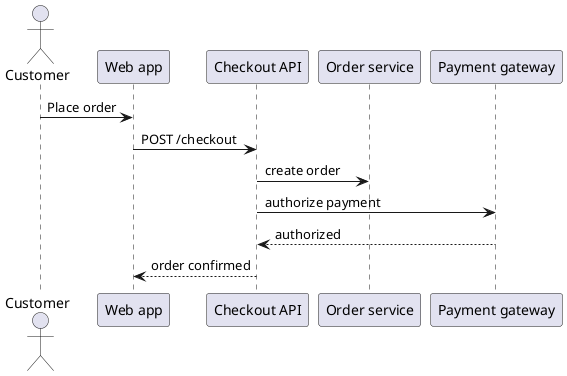

# AskBoard — Experience Spine

`EXPERIENCE.md` owns how AskBoard works; `DESIGN.md` owns how it looks, and this file names DESIGN.md's tokens by path, for example `{colors.change}`. Both spines win on conflict with any mock in `mockups/`, Stitch output or working page in `.working/`.

**Citations.** The PRD and the architecture are owned by the askboard repository, where they moved on 2026-10-27; they are cited here by their original folder names, which resolve under that repository's `docs/`.

| Tag | Meaning |
|---|---|
| `Lnn` | Line nn of this run's `.memlog.md` |
| `F-nn` | A finding of `validation-report.md` whose resolution the user approved (L178) |
| `PCR-nn`, `ACR-nn` | A row of `prd-change-requests.md`, the PRD changes this UX requires, or of `architecture-change-requests.md`, the architecture changes it requires. Both files are drafts that the askboard repository may accept or refuse, so their rows are cited as "pending PCR-nn" and "pending ACR-nn"; the section [Depends on pending change requests](#depends-on-pending-change-requests) gives the fallback for each (F-15) |
| `S-n` | A check for the renderer spike, in `architecture-change-requests.md` |
| `AD-nn` | A decision of `ARCHITECTURE-SPINE.md` |
| `TC §x` | A section of `.working/technical-choices-proposal.md`, whose 22 recommendations the user approved (L160) |
| FR, NFR, SM, R, UJ | IDs of the AskBoard PRD |

**Terms.** The PRD glossary's terms keep their meaning: ask, area, question, option, board, answer, item, open prompt, follow-up, excerpt, reference, widget, derived value, primitive, molecule, asking rule, Snapshot, delivery mode, context header, postponed question. Two terms are this spine's own: in submitted delivery, an answer marked with "Answer" and waiting for Submit is **ready**, and a question that still needs an answer, unanswered or postponed, is **open** (Counting). The primitives are the FR-13 atoms and layouts the agent composes; AskBoard's own chrome controls are **base controls**. Three working artifacts are cited by name: the structural mock ([layout variants](mockups/layout-split-view-variants-2026-10-27.html)), golden-1-base ([the Stitch golden screen](mockups/stitch/golden-1-base.html)) and the colour page ([colour themes](mockups/color-themes-1.html)). The key-screen mocks, each with a PNG, are in `mockups/` too and are linked where they show a surface.

## Foundation

- **Form factor.** AskBoard is a desktop web board in the user's own browser, on the local machine (NFR-3). Each ask opens on its own board in its own browser tab (FR-24). Desktop and laptop only (L25).
- **UI system.** The UI system is shadcn/ui on Radix and Tailwind (L31), initialised with shadcn's Radix base named explicitly (TC §1.1). This spine states only the behavioural deltas over the Radix primitives. Anything it does not state behaves as the Radix primitive does.
- **Visual reference.** DESIGN.md is the visual identity reference.
- **Architectural frame** (cited, not decided here):
  - Agent content is data, rendered as text through the catalogue in a sandboxed view with an opaque origin (AD-8). What runs on the board page and what runs in the view is in Composition and Components, Board page or view.
  - Every component renders from the board document, the draft record and the compute graph, keeps no edit state of its own and reports user actions as typed messages (AD-9).
  - Dates, durations and money travel in the contract's formats (AD-7).
  - UX owns the atoms and layouts, the widget components, the forms library and the visual design, within AD-7 to AD-9 and the component adoption rule (SOLUTION-DESIGN §1, §9). The choices are in Composition and Components (L160).
- **Audience and stakes.** The audience is the PRD's: engineers first, and also power PMs and power sales people who work in Claude Code. The run's "internal / own team" stakes set the polish level only: essential accessibility and little onboarding (L10, L158).
- **Design principle.** AskBoard exists to lower the felt cognitive complexity of a problem. A single-question board must be as effective as a large one (L116, pending PCR-25). The principle serves SM-5: complicated questions are answered on the board without going back to the terminal or the sources. The excerpts, the in-board reading panel, the follow-ups and "Explain" keep the user on the board.
- **Agent cost.** Rich questions stay cheap for the agent (NFR-1, SM-1, SM-2). Two rules follow:
  - **AskBoard-only fields are optional.** Every field AskBoard adds beyond AskUserQuestion's is optional: the ask title, the agent display name, the header chip, the declared language and the minimum margin. When the agent omits them, AskBoard supplies defaults: the title from the first question; "Main agent", "Subagent <type>" or "Teammate <name>" for the name (F-53); the configured language, then en-US (Localization); and the project's minimum margin, when one is set (F-98). An omitted header chip is simply absent. A plain single-question ask stays within SM-1's +25% (L148, pending PCR-32, pending ACR-06, pending ACR-07).
  - **AskBoard computes or holds derived data,** so the agent never writes it: derived values (FR-12), the split and single-question board rules (L106, L120), the change highlight and the Gantt baseline against the agent's original (L76, L72), the Graph's initial layout and auto-layout (L160), molecule expansion (AD-9), and the diffs of Diff review's two alternatives, which AskBoard reads from patch files (L182, pending ACR-07).

## Information Architecture

### Surfaces

| Surface | Reached from | Purpose | Journeys |
|---|---|---|---|
| Board | The tab AskBoard opens, the system notification or the terminal link (FR-23) | One ask: its questions, context, widgets and answers | UJ-1 to UJ-3 |
| Reading panel | A project-file reference, inside the board (L79) | The referenced file at its location, with "Open in editor" | None; the golden case exercises it (see Open Items) |
| Settings panel | "Settings" in the context header, on every board, with user and project scopes (L40) | Theme, density and the context-placement default, editable; every other setting and the current language, read-only (L171, L179; Preferences and Settings; [mock](mockups/key-settings-panel.html)) | None, by choice: covered by description (L96) |
| Invalid-link page | A bare, stale, invalid or discarded-ask board URL (L41) | Says why no board opens and what to do (Component Patterns, Invalid-link page) | None, by choice (L96) |
| System notification | A new ask (FR-23) | Announces who asked, where, the ask's title and the question count (L65), and opens the board where the system lets it: on Linux, not on macOS (F-49, FR-23) | UJ-1 |
| Terminal link and pending-asks list | The agent's Claude Code terminal (FR-23, AD-4) | Opens the ask's board. With the mod, the notice also lists the pending asks (L157, pending PCR-31) | UJ-1 |
| Snapshot | A file in the Snapshot folder (FR-27) | An offline, view-only copy of a board, taken while the ask is open or closed (L137) | UJ-2 and UJ-3 (taken by the agent); taken by the user: covered by description (L96) |
| Leave-page prompt | Closing or reloading a board's tab with unsent work or with postponed questions open (L57, L172, F-57) | The browser's own guard against losing work | UJ-1 edge case, UJ-2 |

The browser tab is labelled with the ask's title: "<title> · AskBoard" (L110, pending PCR-03). The agent may write the title; when it does not, AskBoard derives it from the first question (L148, pending ACR-06). There is **no home view**: boards are the only views (L41, pending PCR-12).

### Board anatomy

This is variant A of the structural mock ([layout variants](mockups/layout-split-view-variants-2026-10-27.html)), with every placement confirmed (L106 to L110). It describes a board with sections or tabs; Presentations gives what one question per view and the single-question board change.

1. **Context header**, sticky, in two rows (L46, L110):
   - **Row 1:** who asked, as type and name (L86), then Project, Directory, Branch and Worktree (FR-24). Without a display name from the agent, the header shows "Main agent", "Subagent <type>" or "Teammate <name>" alone, and a second subagent of the same type in the session adds an ordinal ("code-reviewer #2") (F-53). "Teammate <name>" names an agent-team teammate by its name as Claude Code gives it ("Teammate scout-2"), with no ordinal (PO decision of 2026-11-03). "For: <name>" appears only when the expected answerer differs from this machine's git user (L87, L200). It sits in row 1, after who asked. Directory is the agent's working directory relative to the ask's root ("." at the root), and a field AskBoard does not know, as for an ask with no agent record, shows "—".
   - **Row 2:** the ask state with its postponed and declined counts (L55, F-08), the agent state (FR-24), the open count and the next-open jump (L50, F-08), the count of unread follow-up replies when there is one (F-20), then the quick toggles (Theme, Compact | Comfortable) and Settings (L46, L169).
   - It also carries the agent-change flag (L58).
2. **Outline navigator.** A sticky left rail of areas and questions, each with its state marker (Counting). A click or a keypress jumps to a question (L50, L110). With areas as tabs, a jump into another area activates that tab (L160).
3. **Content column.** The areas, in the presentation the agent chose (below), each holding its question cards. A display-only item outside any question is a top-level item (Board chrome, Top-level item) (F-70).
4. **Question card**, in this order: header chip, question, options (with the "Other…" row last, when the question offers one), widget, open prompt, the Question actions row, follow-up thread (L108, L154, F-52). The Question actions row holds Postpone and "More" (which holds Explain and Decline), then the delivery receipt and "Answer" (L168; DESIGN.md, Components, Question card).
   - **With excerpts**, the question renders split, with the context column (excerpts and references) beside it, as long as at least one excerpt resolved (F-104).
   - **A wide widget** in a split question spans the full card width below the question text, the options and the context column; which widgets are wide, and where they start, is in DESIGN.md, Layout & Spacing (Wide widgets) (F-47, L199).
   - **Without excerpts**, or when none resolved, the question takes the full width.
   - The agent sends no layout for this (L106, FR-13).
   - **Context placement.** The context can move inline, under the question text (Context column).
5. **Bottom action bar**, sticky: the delivery mode switch and its helper text, "Select recommended", "Snapshot" and "Submit" (L46, L109, L170).

### Presentations

| Presentation | Chosen by | Shape | Source |
|---|---|---|---|
| Sections | The agent, per ask | Areas stacked as labelled sections | L42, FR-2 |
| Tabs | The agent, per ask | One tab per area. Each tab label carries its area's open count | L42, L160, F-08 |
| One question per view | The agent, per ask with two or more questions | Each question fills the view. The question navigator above it reaches the others and holds the next-open jump, and there is no outline navigator ([mock](mockups/key-one-question-per-view.html)) | L121, L160, L210, F-100 |
| Single-question board | Automatic, when an ask has one question; it wins over one question per view | No outline navigator, no open count, no next-open jump and no "Select recommended". The delivery mode switch is hidden and the board works as in immediate delivery: "Answer" is the only primary action and sends the answer at once, and Submit does not show. The header and the bottom action bar, with "Snapshot", stay, and the question takes the whole width ([mock](mockups/key-golden.html)) | L120, L168, L198, F-52, F-100 |

The agent chooses the presentation (sections, tabs or one question per view) with one ask-level field; the single-question board and the split question need no field from the agent (L106, L120). An ask with three areas shows three distinct, labelled parts. An ask without areas shows its questions as one group (FR-2). An area the agent has emptied is hidden (F-101). The user cannot switch an ask between one question per view and the full board in the first version (L160). In benchmark mode the view mounts every area, whatever the presentation (AD-17): tabs and one question per view keep their hidden content mounted (TC §1.5).

## Voice and Tone

The brand voice lives in DESIGN.md, Brand & Style. For the things the user acts on, the mocks use the PRD glossary's own words: Postpone, Follow-up, Snapshot, Delivery, the ask states and the agent states; the open prompt's label is the exception (Open prompt). This table holds only strings recorded in the memlog, the mocks, the approved technical choices or the approved validation resolutions. Strings marked "(to review)" are provisional: the key-screen mocks had to invent them, and the user accepted them pending review (L200). The Italian column holds the it-IT strings, written by the OpenSpec change `settings-languages`; those marked "(to review)" wait for a native review.

| Where | English | Italian | Source |
|---|---|---|---|
| Browser tab | "<title> · AskBoard" | "<title> · AskBoard" (to review) | L110 |
| Who asked | "Main agent · <name>", "Subagent <type> · <name>" (for example, "Subagent code-reviewer · Retry review"), "Teammate <name> · <display name>"; without a display name "Main agent", "Subagent <type>" or "Teammate <name>"; a second subagent of the same type "Subagent code-reviewer #2" | "Agente principale · <name>", "Subagente <type> · <name>" (per esempio, "Subagente code-reviewer · Retry review"); senza nome visualizzato "Agente principale" o "Subagente <type>"; un secondo subagente dello stesso tipo "Subagente code-reviewer #2" (to review) | L86, F-53 |
| Expected answerer | "For: <name>" | "Per: <name>" (to review) | L87 |
| Header fields | "Project", "Directory", "Branch", "Worktree" | "Progetto", "Cartella", "Branch", "Worktree" (to review) | Structural mock |
| Ask state | "Waiting", "Partly answered 1/3", "Answered", "Closed", "Discarded"; with postponed or declined questions "answered, 1 postponed", "answered, 1 declined" | "In attesa", "Risposte parziali 1/3", "Con risposta", "Chiusa", "Scartata"; con domande rinviate o rifiutate "con risposta, 1 rinviata", "con risposta, 1 rifiutata" (to review) | Colour page, L55, F-08 |
| Agent state | "Agent: Working", "Agent: Waiting for your answer" | "Agente: al lavoro", "Agente: attende la tua risposta" (to review) | Colour page |
| Header labels | "Ask" before the ask state, "Theme" before the theme control (to review) | "Richiesta" prima dello stato della richiesta, "Tema" prima del controllo del tema (to review) | L200 (T-6) |
| Count and jump | "2 open", "Next open ↓"; in the question navigator "Next open →"; "1 new reply" | "2 aperte", "Prossima aperta ↓"; nel navigatore delle domande "Prossima aperta →"; "1 nuova risposta" (to review) | F-08, F-20, L210 |
| Quick toggles | "Theme" ("System", "Light", "Dark"), "Compact" / "Comfortable", "Settings" | "Tema" ("Sistema", "Chiaro", "Scuro"), "Compatta" / "Comoda", "Impostazioni" (to review) | Structural mock, F-78 |
| Outline | "Outline", "Unanswered", "New" | "Indice", "Senza risposta", "Nuova" (to review) | Structural mock, F-55 |
| Question navigator | "Question n of m", "Previous", "Next", "Question removed by the agent" | "Domanda n di m", "Precedente", "Successiva", "Domanda rimossa dall'agente" (to review) | L160, TC §1.6, F-55 |
| Options | "Options · pick one", "Recommended", "Accept recommended", "+ Add your note to this option", agent annotation prefix "Agent:", "Other…", "Show preview" | "Opzioni · scegline una", "Consigliata", "Accetta la consigliata", "+ Aggiungi una nota a questa opzione", prefisso delle annotazioni dell'agente "Agente:", "Altro…", "Mostra anteprima" (to review) | L61, L108, L154, L155, structural mock |
| Question actions | "Answer"; "More", which holds "Explain" (it sends "Why are you asking, and what changes with each option?") and "Decline" | "Rispondi"; "Altre azioni", che contiene "Spiega" (invia "Perché me lo chiedi, e cosa cambia con ciascuna opzione?") e "Rifiuta" (to review) | L168, F-52, L152, L153 |
| Open prompt | "Note for the agent (optional)"; "Reason for the changes (required)" while "Approve with changes" is selected | "Nota per l'agente (facoltativa)"; "Motivo delle modifiche (obbligatorio)" mentre è selezionato "Approva con modifiche" (to review) | Golden prompt (L118), F-04 |
| Postpone | "Postpone" | "Rinvia" (to review) | Structural mock |
| Delivery receipt | "not sent yet", "sent", "delivered to the agent" | "non ancora inviata", "inviata" (to review), "consegnata all'agente" | F-56, L159, F-48 |
| Reopened question | "Reopened by the agent", "Start from my previous answer" | "Riaperta dall'agente", "Parti dalla mia risposta precedente" (to review) | F-18 |
| Follow-up | "Follow-up", "2 messages", "no messages yet", "Ask a follow-up", "Collapse", composer "Ask the agent a follow-up…", "Send"; message time "5:42 PM" in en-US (to review) | "Chiarimenti", "2 messaggi", "ancora nessun messaggio", "Chiedi un chiarimento", "Comprimi", campo di testo "Chiedi un chiarimento all'agente…", "Invia"; ora del messaggio "17:42" in it-IT (to review) | Structural mock, golden-1-base, L200 (T-9) |
| Context column | "Excerpt and references", "Beside \| Inline", "opens in a reading panel", "opens in browser ↗", "Open in reading panel", type labels "FILE", "GITHUB" | "Estratto e riferimenti", "Accanto \| In linea", "si apre in un pannello di lettura", "si apre nel browser ↗", "Apri nel pannello di lettura", etichette di tipo "FILE", "GITHUB" (to review) | Structural mock, L160, F-60 |
| Reading panel | "Open in editor", "Changed since the agent asked" | "Apri nell'editor", "Modificato dopo la domanda dell'agente" (to review) | L79, F-40 |
| Settings panel | "Theme", "Density", "Context placement", "Language", "Default language", "Asking rules", "Snapshot folder", "Editor"; the note "Applies from the next session" over the behavioural settings (to review) | "Tema", "Densità", "Posizione del contesto", "Lingua", "Lingua predefinita", "Regole per le domande", "Cartella degli Snapshot", "Editor"; la nota "Si applica dalla prossima sessione" sopra le impostazioni di comportamento (to review) | L209 |
| Settings panel states | "Settings" (the panel's title), "Close settings" (the ✕); "default"; "also in <file>: <value> (not used)"; "Set by the project: <file> · <key>"; "Not applied: <problem>", with "not valid JSON", "version <version> is not supported" or "invalid value at <pointer>"; "Unknown key ignored: <key>"; "Ignored in <file>: AskBoard takes the editor only from your user settings"; "Ignored: other users can change <file>"; "Outside the project: .askboard/snapshots/ is used instead"; "Could not save to <path>: <reason>"; "Not saved: the project sets this"; "Not saved: <path> is not applied" (to review) | "Impostazioni", "Chiudi le impostazioni"; "predefinito"; "anche in <file>: <value> (non usato)"; "Impostato dal progetto: <file> · <key>"; "Non applicato: <problem>", con "JSON non valido", "la versione <version> non è supportata" o "valore non valido in <pointer>"; "Chiave sconosciuta ignorata: <key>"; "Ignorato in <file>: AskBoard prende l'editor solo dalle tue impostazioni utente"; "Ignorato: altri utenti possono modificare <file>"; "Fuori dal progetto: si usa .askboard/snapshots/"; "Impossibile salvare in <path>: <reason>"; "Non salvato: lo imposta il progetto"; "Non salvato: <path> non è applicato" (to review) | OpenSpec change `settings-languages` (A1, A10) |
| Language indicator | "English (en-US)"; with other formats, "English (en-US) · formats it-IT" (to review) | "Italiano (it-IT)"; con altri formati, "Italiano (it-IT) · formati en-US" (to review) | DESIGN, Language indicator; OpenSpec change `settings-languages` (A10) |
| Number and date entry | "Write the number in full, without an exponent."; "\"<character>\" is not part of a number: use digits, as in 1,234.5."; "Put at most one sign, before the digits."; "Type digits, as in 1,234.5."; "Use one decimal point at most."; "Put digits on both sides of the decimal point, as in 0.5."; "Use commas only between groups of three digits, as in 1,234.5."; "The number is too large."; "Write the date as month/day/year, as in 12/9/2026"; "Write the year too: month/day/year, as in 12/9/2026"; "<number> is not a month: write month/day/year, as in 12/9/2026"; "<month> <year> has no day <day>", as in "February 2027 has no day 29" (to review) | "Scrivi il numero per intero, senza esponente."; "\"<character>\" non fa parte di un numero: usa le cifre, come in 1.234,5."; "Metti al massimo un segno, prima delle cifre."; "Scrivi delle cifre, come in 1.234,5."; "Usa al massimo una virgola decimale."; "Metti delle cifre prima e dopo la virgola decimale, come in 0,5."; "Usa i punti solo tra gruppi di tre cifre, come in 1.234,5."; "Il numero è troppo grande."; "Scrivi la data come giorno/mese/anno, come in 9/12/2026"; "Scrivi anche l'anno: giorno/mese/anno, come in 9/12/2026"; "<number> non è un mese: scrivi giorno/mese/anno, come in 9/12/2026"; "<month> <year> non ha il giorno <day>", come in "Febbraio 2027 non ha il giorno 29" (to review) | `tree-widget` open question 7; OpenSpec change `settings-languages` (A8); the date texts: `gantt-widget`'s `gantt/model/date.ts`, kept by the PO on 2026-11-03 |
| Board banner, ended board | "This board moved to another tab.", "This ask was discarded. The board is read-only." (to review) | "Questa board si è spostata in un'altra scheda.", "Questa richiesta è stata scartata. La board è in sola lettura." (to review) | E1's board page; Open Items 5 |
| Board load and item errors | "The board could not be loaded: {reason}", "This item could not be shown.", "Loading" (to review) | "Impossibile caricare la board: {reason}", "Impossibile mostrare questo elemento.", "Caricamento" (to review) | OpenSpec change `settings-languages`, task 7.1 |
| Delivery mode switch (E3) | "Switch to immediate delivery?", "Your held work goes to the agent now, in the order you gave it.", "Cancel", "Send and switch"; "1 update needs a choice" (to review) | "Passare alla consegna immediata?", "Il lavoro in attesa va subito all'agente, nell'ordine in cui l'hai dato.", "Annulla", "Invia e passa"; "1 aggiornamento richiede una scelta" (to review) | OpenSpec change `ask-lifecycle`, design decision 6 |
| Outline labels and marks (E3) | "Ready", "Answered", "Postponed", "Declined"; "Previous answer"; "Options" over a multiple choice; "Agent" as a reply's author; "1 message", "Your 1 change on this question" (to review) | "Pronta", "Con risposta", "Rinviata", "Rifiutata"; "Risposta precedente"; "Opzioni"; "Agente"; "1 messaggio", "La tua 1 modifica a questa domanda" (to review) | OpenSpec change `ask-lifecycle`, design decision 6 |
| Context and reading panel (E5) | "Unresolved" with the pointer; "This file is not available"; "This file cannot be shown as text"; "This file is too large to show here"; "No editor set: `editor` in ~/.config/askboard/config.json"; "Could not start the editor"; "WEB" (to review) | "Non risolto"; "Questo file non è disponibile"; "Questo file non si può mostrare come testo"; "Questo file è troppo grande per mostrarlo qui"; "Nessun editor impostato: `editor` in ~/.config/askboard/config.json"; "Impossibile avviare l'editor"; "WEB" (to review) | OpenSpec change `excerpts`, open question A14 |
| Snapshot (E7) | "· your unsent work is not included"; "by <who>" (to review) | "· il lavoro non inviato non è incluso"; "da <who>" (to review) | OpenSpec change `snapshot`, open questions B5 and B6 |
| Diff review | "Fix A \| Fix B \| A vs B", "Split \| Unified", "Accept file", "Reject file", "Accepted", "Rejected", "Edit" (on a line comment); a collapsed run of unchanged lines labelled by its hunk header as the diff gives it ("@@ -41,8 +41,10 @@ …") (to review) | "Correzione A \| Correzione B \| A vs B", "Affiancata \| Unificata", "Accetta il file", "Rifiuta il file", "Accettata", "Rifiutata", "Modifica" (su un commento di riga); una sequenza compressa di righe invariate, etichettata con l'intestazione del blocco come la dà il diff ("@@ -41,8 +41,10 @@ …") (to review) | Structural mock, L200 (T-7) |
| Graph | "Add state", "Add transition", "Delete", "Comment", "Auto-layout", "Checks", "Changes vs agent's original", "none yet" | "Aggiungi stato", "Aggiungi transizione", "Elimina", "Commenta", "Disposizione automatica", "Controlli", "Modifiche rispetto all'originale dell'agente", "ancora nessuna" (to review) | Structural mock |
| Diagram | "Diagram \| Source", "Annotate", "Your changes: 1 annotation"; with no change yet, "Changes vs agent's original · none yet" (to review) | "Diagramma \| Sorgente", "Annota", "Le tue modifiche: 1 annotazione"; senza modifiche, "Modifiche rispetto all'originale dell'agente · ancora nessuna" (to review) | golden-1-base, L200 (T-8) |
| Approval | "Approve", "Approve with changes", "Reject"; the label "Approval" above the decision buttons and the summary title "2 changes" (with the count) (to review); the Field error for an empty required reason, "Add the reason for your changes." (to review); the open prompt's label "Reason for the changes (required)"; the summary's "No changes" and "and 5 more", a switched value "on" / "off" (to review); before a received answer is revised, "Send a new answer?", "The agent has already received your earlier answer. This one replaces it.", "Send", "Cancel" (to review) | "Approva", "Approva con modifiche", "Respingi"; l'etichetta "Approvazione" sopra i pulsanti e il titolo del riepilogo "2 modifiche" (con il numero); l'errore del campo per un motivo obbligatorio vuoto, "Aggiungi il motivo delle modifiche."; l'etichetta del campo "Motivo delle modifiche (obbligatorio)"; "Nessuna modifica" e "e altre 5", un valore "attivo" / "disattivo"; prima di rivedere una risposta già ricevuta, "Inviare una nuova risposta?", "L'agente ha già ricevuto la tua risposta precedente. Questa la sostituisce.", "Invia", "Annulla" (to review) | FR-11, F-04, F-63, L200 (T-4), L198; OpenSpec change `approval-scale-ranking` |
| Ranking and Kanban | "Keep this order", "Move up", "Move down", "Move to…"; the Ranking's counter "No changes", "Order kept", "Your changes: 2 moved" (to review) | "Mantieni quest'ordine", "Sposta su", "Sposta giù", "Sposta in…"; il contatore "Nessuna modifica", "Ordine mantenuto", "Le tue modifiche: 2 spostati" (to review) | L160, TC §2.1, §2.2; OpenSpec change `approval-scale-ranking` |
| Scale | "Not set" while no value is set; values and the unit in the ask's locale ("12.5 %", "12,5 %") (to review) | "Non impostato" (to review) | FR-11, TC §2.5; OpenSpec change `approval-scale-ranking` |
| Sales estimate review | "Total", "Margin", "on" / "off" for an optional line (to review) | "Totale", "Margine", "inclusa" / "esclusa" per una riga facoltativa (to review) | L200 (T-4) |
| WBS with PERT | Columns "Work package", "Optimistic", "Most likely", "Pessimistic", "Expected effort", "Spread" (to review) | Colonne "Pacchetto di lavoro", "Ottimistica", "Più probabile", "Pessimistica", "Stima attesa", "Scarto" (to review) | L200 (T-5) |
| Gantt plan | Columns "Task", "Start", "Duration"; zoom "Day \| Week \| Month" (to review) | Colonne "Attività", "Inizio", "Durata"; zoom "Giorno \| Settimana \| Mese" (to review) | L200 (T-5) |
| Tree and Gantt chrome | "Add node / Add child" (to review) | "Aggiungi nodo / Aggiungi figlio" (to review) | OpenSpec change `widget-editing-plus`, F-04 |
| Tree and Gantt chrome | "Move up / Move down / Indent / Outdent / Delete" (to review) | "Sposta su / Sposta giù / Rientra / Riduci rientro / Elimina" (to review) | OpenSpec change `widget-editing-plus`, F-04 |
| Tree and Gantt chrome | "No changes / Your changes: N / M follow from the WBS" (to review) | "Nessuna modifica / Le tue modifiche: N / M derivano dalla WBS" (to review) | OpenSpec change `widget-editing-plus`, F-04 |
| Tree and Gantt chrome | "Day / Week / Month" (to review) | "Giorno / Settimana / Mese" (to review) | OpenSpec change `widget-editing-plus`, F-04 |
| Tree and Gantt chrome | "Task / Start / Duration / Depends on" (to review) | "Attività / Inizio / Durata / Dipende da" (to review) | OpenSpec change `widget-editing-plus`, F-04 |
| Tree and Gantt chrome | "Work package / Optimistic / Most likely / Pessimistic / Expected / Spread" (to review) | "Pacchetto di lavoro / Ottimistica / Più probabile / Pessimistica / Atteso / Dispersione" (to review) | OpenSpec change `widget-editing-plus`, F-04 |
| Tree and Gantt chrome | "Critical path / Baseline / earliest" (to review; "Baseline" decided by the PO, 2026-11-06) | "Percorso critico / Baseline / primo possibile" (to review; "Baseline" decided by the PO, 2026-11-06, the technical term kept in Italian) | OpenSpec change `widget-editing-plus`, F-04 |
| Tree and Gantt chrome | "Adjust by %… / Apply / Cancel / Undo adjust" (to review) | "Modifica di %… / Applica / Annulla / Annulla modifica" (to review) | OpenSpec change `widget-editing-plus`, F-04 |
| Tree and Gantt chrome | "Select all / Select none / N selected" (to review) | "Seleziona tutto / Deseleziona / N selezionati" (to review) | OpenSpec change `widget-editing-plus`, F-04 |
| Tree and Gantt chrome | "Resize the Task column / Use estimate" (to review) | "Ridimensiona la colonna Attività / Usa la stima" (to review) | OpenSpec change `widget-editing-plus`, F-04 |
| Tree and Gantt chrome | "Cannot drop inside its own branch / At most 8 levels" (to review) | "Impossibile rilasciare nel suo stesso ramo / Al massimo 8 livelli" (to review) | OpenSpec change `widget-editing-plus`, F-04 |
| Tree and Gantt chrome | "More / Copy path" (to review) | "Altro / Copia percorso" (to review) | OpenSpec change `widget-editing-plus`, F-04 |
| Bottom action bar | "Delivery", "Immediate \| Submitted", "Answers go to the agent as you give them.", "Select recommended", "Snapshot", "Submit" | "Consegna", "Immediata \| Su invio", "Le risposte arrivano all'agente man mano che le dai.", "Seleziona le consigliate", "Snapshot", "Invia le risposte" (to review) | Structural mock, L170 |
| Agent-change notice | "The agent updated this", "Your 17 changes on this question" (with the count), "Show the agent's change", "Reload, losing my work", "Keep mine" | "L'agente ha aggiornato questa domanda", "Le tue 17 modifiche a questa domanda" (con il numero), "Mostra la modifica dell'agente", "Ricarica, perdendo il mio lavoro", "Tieni le mie" (to review) | L58, F-19 |
| Deleted item | "Removed by the agent" [ASSUMPTION] | "Rimosso dall'agente" (to review) | L60 |
| Board banner | "Connection lost, retrying"; "Your unsent work was not sent", "Copy my unsent work"; "Continue here" | "Connessione persa, nuovo tentativo in corso"; "Il lavoro non inviato non è stato inviato", "Copia il mio lavoro non inviato"; "Continua qui" (to review) | L85, L139, F-17, F-58 |
| Postponed warning (bottom action bar) | "You have 1 postponed question: closing loses this ask", "You have 2 postponed questions: closing loses this ask" | "Hai 1 domanda rinviata: chiudendo perdi questa richiesta", "Hai 2 domande rinviate: chiudendo perdi questa richiesta" (to review) | L172, L190 |
| Snapshot | "Your unsent work will not be in the Snapshot"; on a project-file reference, "not available in a Snapshot"; the top line of an opened Snapshot, "Snapshot · taken Oct 28, 2026, 4:12 PM by the agent · read-only" (when and by whom; to review) | "Il lavoro non inviato non sarà nello Snapshot"; su un riferimento a un file del progetto, "non disponibile in uno Snapshot"; la riga in alto di uno Snapshot aperto, "Snapshot · creato il 28 ott 2026, 16:12 dall'agente · sola lettura" (to review) | F-80, F-69, L207 |
| Browser tab | "<title> · AskBoard" | — | L110 |
| Who asked | "Main agent · <name>", "Subagent <type> · <name>" (for example, "Subagent code-reviewer · Retry review"), "Teammate <name> · <display name>"; without a display name "Main agent", "Subagent <type>" or "Teammate <name>"; a second subagent of the same type "Subagent code-reviewer #2" | — | L86, F-53 |
| Expected answerer | "For: <name>" | — | L87 |
| Header fields | "Project", "Directory", "Branch", "Worktree" | — | Structural mock |
| Ask state | "Waiting", "Partly answered 1/3", "Answered", "Closed", "Discarded"; with postponed or declined questions "answered, 1 postponed", "answered, 1 declined" | — | Colour page, L55, F-08 |
| Agent state | "Agent: Working", "Agent: Waiting for your answer" | — | Colour page |
| Header labels | "Ask" before the ask state, "Theme" before the theme control (to review) | — | L200 (T-6) |
| Count and jump | "2 open", "Next open ↓"; in the question navigator "Next open →"; "1 new reply" | — | F-08, F-20, L210 |
| Quick toggles | "Theme" ("System", "Light", "Dark"), "Compact" / "Comfortable", "Settings" | — | Structural mock, F-78 |
| Outline | "Outline", "Unanswered", "New" | — | Structural mock, F-55 |
| Question navigator | "Question n of m", "Previous", "Next", "Question removed by the agent" | — | L160, TC §1.6, F-55 |
| Options | "Options · pick one", "Recommended", "Accept recommended", "+ Add your note to this option", agent annotation prefix "Agent:", "Other…", "Show preview" | — | L61, L108, L154, L155, structural mock |
| Question actions | "Answer"; "More", which holds "Explain" (it sends "Why are you asking, and what changes with each option?") and "Decline" | — | L168, F-52, L152, L153 |
| Open prompt | "Note for the agent (optional)"; "Reason for the changes (required)" while "Approve with changes" is selected | — | Golden prompt (L118), F-04 |
| Postpone | "Postpone" | — | Structural mock |
| Delivery receipt | "not sent yet", "sent", "delivered to the agent" | "consegnata all'agente" (for "delivered to the agent"); the others — | F-56, L159, F-48 |
| Reopened question | "Reopened by the agent", "Start from my previous answer" | — | F-18 |
| Follow-up | "Follow-up", "2 messages", "no messages yet", "Ask a follow-up", "Collapse", composer "Ask the agent a follow-up…", "Send"; message time "5:42 PM" in en-US (to review) | — | Structural mock, golden-1-base, L200 (T-9) |
| Context column | "Excerpt and references", "Beside \| Inline", "opens in a reading panel", "opens in browser ↗", "Open in reading panel", type labels "FILE", "GITHUB", "WEB" (every other web address, Atlassian's included); for an unresolved excerpt or image, "Unresolved" with its pointer (to review) | — | Structural mock, L160, F-60 |
| Reading panel | "Open in editor", "Changed since the agent asked"; "This file is not available", "This file cannot be shown as text", "This file is too large to show here", each with the path; "No editor set: `editor` in ~/.config/askboard/config.json", "Could not start the editor" (to review) | — | L79, F-40 |
| Settings panel | "Theme", "Density", "Context placement", "Language", "Default language", "Asking rules", "Snapshot folder", "Editor"; the note "Applies from the next session" over the behavioural settings (to review) | — | L209 |
| Diff review | "Fix A \| Fix B \| A vs B", "Split \| Unified", "Accept file", "Reject file", "Accepted", "Rejected", "Edit" (on a line comment); a collapsed run of unchanged lines labelled by its hunk header as the diff gives it ("@@ -41,8 +41,10 @@ …") (to review) | — | Structural mock, L200 (T-7) |
| Graph | "Add state", "Add transition", "Delete", "Comment", "Auto-layout", "Checks", "Changes vs agent's original", "none yet" | — | Structural mock |
| Diagram | "Diagram \| Source", "Annotate", "Your changes: 1 annotation"; with no change yet, "Changes vs agent's original · none yet" (to review) | — | golden-1-base, L200 (T-8) |
| Approval | "Approve", "Approve with changes", "Reject"; the label "Approval" above the decision buttons and the summary title "2 changes" (with the count) (to review); the Field error for an empty required reason, "Add the reason for your changes." (to review) | — | FR-11, F-04, L200 (T-4), L198 |
| Ranking and Kanban | "Keep this order", "Move up", "Move down", "Move to…" | — | L160, TC §2.1, §2.2 |
| Sales estimate review | "Total", "Margin", "on" / "off" for an optional line (to review) | — | L200 (T-4) |
| WBS with PERT | Columns "Work package", "Optimistic", "Most likely", "Pessimistic", "Expected effort", "Spread" (to review) | — | L200 (T-5) |
| Gantt plan | Columns "Task", "Start", "Duration"; zoom "Day \| Week \| Month" (to review) | — | L200 (T-5) |
| Bottom action bar | "Delivery", "Immediate \| Submitted", "Answers go to the agent as you give them.", "Select recommended", "Snapshot", "Submit" | — | Structural mock, L170 |
| Agent-change notice | "The agent updated this", "Your 17 changes on this question" (with the count), "Show the agent's change", "Reload, losing my work", "Keep mine" | — | L58, F-19 |
| Deleted item | "Removed by the agent" [ASSUMPTION] | — | L60 |
| Board banner | "Connection lost, retrying"; "Your unsent work was not sent", "Copy my unsent work"; "Continue here" | — | L85, L139, F-17, F-58 |
| Postponed warning (bottom action bar) | "You have 1 postponed question: closing loses this ask", "You have 2 postponed questions: closing loses this ask" | — | L172, L190 |
| Snapshot | "Your unsent work will not be in the Snapshot", shown as the Snapshot is taken, with no confirmation; on a project-file reference, "not available in a Snapshot"; the top line of an opened Snapshot, "Snapshot · taken Oct 28, 2026, 4:12 PM by the agent · read-only" (when and by whom; to review), with "by <who>" when the user took it and "· your unsent work is not included" before "· read-only" when the board held unsent work (to review) | — | F-80, F-69, L207; OpenSpec change `snapshot` |

| Do | Don't |
|---|---|
| "Recommended" | "Agent recommended" (Stitch pass 1) |
| "Main agent · <name>" | "AskBoard Agent" (Stitch pass 1) |
| "Follow-up" as the thread's title | "Agent Conversation Log" (Stitch pass 1) |
| A visible label, "Note for the agent (optional)" | The label as placeholder text (golden-1-base), or a second label for the same field ("Note to the agent", structural mock) |
| Author and time on follow-up messages | Invented stamps such as "Just now" on an annotation (golden-1-base) |
| "Edit" on the user's own line comment | "Reply" and "Resolve" on line comments (Stitch pass 1) |
| "delivered to the agent" | "read by the agent", which claims more than AskBoard can know (F-48) |

## Component Patterns

These are behavioural rules; the visual specs live in DESIGN.md, Components, under the same names. A rule not stated here is the Radix primitive's default. The components behind each widget are in Composition and Components.

### Board chrome

| Component | Behavioural rules | Source |
|---|---|---|
| **Context header** | It stays visible however far the user scrolls. Two asks from different worktrees of one project are told apart by their headers alone. Agent state changes show at once, and when the agent starts waiting, the header shows it within the same interaction. It flags an item the agent changed while the user had unsent work on it, so the change is seen when the item is off-screen. It carries the unread-reply count (Unread-reply marker). | FR-24, AD-4, L58, F-20 |
| **Agent-written labels** | The ask title, the agent's name, header chips, tab labels and outline entries are capped and end in an ellipsis, with the full text on hover and on focus. The tab strip scrolls. Every agent string is isolated for bidirectional text, and bidi control characters in paths, IDs and notifications show as visible escapes. The cap lengths are not recorded. | F-64 |
| **State pill** | The ask pill shows the ask state (State Patterns, Ask states) as the agent has received it, with the postponed and declined counts once the ask is answered ("answered, 1 postponed"). Ready answers do not move it (Counting). The agent pill shows working, or waiting for an answer. The agent state shows presence only: it is never an ask state or an event. | L55, AD-4, AD-10, F-08 |
| **Next-open jump** | A button and a key move to the next open question: questions the agent added and the user has not seen come first, then unanswered and postponed questions in board order. The header shows the open count (Counting). With areas as tabs, the jump switches to the tab that holds that question. On boards with sections or tabs it sits in the context header and reads "Next open ↓". In one question per view it sits in the question navigator instead, reads "Next open →", searches forward from the question in view and wraps to the start; the open count stays in the header. It is absent on the single-question board, and so is the open count. The key binding is not recorded. | L50, L120, L160, L198, L210, F-08, F-55 |
| **Quick toggles** | Theme and density switch and apply at once, and are saved as user settings (Preferences and Settings). Theme has three states: System, which follows the system preference and is the default, Light and Dark. There is no language toggle (Localization). | L24, L36, L40, L138, L169, F-78 |
| **Settings panel** | Opened from the context header on every board. Theme, density and the context-placement default are editable; every other setting, the default language included, is read-only (Read-only setting), and the current language shows in the Language indicator (Preferences and Settings). It is non-modal and rendered on the board page: the board stays usable while it is open, and Esc or its close control dismisses it. Its placement and its three groups are in DESIGN.md, Components, Settings panel. | L40, L171, L179, L204, L209, L211 |
| **Read-only setting** | A setting the board does not write: its value in effect, with the configuration file and key that set it, and no control. A key set in neither file shows its default, marked "default", with the user file and key that would set it; a key both files set adds the other file's value, marked as not used, so both levels show (FR-35). It applies from the next session (Preferences and Settings). | L171, AD-14 |
| **Language indicator** | The ask's current language, read-only, in the settings panel's Language row (`{components.language-indicator}`). It offers no choice: another language means a new ask (Localization). When the ask's formats differ from its language, it names them: "English (en-US) · formats it-IT". | L169, L179 |
| **Outline navigator** | It lists the areas and questions with each question's state marker (Counting), and the top-level items without a state. A click or a keypress jumps to a question. It scrolls on its own and highlights the question in view. With areas as tabs, a jump into another area activates that tab. It flags the items the agent changed under unsent work, the questions the agent added (`{components.new-question-badge}`, until seen) and unread replies (`{components.unread-reply-marker}`). It is absent on the single-question board and in one question per view. | L50, L58, L120, L160, F-20, F-55, F-70, F-94 |
| **Question navigator** | In one question per view, a compact bar above the question: "Question n of m", a strip of per-question state markers that the user can click, Previous and Next, and the next-open jump ("Next open →", Next-open jump). It is not sticky. The markers follow Counting and carry the new-question and unread-reply marks too. It never advances by itself when a question is answered, and Previous and Next are disabled at the ends: they do not wrap, while the next-open jump does. On navigation, focus moves to the new question's heading. When the agent deletes the question in view, the navigator moves to the next one and says "Question removed by the agent". The user cannot switch an ask to or from this presentation in the first version. | L121, L160, L210, L211, TC §1.6, F-20, F-55, F-61 |
| **Area** | The agent picks per ask whether areas render as sections, as tabs, or one question per view (Presentations). Each area is a distinct, labelled part of the board. A tab label carries its area's open count and the new-question mark. An area the agent has emptied is hidden. | L42, FR-2, L160, F-08, F-55, F-101 |
| **Top-level item** | A display-only item outside any question, such as a context Chart, renders untitled at the top of its area, or of the board when the ask has no areas. The outline navigator lists it without a state, and no counter counts it (Counting). | AD-20, F-70 |
| **Bottom action bar** | Always visible. On the single-question board it holds only "Snapshot" (Presentations). While postponed questions remain open, it shows a fixed line warning that closing loses the ask (string: Voice and Tone, Postponed warning; rule: Interaction Primitives, Close and reload). | L46, L109, L120, L168, L172, L190 |
| **Select recommended** | Selects the recommended option, as one explicit click, on every unanswered question that has one and where the user has chosen nothing; it never replaces a choice the user made, and it sends nothing. Each selection only fills that question's draft: the user confirms each with "Answer", or, in submitted delivery, all of them with Submit. It leaves ready, answered, postponed and declined questions alone. It is hidden when no question has a recommendation, and absent on the single-question board. | L170, L187, AD-10, F-102, pending PCR-13 |
| **Delivery mode switch** | A new board starts in the mode the agent requests, or immediate if it requests none. The user can switch while answering. Switching from submitted to immediate with held work (ready answers, postpones, declines, notes) asks the user to confirm sending it now (Mode-switch confirmation). Once confirmed, the held actions go in the order the user produced them. It is hidden on the single-question board, which works as in immediate delivery (Presentations). | FR-22, L56, AD-20, L168 |
| **Submit** | Disabled in immediate delivery, and hidden on the single-question board. In submitted delivery it sends, as one atomic append, every ready answer, every held postpone, decline and note, and the recommended options that "Select recommended" selected and the user left in place (L170). It is disabled while nothing is held, and while an agent-change notice sits on a question with held work: the bottom action bar then says how many updates need a choice and offers a jump to the first. It is disabled while the connection is lost; a Submit retried after a drop is never appended twice, and on reconnect the board shows whether it landed. | L109, L168, L170, FR-22, AD-20, F-16, F-56, F-102 |
| **Snapshot control** | Takes a Snapshot of the whole board, without any request from the agent, while the ask is open or closed, never once it is discarded (Snapshots). When the board holds unsent work, it says "Your unsent work will not be in the Snapshot" before taking it. Afterwards it confirms with the file's path, or shows the write error with the Snapshot folder's path. | FR-26, L46, L137, F-80 |

### Question card

| Component | Behavioural rules | Source |
|---|---|---|
| **Question card** | Its element order is fixed (Board anatomy). It renders split when at least one of its excerpts resolved, and full width otherwise. Every question shows an open prompt, whatever its options or widget. A board shows every question of an ask, however many there are, and a question shows every option. Progressive disclosure keeps a simple question light: "+ Add your note to this option" shows only on a selected option or on hover or focus, Explain and Decline sit behind "More" in the Question actions row, and the follow-up thread starts collapsed. | L108, L106, FR-7, FR-1, F-52, F-104 |
| **Question actions** | One row under the open prompt. On the left, Postpone and "More", which holds Explain and Decline as menu items reachable from the keyboard; on the right, the delivery receipt and "Answer". Each control follows its own row below; the row's layout is in DESIGN.md, Components, Question card. | L168, F-52 |
| **Answer** | Every question has its own "Answer" (`{components.button-answer}`) in the Question actions row; on a board with more than one question it is not a second primary action beside Submit. Choosing an option, editing a widget, or writing a note or an option note only fills the draft. "Answer" takes the question's whole answer together (the chosen options, the "Other…" text, the widget's value, the user's option notes and the open-prompt text) and delivers it as Interaction Primitives, Delivery says. It is disabled until the question has a choice, a widget change or a note (L198). With only open-prompt text, it sends the note as feedback (FR-7): the question stays unanswered and still counts as open, and the agent may reword the question. A failing field check blocks it; a formula error does not (Field error). For revisions, see Interaction Primitives, Revisions. | L168, L188, L189, L191, L198, AD-10, AD-20, pending PCR-34, F-39 |
| **Header chip** | A short label per question, written by the agent and optional. It also names the question in the outline navigator. | L47, L148, pending PCR-21, structural mock |
| **Question marker** | Marks a question that is ready (`{components.question-marker-held}`), postponed (`{components.question-marker-postponed}`) or declined (`{components.question-marker-declined}`) in the outline navigator and the question navigator, and on the card where DESIGN.md places it. Which state a question is in follows Counting. | F-08, F-37, L168 |
| **Question loading** | Shown on a question until all its items have loaded (`{components.question-loading}`); a question in this state never counts as visible (SM-C2). Past a time limit it turns into an error on that question. A Diagram's failed first render also ends the loading state (Diagram). The time limit and the error's wording are not recorded. | AD-9, SM-C2, F-38, F-07 |
| **Option** | Single or multiple choice, with a description under the label. Nothing is preselected (Interaction Primitives, Explicit acts). Delta over Radix: options use manual activation, so the arrow keys move focus only, Space or Enter selects, and selecting only fills the draft. The options never collapse into a dropdown: a long list gains a filter field and keeps every row, with its description, badge, notes, preview and "Other…". The list length that adds the filter is not recorded. The option list is the Choice atom plus the question card's chrome (Composition and Components). | FR-3, L47, AD-10, L160, L168, F-02, F-23 |
| **Other row** | An "Other…" row at the end of the options, with its own text field. Its text is an answer, returned as the Choice's `other` text and kept separate from the question's open prompt. | FR-3, L154, TC §1.2 |
| **Option preview** | An option with a preview shows "Show preview", which opens the preview below the option. One preview is open at a time. A preview is text or data, never markup, shown with the Text and Image atoms. | FR-3, L155, TC §1.2 |
| **Recommended badge** | Labels the agent's recommended option. It never selects it. | L61, NFR-10, AD-10 |
| **Accept recommended** | "Accept recommended" on a question counts as "Answer": one explicit click selects the recommended option and answers the question, so immediate delivery sends it and submitted delivery marks it ready. It is hidden on a question without a recommendation. The board-wide "Select recommended", which only selects, is under Board chrome. | L61, L186, L200, AD-10, pending PCR-13 |
| **Option annotation** | The agent's annotations show under their option. The user can add their own to any option ("+ Add your note to this option", shown on a selected option or on hover or focus). The user's annotations return with the answer. | L49, pending PCR-21, F-52 |
| **Open prompt** | One free-text field per question, labelled "Note for the agent (optional)": the golden case's label, kept because the same field serves as the open prompt (FR-7), the note on an answer (FR-3), the Approval reason and the reason for a Decline. It returns with the question's answer. Its text becomes an event only on an explicit send action or as a field of the answer it accompanies, never on typing or blur. While "Approve with changes" is selected its label reads "Reason for the changes (required)". "Answer" with only this text sends it as feedback, without an answer (Answer). | L63, L118, pending PCR-04, AD-20, L74, L153, L191, F-04 |
| **Postpone** | Marks the question postponed without answering it, and the user can undo it at will. It follows the delivery mode: in immediate delivery the postpone reaches the agent at once, and undoing it sends the event "question reopened by the user" (pending ACR-05); in submitted delivery the postpone and its undo are held until Submit. A postponed question stays on the board, open, and the next-open jump reaches it. Postpone is disabled on a question that is answered or ready. | FR-4, L51, L142, AD-20, L50, F-37 |
| **More** | Beside Postpone in the Question actions row, it opens a menu holding Explain and Decline, reachable and operable from the keyboard. Each item follows its own row. | F-52, F-50 |
| **Decline** | "Decline", under "More", closes the question as declined, with an optional reason in the open prompt (pending ACR-08). A decline is an answer kind: it follows the delivery mode, and it can be revised or undone like an answer; undoing it reopens the question with the event "question reopened by the user" (pending ACR-05). L153's "the agent learns not to ask it again" means that the declined event carries the reason and that the shipped skills tell the agent not to ask the question again within its task: nothing is kept beyond the ask. Decline is disabled on a question that is answered or ready. | L153, pending PCR-29, F-37 |
| **Explain** | Under "More" on each question. It sends a ready-made follow-up, "Why are you asking, and what changes with each option?", into the question's follow-up thread, where the reply arrives like any other. It is disabled while its reply is pending. There is no rationale field, so the agent pays for an explanation only when the user asks for one. | L152, FR-10, NFR-1, F-52, F-103 |
| **Delivery receipt** | Each delivered answer shows "sent", then "delivered to the agent" once the agent has received it, that is, once AD-3's `received` signal is set: when `collect` returns the event, when a stop block carries it, or when the mod reports it delivered (pending ACR-09). It never claims that the agent read the answer. When answers cannot reach a working agent (R1, FR-21), an answer stays at "sent" until the agent receives it, so the user sees that interactivity is reduced, not lost. An answer given while the connection is lost shows "not sent yet" and goes, in order, on reconnect. | L159, AD-3, pending PCR-30, F-48, F-56 |
| **Follow-up thread** | Inline under the question, collapsed until opened, with its composer at the foot. A question can go through several rounds before it is answered, and follow-ups stay available on every question while the ask is open, including answered, postponed and declined questions. In the composer, Enter adds a line and a modified Enter sends. A follow-up, "Explain" included, goes to the agent at once, in either delivery mode. The agent's reply is appended to the thread: it never counts as a change to the question and raises no agent-change notice. A reply that arrives while its question is out of view gets the Unread-reply marker. The state between sending and the reply is not recorded, beyond Explain being disabled. | L45, L152, FR-10, AD-20, F-20, F-50, F-103 |
| **New-question badge** | A question the agent adds carries "New" (`{components.new-question-badge}`) in the outline navigator, its tab label and the question navigator until it has been in view, and the next-open jump reaches it first. | F-55 |
| **Unread-reply marker** | Marks a follow-up reply that arrived while its question was out of view, on the question's outline entry and question-navigator marker (`{components.unread-reply-marker}`). The header counts unread replies ("1 new reply"), and activating the count jumps to the first. The mark clears once the reply has been in view. | F-20 |

### Context

| Component | Behavioural rules | Source |
|---|---|---|
| **Context column** | Holds the question's excerpts, then its references. It sits beside the question (the default) or inline under the question text. The "Beside \| Inline" control sits in the context column's title row ("Excerpt and references") and stays there in both positions, so it never jumps. The board-wide placement is set in the settings panel (Preferences and Settings), and the control on a question overrides it on that question only; the override stays with the ask (What a reload keeps). A question with no resolved or agent-written excerpt does not split: its references and unresolved pointers show inline under the question text, under the same title, with no "Beside \| Inline" control. | L108, L111, L112, L160, F-33 |
| **Excerpt** | Shown beside its question. A resolved pointer shows the content at its location, and an agent-written excerpt shows as written. An unresolved pointer shows as unresolved, with the pointer, and does not block the board; when none of a question's excerpts resolved, the question does not split and the pointer shows inline. A path outside the ask's root resolves as unresolved. A long excerpt is capped in height (DESIGN.md, Components, Excerpt) and scrolls inside, and an excerpt from a project file adds "Open in reading panel". An excerpt always shows as source text with its line numbers, so its line range stays meaningful: code does not wrap and scrolls sideways, and Markdown soft-wraps (its look: DESIGN.md, Components, Excerpt). | FR-8, AD-12, F-60, F-104, L199 |
| **Reference** | Opens in one click, and only on an explicit user click. A project-file reference opens the reading panel at the referenced location; in the context column it shows its type and path, then the hint "opens in a reading panel" (DESIGN.md, Components, Reference). A web, GitHub or Atlassian reference opens in the user's browser, in a new tab, and only `http:` and `https:` URLs open. For references in a Snapshot, see Snapshots, Snapshot view. | FR-9, L79, L80, AD-8, F-69, L199 |
| **Reading panel** | Shows the referenced project file at its location, inside the board. It renders on the board page, since the view cannot frame AskBoard's source view, as a non-modal side sheet over the context column and part of the question (its width: DESIGN.md, Components, Reading panel), and it frames that token-gated source view, which renders the file as text only (pending ACR-03). Esc or its close control dismisses it, and focus returns to the reference. It reads the file when it opens, so it shows the current file, with "Changed since the agent asked" when the excerpted range differs from the excerpt. "Open in editor" opens the file at that line with the editor command set in the configuration, under these rules: only on an explicit user click, never on agent content; the command comes from the user's settings; it starts with an argument vector, never through a shell; and the path is confined to the ask's root (AD-12, pending ACR-04). "Open in editor" is disabled for a missing file. The panel's states are in State Patterns. The [UJ-1 mock](mockups/key-uj1-diff-review.html), section 2, shows it open. | L79, L80, L139, L140, AD-8, pending PCR-14, F-03, F-40, L199 |

### Changes, values and board states

| Component | Behavioural rules | Source |
|---|---|---|
| **Change highlight** | Board-wide: every editable widget shows what the user changed against what the agent sent, with `{components.change-highlight}`. Anything the user did takes the change hue, a comment on a Diff line included, and its shape shows the kind of change: a removed edge or line, for example, is dashed or struck through (DESIGN.md). It is display only and adds no action. The idle text of the Tree's and the Gantt's counters is "No changes", not "Changes vs agent's original · none yet". In a plan, a task whose duration only follows an estimate or a package changed in the Tree takes the derived mark (`change-subtle` fill, a dotted outline on its bar, no border), is not counted among "Your changes: N", and is counted apart as "M follow from the WBS"; a requested duration is a direct change, with a pin, and counts. The counter truncates before it overprints a tool. | L76, F-51, L199, F-07, F-16 |
| **Derived value** | AskBoard computes it and updates it as the user edits, within the same interaction and without the agent. The answer carries derived values as they stood. Locale formats apply only to the display. A formula with a missing reference or a cycle shows as a Field error. A summed money column has one fixed currency, and mixed currencies raise a formula error. | FR-12, FR-14, AD-13, F-39, F-96 |
| **Field error** | An inline error under a field, or under a cell's row in a grid (`{components.field-error}`), for a failing field check, a formula error or an empty required reason (Approval). A failing field check blocks its question's "Answer" (Field checks). A formula error never blocks the answer: AD-13 shows formula problems and never refuses them. The messages are not recorded. | AD-13, F-39 |
| **Agent-change notice** | Raised when the agent changes an item on which the user has unsent work. An active gesture counts as unsent work: a pointer drag, a focused field with a pending edit or an IME composition; an update that arrives during one is applied when it ends, and then these rules apply. The notice (`{components.agent-change-notice}`) sits inline on the item: "The agent updated this", what is at stake ("Your 17 changes on this question"), "Show the agent's change", which opens a read-only view of the new revision with its differences marked, and the two choices, "Reload, losing my work" and "Keep mine". There is no merge in the first version. The outline navigator and the context header flag it too. The choice reaches the agent at once, before the item's answer. The notice never takes focus. Without unsent work, a change shows without a reload and raises no notice. [ASSUMPTION] When the agent deletes an item with unsent work, the item turns read-only with "Removed by the agent", keeping the user's work visible until dismissed and flagged like a change. Without unsent work, a deleted item disappears. | L58, L59, L60, FR-6, AD-20, F-19, F-54, F-68 |
| **Reopened question** | When the agent reopens an answered question, it shows "Reopened by the agent" and starts from the agent's new revision, with nothing carried over (AD-10). The previous answer shows read-only for reference, and "Start from my previous answer" moves it into the draft as an explicit act. | AD-10, AD-20, F-18 |
| **Board banner** | It renders on the board page in `{components.board-banner}`; for the Closed, Discarded and Board moved variants, the board page also locks the view (Board page or view). Variants: • **Closed:** the open tab stays readable and locked, with a banner saying the ask is closed. The user can still take a Snapshot, and the ask's link reopens this locked board. • **Discarded:** the open tab stays readable and locked, with a banner saying the ask was discarded. No Snapshot can be taken, since AskBoard has dropped the ask's data. • **Unsent work:** on a closed or discarded board, the banner also says "Your unsent work was not sent". The draft stays visible and selectable in the locked board, and "Copy my unsent work" puts it on the clipboard as text. • **Connection lost:** "Connection lost, retrying" covers a drop within the AD-21 grace period. Inputs stay editable, answers wait as "not sent yet" (Delivery receipt) and Submit is disabled. The board resumes if the ask is still open. After the session process exits, the board shows the ask as discarded. • **Board moved:** the board opened in another tab, so this older tab shows that the board moved, and closing it discards nothing. "Continue here" takes the board back. A takeover restores the draft only once the old tab's last draft mirror has arrived. | L52, L85, L137, L139, AD-21, pending PCR-10, F-17, F-56, F-58, F-93 |
| **Snapshot view** | How a Snapshot shows the board when it is opened: Snapshots, Snapshot view. | L83, F-69 |
| **Mode-switch confirmation** | Shown only when the user switches from submitted to immediate delivery with held work. Confirming sends it now. Like Submit, it is blocked while an agent-change notice sits on a question with held work. It is a modal Alert Dialog. Its scroll lock runs under the view CSP through the view's style-element shim (S-6, settled by the renderer spike). | L56, S-6, F-16 |
| **Invalid-link page** | Says why the link opens no board and what to do, and shows no board content. A discarded ask's board URL shows only that the ask was discarded (AD-21), and a request without the board's token is refused (NFR-4, AD-11). A closed ask's link opens its locked board, from which a Snapshot can still be taken, and a tab reopened within the grace period returns to its board (F-93). The page's wording is not recorded. | L41, AD-21, AD-11, NFR-4, F-93, pending PCR-12 |

### Primitives

The FR-13 atoms and layouts the agent composes when no widget fits. A question built only from atoms returns, as its typed answer, a map from each input atom's item ID to that atom's value (FR-13). No atom carries HTML, CSS or layout geometry (AD-7). Each atom's A2UI counterpart and the components it is built on are in Composition and Components, Atoms.

| Component | Behavioural rules | Source |
|---|---|---|
| **Display atoms** | Text, Image and Value show content and return no answer. Markdown in a Text goes through the view's sanitizer, the same path option previews take; an excerpt, the agent's included, always shows as source text (Excerpt). An image pointer that does not resolve shows as unresolved, like an excerpt, keeps the rest of the board working and sends the agent a typed warning (AD-6). Value shows a given or derived value in the ask's locale, or its formula error. | FR-13, L160, TC §1.2, F-41 |
| **Input atoms** | TextField, NumberField, MoneyField, DateField, Choice, Toggle and Slider return the typed answers below. Each starts empty or unset; in a widget that reviews agent content (Table, Tree, a Form over agent values), it starts from the agent's value, and an untouched value is reported unchanged. Typing never answers: a value becomes an answer only through the question's "Answer" and the delivery mode. Atoms show and accept input in the ask's locale, en-US or it-IT, and return the contract's formats (AD-7). NumberField and MoneyField are text inputs with AskBoard's own parser for the ask's locale, never the browser's number input: input that is ambiguous in that locale is refused with a message, and the parsed value is echoed beside the field ("= 12.5"). In en-US, `.` is the one decimal mark and `,` stands only between groups of three digits; it-IT swaps them, so `1.234,5` is 1234.5 and `1234.5` or `1.23` is refused. The echo writes the value without grouping ("= 1234,5"). DateField reads `M/D/YYYY` in en-US and `D/M/YYYY` in it-IT, and `YYYY-MM-DD` in both, and echoes the day with its weekday ("= mer 9 dic 2026"). In the Tree's and the Gantt's grid editors and in the adjustment panel's percentage field the parsed value is not echoed: an ambiguous or invalid entry is refused with a message, and after the commit the cell shows the value formatted in the ask's locale. The echo stays on the standalone atoms. | FR-13, AD-10, AD-20, L160, L168, L169, F-26, OpenSpec change `settings-languages` (A8) |
| **Layouts** | Stack, Row and Group compose items, and Tabs inside a question is optional (Composition and Components, Layouts). Layouts return no answer. The board-level layouts follow Board anatomy and Presentations. | FR-13, L160, TC §1.5 |

| Atom | Purpose | Typed answer |
|---|---|---|
| Text | Plain text, or Markdown; Markdown carries code blocks too | — |
| Image | An image from the board document, shown through a `blob:` URL; alt text required | — |
| Value | A read-only typed value: number, money, date, duration or percent, given or derived, with locale formatting and a formula-error state | — (answers carry derived values as they stood, AD-20) |
| TextField | Short or long free text, with label and description | `string` |
| NumberField | A number or an integer, with min, max, step and a unit label | JSON number |
| MoneyField | An amount in a currency the agent fixes or lets the user pick | `{ "amount": "<decimal string>", "currency": "<ISO 4217>" }` |
| DateField | A calendar date, without time | RFC 3339 `full-date` |
| Choice | Single or multiple choice; options carry label, description and an optional "Other…" answer; radios or checkboxes, and a dropdown only in a Form pick field | Option ID or list of IDs, plus `other` text when used |
| Toggle | On or off | `true` / `false`; an untouched toggle returns no answer |
| Slider | A value, or a range, on a numeric scale | A number, or `[low, high]` |
| Divider (optional) | A separator between items | — |

### Base controls

AskBoard's own chrome controls. They are not FR-13 atoms, and the agent never composes them (TC §1.3).

| Component | Behavioural rules | Source |
|---|---|---|
| **Button** | No delta over Radix. A disabled button takes no action. | L109 |
| **Segmented control** | Single selection, with Radix toggle-group keyboard behaviour. No delta. It serves the delivery mode, density, Split \| Unified, Fix A \| Fix B \| A vs B, Diagram \| Source and Beside \| Inline. | Inherited, TC §1.3 |
| **Status chip** | A label only: the chips report a state, and their controls sit elsewhere (for example the ✓ and ✕ beside "Accepted" in Diff review). | Structural mock |
| **Focus ring** | Shown on keyboard focus on every interactive element (keyboard core), as `{components.focus-ring}`. | L28 |
| **Widget frame** | The toolbar holds the widget's own controls. A widget renders from content and data alone and returns what the user did as a typed answer. A widget either sits in a question, and so has the open prompt and "Answer", or is display-only and returns no answer. Each widget is one Tab stop (Accessibility Floor). | FR-11, AD-7, AD-9, L168, F-67 |
| **Annotation pin** | A numbered pin on a Graph's node or edge, or on the annotation overlay of a Diagram or an Image annotation. A graph or diagram pin is keyed to the element's ID, or, when it has none, to its quoted label and its occurrence, and re-attaches by that key after a re-layout, a re-render or the user's correction of the source. A pin whose element is gone, or whose match has become ambiguous, is listed as detached, never silently dropped or guessed. An image pin is an `xywh=percent:` region. A click or a keypress on a pin opens its comment card. | L70, L160, AD-7, TC §2.4, F-62 |
| **Comment card** | Opens from an annotation pin, by click or keypress, in `{components.comment-card}`; placing a new pin opens an empty one. The user writes the comment, changes it with "Edit", or deletes it, which removes its pin. Esc or the close control dismisses the card, and focus returns to the pin. Open comment cards and their pins survive a theme re-render. | L160, F-35, F-65 |

### Widgets

Widgets come from the FR-11 catalogue. The molecules, which AskBoard expands into widgets when the ask is sent (AD-9), follow under Molecules. Each widget's keyboard minimum is in Accessibility Floor.

| Component | Behavioural rules | Source |
|---|---|---|
| **Diff review** | Line comments, and accepting or rejecting each change, line by line or a whole file at once. A split or unified view; it opens in Unified when the widget is narrower than about 900px. "Fix A \| Fix B \| A vs B" switches between two alternative fixes, which the agent gives as two patch files under the ask's root, applying to its files as they stand when the ask is sent; AskBoard reads and diffs them itself, with no git access (pending ACR-07). The choice of fix is a single-choice option on the question, not a widget decision. Line decisions and comments are kept per fix, and "A vs B" takes comments only. A patch file that does not resolve shows as an unresolved pointer: that fix and "A vs B" are disabled, the rest of the board works, and the agent gets a typed warning (AD-6). The answer lists every undecided change as undecided, never as accepted. Unchanged context and whole files collapse, and a long diff is virtualised. Scope in Widget Scope. | FR-11, L69, L108, L182, AD-8, AD-10, AD-12, F-13, F-22, F-25, F-41, F-47 |
| **Graph** | The user edits nodes and edges, and checks such as cycles run as they edit. When the graph opens, AskBoard computes its initial layout with dagre, so the agent never sends positions, and "Auto-layout" runs it again (pending ACR-10). Comments are pinned to a node or edge and survive re-layout. Changes are highlighted against the agent's original. Nodes the user adds get view-made IDs (Tree). | FR-11, L70, L160, F-09 |
| **Diagram** | The user annotates and corrects a Mermaid or PlantUML diagram, on the diagram or in its source ("Diagram \| Source"). AskBoard renders the source to an image and lays its own annotation overlay over it, so pins are keyed to element IDs, never to pixel regions, and re-attach when the corrected source re-renders. A source that does not render, whether the agent's or the user's correction, keeps the last good render with its pins, and the renderer's message and line show under Source; the failure does not count as a re-render. A first render that fails opens Source with the error, and the question counts as loaded. Each render carries a generation number and only the latest is applied, its hit map included, so a theme switch during a render cannot leave the wrong one. The answer returns the source as written, with the annotations. No scope beyond the minimum. | FR-11, L68, L118, L160, AD-7, AD-8, F-07, F-65 |
| **Ranking** | The user reorders the items by drag, or from the keyboard with "Move up" and "Move down". The agent's initial order is not an answer: the user either moves an item or clicks "Keep this order", which accepts the order as it stands. A row drags by its handle and drops before or after another row, by the half of the row the pointer is over; Escape cancels. The list is one Tab stop whose arrow keys move the current row, and the toolbar ("Move up", "Move down", "Keep this order") another. Moved rows take the change highlight, and the toolbar counts them. | FR-11, L160, AD-10 |
| **Form** | Typed fields: text, number, money, date, a pick from a list (single or multiple) and on/off; the on/off field is a deliberate extension of FR-11's list (Widget Scope). AskBoard computes the field checks (Field checks), and a failing check shows as a Field error. A pick field may show as a dropdown, the only place a dropdown appears. Enter never submits the form: answers go by "Answer" and the delivery mode. | FR-11, L160, L165, L168, TC §3, F-23, F-39 |
| **Image annotation** | The user places pins and boxes on an image and comments on each. They sit on AskBoard's annotation overlay, shared with the Diagram, and their positions are `xywh=percent:` regions of the image. | FR-11, L160, AD-7 |
| **Approval** | Approve, approve with changes or reject. The decision buttons (`{components.button-decision}`) only select, and "Answer" sends the decision. Selecting "Approve with changes" relabels the open prompt "Reason for the changes (required)". "Answer" stays enabled: pressed with the reason empty, it sends nothing, shows a Field error under the reason and moves focus there. Rejecting needs no text. The Approval summary sits beside the decision buttons. With changes in its question, that is edits to the question's other widget items (another widget's result is no change), plain "Approve" is disabled, a selected "Approve" is cleared, and "Approve with changes" is the approving act; without edits, "Approve with changes" stays available, its reason saying what to change. "Reject" sends the edits as context. A selected decision pressed again is cleared. Once the agent has received the question's answer, "Answer" and Decline ask for confirmation before they send a revision; Cancel sends nothing and keeps the draft. AskBoard refuses an answer that approves beside edits, or approves with changes without a reason. | FR-11, L74, L168, L198, F-04, F-63 |
| **Approval summary** | Lists what the user changed in the Approval's question, built from the change highlight's diff (`{components.approval-summary}`), beside the decision buttons: before the answer is sent, and read-only after. It shows at most 20 lines, then "and N more", and reads "No changes" when there are none. | L74, F-04 |
| **Choice** | The user picks one or several options, with previews: the Option, Other row and Option preview rules apply. | FR-11, FR-3 |
| **Scale** | The user sets a value or a range on a slider, or a rating. It starts unset, and only a value the user sets counts (Interaction Primitives, Explicit acts). A click on an unset slider's track sets the value at that point: Radix's Slider sets none there, so AskBoard's sets it itself (renderer spike). From the keyboard, the unset slider takes Home or an arrow key for its minimum and End for its maximum; then Radix's keys apply. A range starts with both thumbs at the first value. A rating's pressed step, pressed again, clears the value; a slider has no control that clears it. | FR-11, L160, TC §2.5 |
| **Document review** | The user selects a passage to comment on it or to suggest an edit. Comments anchor to the quoted text or to its position (AD-7). | FR-11, L160 |
| **LaTeX** | The user reads and edits one expression: a source field with a live preview, and the parse error shown while the source does not parse. | FR-11, L156, L160 |
| **Table** | The user edits a grid with typed columns. Totals and formula columns follow from the compute graph (Derived value). | FR-11, FR-12, L160 |
| **Spreadsheet** | The user edits cells, including cells that hold formulas, with A1 addresses and a formula bar. A formula error shows as a Field error under its cell's row (Derived value). | FR-11, FR-14, L160 |
| **Chart** | The user reads a chart and highlights data points, which the answer returns. | FR-11, L160 |
| **Tree** | The user adds, moves, renames and deletes nodes and edits node fields, and roll-ups follow. A long tree is virtualised. The moves are up, down, indent and outdent. Deleting a node with children asks for confirmation and says how many it removes. Elements the user adds get IDs with a prefix reserved for the view, which agents may not use (pending ACR-13). Rows are selected with a checkbox in a leading column, with Space and with Shift and the arrow keys, and "Select all" takes every node, collapsed ones included; a parent selects its children. "Adjust by %…" changes the number fields of the selection, as the WBS with PERT says. A row drags by its handle and drops before, after or into another row; the drop is the move the buttons make. The current row, the one the tools act on, is marked with a `primary-subtle` fill and a 2px `primary` left bar, apart from the selected rows; the row tools are disabled until a row is current; a drag handle shows on hover and on the current row. | FR-11, L160, F-09, F-59 |
| **Gantt** | The user reschedules tasks by dragging and edits durations and dependencies; dates and the critical path follow. A drag snaps to working days and stops at the earliest start the dependencies allow, which shows during the drag, and a duration never goes below one working day. To move a task past a dependency, the user edits the dependency. The Task column is as wide as the user makes it, by dragging its header's edge or with the keyboard on the edge, and a name that does not fit is cut with an ellipsis and holds its full text as a title. A "Critical path" switch in the toolbar shows or hides the critical highlighting, on when the Gantt opens; it is a view setting, never part of an answer. | FR-11, AD-7, AD-13, F-24 |
| **Timeline** | The user moves milestones and ranges across lanes, on the Gantt's time axis. | FR-11, L160 |
| **Kanban** | The user moves cards between columns, by drag or with "Move to…". | FR-11, L160 |

### Molecules

**[ASSUMPTION] Molecule composition** (L78):
- **WBS with PERT** is a Tree with three-point estimate fields and PERT formulas, plus an excerpt per work package.
- **Gantt plan** is a Gantt linked to the WBS by item IDs.
- **Sales estimate review** is a Table (roles, effort, rates, optional lines) with total and margin formulas, ending with an Approval.
- **Decision matrix** is a Table of options by weighted criteria, with score formulas.

The component choices for the molecules build on this composition (TC §2.1).

| Component | Behavioural rules | Source |
|---|---|---|
| **WBS with PERT** | The user adds, moves, renames and deletes work packages (Tree) and edits three-point estimates. Expected effort and spread roll up live; a parent's spread is the root-sum-square of its children's. Branches expand and collapse: a parent row's chevron shows its children, and a leaf row's chevron opens its excerpt. The WBS opens expanded to the depth the agent sets, or two levels. Each work package shows an excerpt of the feature it covers. A work package the user adds gets a Gantt task whose duration is its PERT expected effort, rounded up to whole working days, and whose predecessors are those of the package it was added after, as in a split, or of its parent when it is added as a child. Deleting a package that has Gantt dependents asks for confirmation, then connects them to the package's own predecessors. With packages selected, "Adjust by %…" opens a panel: the estimates to change (Optimistic, Most likely, Pessimistic, all checked), a signed percentage from -99.9 to +1000 with at most one decimal, and a preview of how many values change, how many are skipped (empty), the first three changes and, when any row would fall out of order or out of the range of an estimate, a message naming the rows with "Apply" disabled: a change that breaks any row applies to none. A single estimate edit that breaks optimistic ≤ most likely ≤ pessimistic, or is negative, is refused with a Field error. The panel changes the leaves among the selection by that percentage, rounded half away from zero to one decimal, as one step; the totals and the Gantt follow, the changed cells take the change highlight, and "Undo adjust" restores them until the next edit. Dragging a package moves it with its children, and the plan's tasks follow the new order. | FR-11, FR-15, L71, F-09, F-59, L199, L200 |
| **Gantt plan** | The user reschedules and edits durations and dependencies as in the Gantt. Dates and the critical path follow without the agent. The plan zooms by day, week or month, and the agent's original plan sits as a baseline under the bars, drawn by AskBoard. Each work package's duration is, unless the user requests another, its PERT expected effort rounded up to whole working days, and parent packages get no summary bar. The user requests a duration by dragging the end of its bar or typing it in the grid; a requested duration is marked with a pin and carries the change highlight, and it stays as it is when the estimates change; dragging the end back to the estimate's length, or "Use estimate", removes it. The "Critical path" switch is in the plan's toolbar, with the zoom. It opens at the finest zoom that fits the whole plan in the chart's width (Month at most), and shows a scroll cue when the chart still overflows; the grid reads dates as "Mon 11/2" (the year only when the plan spans two) and durations as "6 d"; the axis labels its first period and shades non-working days at Day zoom; a drag shows the earliest start as a full-height dashed guide labelled "earliest 11/6", and a resize shows the live duration "8 d"; dependency arrows leave the bar end with a stub, run between rows and enter from the left, the non-critical ones in the neutral border colour. Packages added or deleted in the WBS carry into the plan (WBS with PERT). | FR-11, FR-12, L72, L73, L160, L200, F-09 |
| **Sales estimate review** | The user changes rates, effort and scope lines, and totals and margin recompute. Optional lines switch on or off and are never deleted: a switched-off line stays visible in the table, muted, and is listed in the Approval summary (its look: DESIGN.md). A warning (`{components.status-chip-warning}`) shows when the margin falls below the minimum margin, which the agent may set (pending ACR-07) and which otherwise comes from the project default; with no minimum anywhere, there is no warning and no chip. It ends with an Approval. | FR-15, L75, L148, TC §2.1, F-87, F-98 |
| **Decision matrix** | Each option's score recomputes as the user changes weights or ratings. Its FR-15 minimum is also its first-version ceiling (Widget Scope). | FR-15, L68 |

## State Patterns

### Ask states

| Ask state | When | Board | Source |
|---|---|---|---|
| Waiting | Sent, with no answer, postpone or decline received yet. An ask whose board never connected stays waiting until the agent closes it or the session ends. | "Waiting" | FR-24, AD-10, AD-21 |
| Partly answered | After the first answer, postpone or decline the agent receives | "Partly answered n/m" (Counting) | FR-24, AD-10, F-08 |
| Answered | Every question that is not postponed is answered or declined, as received by the agent (in submitted delivery, after Submit) | "Answered", with "answered, 1 postponed" or "answered, 1 declined" when some are | L55, pending PCR-07, F-37 |
| Closed | The agent closes the ask, or the subagent that owns it finishes | Board banner, Closed | FR-6, L52, AD-10 |
| Discarded | The board's tab is gone past the grace period, or the session ends | Board banner, Discarded. The URL then shows only that the ask was discarded | FR-25, L52, AD-21 |

- **Back transition.** An answered ask returns to partly answered when the agent adds or reopens a question (AD-10, AD-20), or when the user reopens a postponed or declined question (L142, pending ACR-05, F-37).
- **Declined questions.** A declined question is closed, like an answered one, and counts as Counting says (pending ACR-08, F-37).
- **After a discard.** Nothing is restored, and an ask the agent sends again opens a fresh board (FR-25, FR-5). AskBoard tells the agent when it discards an ask (NFR-10).
- **Related rules:** revisions (Interaction Primitives, Revisions; L51, pending PCR-05); the mode switch (Delivery mode switch; L56, pending PCR-08); close and reload (Interaction Primitives, Close and reload; L57, L172, pending PCR-09), where the grace period's length is an implementation setting (AD-21); the ended board and the dropped connection (Board banner; L52, L85, L137, L139, pending PCR-10, pending PCR-11); a closed ask's link (Invalid-link page).

### Counting

Every counter on the board and in the notices follows this table (F-08). On the board, a question is **open** while it still needs an answer: unanswered or postponed. AD-10's question state `open` leaves postponed questions out; the board's count keeps them in.

| Counter | What it counts | Source |
|---|---|---|
| Header count and next-open jump ("2 open", "Next open ↓") | The open questions on the board, questions the agent added included, and postponed ones whether held or delivered. A ready, answered or declined question is not open. The jump reaches new questions first. Both are hidden on the single-question board | L50, L198, F-08, F-55 |
| Tab label | The same count, for its area | L160, F-08 |
| Outline entry and question navigator marker | Each question's own state: unanswered, ready, answered, postponed or declined, each with its marker shape (DESIGN.md), plus the new-question and unread-reply marks | F-08, F-20, F-55 |
| Ask state pill | Only what the agent has received (AD-10). Ready answers and held postpones and declines move it only at Submit. "Partly answered n/m" counts the questions answered or declined out of all; "answered" adds the postponed and declined counts | L55, AD-10, F-08, F-37 |
| Notification | The questions in the ask when it is sent | L65 |
| Pending-asks list | Like the ask pill: the questions for which the agent has received neither an answer nor a decline | L157, F-08 |
| Every counter | A question the agent answered on the user's behalf counts as answered. A question that received only a note stays open. A deleted question leaves every count. A top-level item never counts | FR-6, FR-19, F-70, L191 |

### By surface

| Surface | State | Treatment | Source |
|---|---|---|---|
| Board | Cold load | A question counts as visible only when all its items have loaded (AD-9 calls this "ready"); a partial board does not count as visible (SM-C2). Until then each question shows its loading state (Question loading). In the golden case, the PlantUML render is part of loading: 86 to 93% of the time to visible in the renderer spike. | SM-C2, SM-3, FR-33, AD-9, F-38, F-07 |
| Board | Ask state | The ask state pill (State pill; Ask states). | FR-24, L55 |
| Board | Agent working, or waiting for an answer | The agent state pill. Changes show at once. | FR-24, AD-4 |
| Board | Reload (F5) | The same board comes back in its state (What a reload keeps). A reload is not a close, although the leave-page prompt also shows on it when armed (Interaction Primitives, Close and reload). | L57, AD-20, AD-21, F-57 |
| Board | Postponed questions open | The bottom action bar's fixed line (Bottom action bar). | L172, L190 |
| Board | Tab closed with unsent work, or with postponed questions open | The browser's leave-page prompt appears first (Interaction Primitives, Close and reload). | L57, L172 |
| Board | Connection lost | Board banner, Connection lost. | L85, L139, AD-21, F-56 |
| Board | Opened in another tab | Board banner, Board moved. The wording is not recorded. | AD-21, F-58 |
| Board | Closed | Board banner, Closed. | FR-6, L52, L137, AD-10 |
| Board | Discarded | Board banner, Discarded. | FR-25, L52, L137, AD-21 |
| Board | Closed or discarded with unsent work | Board banner, Unsent work. | AD-20, F-17 |
| Board | Closed or discarded, header and options | The header hides the open count and the next-open jump and shows the agent as ended; option rows and link-buttons take the disabled look. The Closed and Discarded banners sit directly under the context header, keep their message on one line, and show a saved Snapshot's path project-relative, cut in the middle, with the full path in a tooltip and a "Copy path" button, on its own line under the message. The bottom bar's Snapshot feedback does the same on its own line. | F-06, F-18 |
| Board | Newly opened | It ignores keys until the user clicks or focuses inside it (Accessibility Floor). | F-66 |
| Board | Keyboard focus | The focus ring, `{components.focus-ring}`. | L28 |
| Question | Unanswered | "Unanswered" in the outline. It counts as open. | Structural mock, L50, F-08 |
| Question | Ready (submitted delivery) | Its Question marker. Not open, and the ask pill does not count it until Submit. An edit makes it not ready again. | L168, L188, F-08 |
| Question | Answered | Answered, with the delivery receipt (Delivery receipt). While the ask is open the user can revise it (Interaction Primitives, Revisions). | L51, L159, AD-20 |
| Question | Answered, not yet received by the agent | The receipt stays at "sent". When answers cannot reach a working agent (R1), this is the reduced mode the user sees. | L159, FR-21, pending PCR-30, F-48 |
| Question | Answer given while the connection is lost | "not sent yet", then sent in order on reconnect. | F-56 |
| Question | Postponed | It stays on the board, open, with its Question marker, and counts in the ask state's postponed count. Undo follows Postpone. | FR-4, L51, L55, L142, F-08 |
| Question | Declined | Closed as declined, with the optional reason and its Question marker. Not open, and counted in the ask state's declined count. Undo follows Decline. | L153, pending ACR-08, F-08, F-37 |
| Question | Option preview open | Shown below its option. Opening another preview closes it. | L155 |
| Question | Answered by the agent on the user's behalf | Shown as answered. Whether it is marked as answered by the agent is not recorded. | FR-6, FR-19 |
| Question | Changed by the agent | Without unsent work, it updates in place. With unsent work, the agent-change notice. | FR-6, L58 |
| Question | Added by the agent | New-question badge. It counts as open. | F-55 |
| Question | Reopened by the agent | Reopened question. | F-18 |
| Question | Deleted by the agent | Without unsent work, it disappears; in one question per view the question navigator moves on with "Question removed by the agent". With unsent work: [ASSUMPTION] read-only, "Removed by the agent". | FR-6, L60, F-55 |
| Question | No follow-ups yet | The thread collapses to one row: "Follow-up · no messages yet · Ask a follow-up". | Structural mock |
| Question | Follow-up sent, reply pending | "Explain" is disabled until its reply arrives. The rest of the treatment is not recorded. | F-103 |
| Question | Unread follow-up reply | Unread-reply marker. | F-20 |
| Question | "Approve with changes" without a reason | Approval: Field error under the reason, focus to the reason. | L74, L198, F-04 |
| Context | Unresolved excerpt | Excerpt. | FR-8, AD-12, F-104 |
| Context | No excerpts | Board anatomy, Question card. | L106 |
| Context | Long excerpt | Excerpt. | F-60 |
| Context | Excerpt over its limit | Unresolved, like a missing pointer: more than 1,000 lines or 64 KiB is not read, and the agent's warning says to narrow the pointer. | FR-8, AD-12 |
| Widget | No user changes | "Changes vs agent's original · none yet"; "Your changes: N" counts them as they come. | Structural mock, golden-1-base |
| Widget | Ranking untouched | Ranking: no answer until a move or "Keep this order". | L160, AD-10 |
| Widget | Field check fails (Form) | Field error, blocking the question's "Answer". | L160, AD-13, TC §3.1, F-39 |
| Widget | Formula error (missing reference, cycle, mixed currencies) | Field error, not blocking the answer. | FR-14, AD-13, F-39, F-96 |
| Widget | Graph cycle | "Checks · 1 cycle: …" under the canvas. | Structural mock, FR-11 |
| Widget | Diagram source does not render | Diagram. | F-07 |
| Widget | Diagram re-rendered after a source correction | Annotation pin. | L160, TC §2.4, F-62 |
| Widget | Diff alternative unresolved | The pointer shows as unresolved; that fix and "A vs B" are disabled. | F-41 |
| Widget | Margin below the minimum | A warning chip, `{components.status-chip-warning}`. With no minimum anywhere, no chip. | L75, L132, F-87, F-98 |
| Widget | Optional line switched off | The totals follow, and the line stays visible. Its visual treatment is in DESIGN.md. | L75, TC §2.1 |
| Reading panel | Loading | A loading state while the file is read. Its look is not recorded. | F-40 |
| Reading panel | File missing, or outside the ask's root | The panel says the file is not available and shows its path (paths resolve only inside the root). "Open in editor" is disabled for a missing file. | AD-8, AD-12, F-40 |
| Reading panel | Binary file | The panel says the file cannot be shown as text. | AD-8, F-40 |
| Reading panel | Very large file | Over the source view's limit (2 MiB or 20,000 lines), the panel says "This file is too large to show here" with its path and size; "Open in editor" stays enabled. | F-40 |
| Reading panel | File changed since the ask | The current file, with "Changed since the agent asked" when the excerpted range differs. | F-40 |
| Settings panel | Preference changed | Preferences and Settings, Persistence. | L43, L138, L171, AD-14 |
| Settings panel | Preference write fails | An error naming the configuration file's path. | F-80 |
| Settings panel | Behavioural setting | Read-only setting. | L171, AD-14 |
| Settings panel | Snapshot folder outside the project | Replaced by the default, with a warning. | AD-14 |
| Settings panel | Configuration file not applied | The file's path and its problem, above the behavioural settings; none of its keys applies. | AD-14 |
| Settings panel | Editor set in the project file | The Editor row shows the user's editor, or none, with "Ignored in <file>: AskBoard takes the editor only from your user settings". | AD-8, AD-14 |
| Settings panel | Preference set in the project file | Read-only setting, with the file and key; the header's toggle for it is disabled. | AD-14 |
| Settings panel | Preference write refused | An error under its row: set by the project, or the user file not applied. | AD-14 |
| Snapshot | Taken by the user | A confirmation naming the file's path. | F-80 |
| Snapshot | Write fails | An error naming the Snapshot folder's path. | F-80 |
| Snapshot | Taken with unsent work on the board | "Your unsent work will not be in the Snapshot" on the board, and the file says so too. | AD-15, F-80 |
| Snapshot | Opened offline | Snapshots. | L83 |
| Invalid-link page | Bare, stale, invalid or discarded-ask link | Invalid-link page. | L41 |
| Notices | Devcontainer host blocks browser or system notices | The terminal link is the notice that always works. | FR-23 |

### What a reload keeps

A reload, or a takeover in another tab, brings the board back from the draft record (AD-20): the edited values, ready answers, held postpones and declines, open-prompt text and the delivery mode. Each question's context placement, the follow-up composers' text, the user's option notes, and the active tab or the question in view, come back too (pending ACR-11). Scroll positions and open threads reset. Theme, density and the context-placement default are settings, not draft: see Preferences and Settings (L57, F-33).

## Interaction Primitives

- **Input.** Mouse and keyboard. No touch (L39).
- **Keyboard core.** In Accessibility Floor.
- **Explicit acts only:**
  - An answer comes only from an explicit user action on its question, through its "Answer" or its "Accept recommended", or from Submit in submitted delivery (AD-10, L168, L186).
  - Nothing is preselected, whatever the agent marks as recommended or default (L61, AD-10). "Select recommended" is an explicit click that only selects (L170, L187); "Accept recommended" selects and answers its own question (L186).
  - Choosing an option, typing, editing a widget and writing a note only fill the draft. Moving through the options with the arrow keys never selects (L168, F-02).
  - The agent's initial Ranking order counts only after a move or "Keep this order" (Ranking).
  - References and "Open in editor" open only on an explicit click (L80, pending ACR-04).
- **Delivery:**
  - **Immediate:** "Answer" sends the question's answer at once, and postpones and declines also go at once.
  - **Submitted:** "Answer" marks the answer ready, and ready answers, postpones, declines and notes wait for Submit. An edit to a ready question makes it not ready again, so Submit sends nothing the user did not confirm (L168, L188, AD-20).
  - **Single-question board:** it works as in immediate delivery, with no switch and no Submit (Presentations).
  - **Always at once:** follow-ups, "Explain" included, and agent-change choices (FR-22, AD-20, L152).
  - **Receipt:** Delivery receipt.
- **Revisions.** While the ask is open, the user can change a delivered answer, whether it went at once or with Submit: the question becomes editable again, the first edit starts the draft from the answer (its choice, its notes, its note and its widgets' results), and "Answer" sends the revision, in submitted delivery through Submit. The agent is told the revision supersedes the earlier one, and the latest answer wins (L51, L189, AD-20, pending PCR-05). A postpone or a decline can be undone (Postpone, Decline).
- **Live computation.** Derived values recompute on each edit, without the agent (FR-12, AD-13).
- **Drag.** Ranking, Kanban and Tree drag with a drag-and-drop library, and wherever a drag is an answer path the same move has an explicit keyboard action (Accessibility Floor). A Tree row drags by its handle; over a row, the top quarter drops before it, the bottom quarter after it and the middle inside it as its last child, and a drop that is not allowed shows the not-allowed indicator; Escape cancels. Gantt tasks reschedule and resize, the Gantt's Task column resizes and Graph nodes move by pointer drag, with no drag-and-drop library (FR-11, L160, TC §2.2). If native drag does not work in the sandboxed frame, the Tree drags by pointer in the Gantt's way, with the same drops.
- **Hover and focus feedback.** Every interactive control and every editable cell shows on hover that it responds, with a cursor (pointer on buttons, switches, segments, checkboxes, chevrons, links, option rows and rows that act; text on editable cells; grab on drag handles and Gantt bars; `ew-resize` on a bar's end; column-resize on the Task column's edge) and DESIGN's `hover` token pair (F-01), and shows the focus ring on keyboard focus. A disabled control shows none of the hover and the not-allowed cursor; a cell that is not editable and every control of a read-only widget show none. Hover differs from the change highlight and from the focus ring (L160).
- **Double-click edits.** In the Tree's and the Gantt's grids, a double-click on an editable cell opens its editor, as Enter and F2 do.
- **Close and reload.** A reload is not a close (L57, AD-21). The browser's leave-page prompt is armed while the draft holds changes, or while postponed questions are still open, since closing would lose the ask (L57, L172). Browsers cannot tell a reload from a close, so the prompt also shows on reload; this is accepted, and the board never tries to tell the two apart (F-57). Browsers show their own text in that prompt, so while postponed questions remain open the bottom action bar carries the warning as a fixed line (Bottom action bar), and on closing the browser's own prompt appears as well (L190).
- **Banned:**
  - preselecting any option or value (L61, AD-10);
  - browser storage of any kind: no Web Storage, IndexedDB or cookies (L43, AD-20);
  - loading anything from outside the machine (AD-8, L38).

## Accessibility Floor

Visual contrast lives in DESIGN.md, Colors.

- **Target.** Best effort, with no conformance target, plus a keyboard core (L27, L28, pending PCR-24).
- **Keyboard core.** Every action that produces an answer, a postpone, a decline or an agent-change choice works from the keyboard, and so do submitting and follow-ups (L28, F-50). That covers the options and the "Other…" field, "Accept recommended", "Select recommended", "Answer", the open prompt, Postpone, "More" with Explain and Decline, the follow-up composer and Send, the agent-change choices, the delivery mode switch, Submit, the outline navigator, the question navigator and the next-open jump (L50, L160, L168, L170). The minimum per widget:
  - Diff review: ✓, ✕ and the file actions are focusable buttons;
  - Graph: nodes and edges are focusable, Delete removes the focused one, and "Add transition" takes its ends from "from" and "to" pickers;
  - Gantt: start and duration can be edited in the grid, a plan's included, and Enter, F2 or a double-click on an editable cell starts editing; the Task column's edge is a focusable separator that the arrow keys, Home, End and Enter resize; the "Critical path" switch works with Space;
  - Tree: Enter, F2 or a double-click on an editable cell starts editing; the moves up, down, indent and outdent, which every drop reaches as well; Space and Shift with the arrow keys select rows; "Adjust by %…" and "Undo adjust" are toolbar buttons, and Ctrl or Cmd with Z undoes the adjustment; Kanban: "Move to…"; Ranking: "Move up", "Move down" and "Keep this order";
  - Approval: the decision buttons.

  Key bindings are not recorded. Radix keyboard behaviour is inherited everywhere else, except the options, which use manual activation: the arrow keys move focus only, and Space or Enter selects (F-02).
- **Shortcuts.** A key that answers, postpones, declines, submits or sends needs a modifier and never fires while focus is in a field. A newly opened board ignores keys until the user clicks or focuses inside it (F-66). In the follow-up composer, Enter adds a line and a modified Enter sends (F-50); the modifier is not recorded.
- **Tab order.** Each widget is one Tab stop: the arrow keys move inside it, Tab leaves it, and the outline jump and the question heading give a way around it (F-67).
- **Focus.** Keyboard focus is always visible, with `{components.focus-ring}`. Focus moves (F-68, TC §1.6):
  - in one question per view, to the new question's heading on navigation;
  - after Postpone or Decline, to the question's heading;
  - after the agent deletes the question that holds focus, to the next question's heading;
  - when the ask closes or is discarded, to the banner;
  - after the reading panel or a comment card closes, back to the reference or the pin (F-03, F-35);
  - after "Answer" is pressed with an empty required reason, to the reason (Approval; L198).

  A notice never takes focus: it stays reachable from the keyboard.
- **State.** No state relies on colour alone: every state pill, status chip and question marker also carries a marker shape (DESIGN.md, Colors).
- **Theme.** Light and dark, following the system preference by default, with "System", "Light" and "Dark" (L24, F-78).
- **Gaps.** What this floor does not record is listed in Open Items 22.

## Responsive & Platform

| Concern | Rule | Source |
|---|---|---|
| Form factor | Desktop and laptop only. The viewport floor is `{spacing.viewport-floor}`. No tablet or phone layout. | L25 |
| Other widths | Not recorded, above or below the floor (Open Items 23). | — |
| Operating systems | macOS and Linux, Linux devcontainers and CI runners. Windows only through WSL. | NFR-7 |
| Devcontainer | The board opens in the host's browser through a forwarded port. Container binding is opt-in. The terminal link is the notice that always works. | NFR-3, FR-23, L39, AD-11 |
| Remote hosts (SSH, Codespaces) | Out of the first version: the agent gets `unavailable`, and no board opens. | AD-18, AD-22 |
| Browsers | The current and previous major versions of Chrome, Edge, Firefox and Safari. | AD-19 |
| Input | Interaction Primitives, Input. | L39 |
| Network | None at run time. Fonts, icons and assets are bundled. | AD-8, L38 |
| Claude Code surface | The CLI only, in the first version. The Claude Desktop Browser pane is not a v1 window for boards. | NFR-8, L156, pending PCR-33 |

## Inspiration & Anti-patterns

### Lifted

- **From Atlassian's developer documentation:** the look, as a style reference only (L101, L104, L105).
- **From AskUserQuestion:** option descriptions, the per-question header chip and option annotations, for parity (L47; research idea D6 restored).
- **From Plannotator**, which the PRD addendum names as the UX reference for question cards, "Ask this session" and annotation: the run brought "Accept recommended" into the first version (L61, pending PCR-13), comments pinned to graph nodes and edges (L70; research idea D4), and its "skip", reshaped as "Decline" (L153, pending PCR-29).
- **From the research's qa-guide side pane (D3):** "why the agent asks", reshaped as the "Explain" button, which costs the agent only when used (L152).
- **Measured against A2UI's basic catalogue v1:** the atom set (Composition and Components). The data format stays AskBoard's own (AD-7), and A2UI remains a future inbound translator (L128).
- **From the Stitch golden screen:** the structure and character, minus the departures listed in DESIGN.md, Do's and Don'ts (L124).

### Not adopted

- The research's review-first ceiling as a blanket rule (Widget Scope, R4 rule; L67).
- Asks that persist after their tab closes (FR-25), and an inbox or home view (L41).
- Preselecting a recommended option (L61).
- A rationale field per question; "Explain" replaces it (L152).
- Translating a board, and a language toggle: another language means a new ask (L169, Localization).
- **Not in v1, confirmed** (L156, pending PCR-33):
  - the Claude Desktop Browser pane as a window for boards (D7; NFR-8, CLI only);
  - intercepting or redrawing AskUserQuestion's dialog, and diagram previews in the terminal (D8's companion surfaces; AD-16's hook refusal stays). D8's pending-asks list is adopted, in the terminal notice (L157);
  - LaTeX annotation and LaTeX documents (D5). The LaTeX widget stays "read and edit one expression".
- A2UI's Button, List, Modal, Icon, Video and AudioPlayer, its obscured text field and its time-of-day input (L160; Composition and Components).

No anti-references were named (L107).

## Key Flows

The PRD's journeys are mirrored with their names and steps verbatim (§2.4), and this run's UX decisions are layered onto each step. The PRD marks no climax, so the climax is the beat that carries the journey's title.

### UJ-1. Luca reviews a fix without hunting for context

"Luca, an engineer, has an agent fixing a failing payment retry in a worktree." Key screen: [step 5 and the reading panel](mockups/key-uj1-diff-review.html).

1. "The agent keeps writing tests and sends an ask with two questions: which of two fixes to keep, as a Diff review with the relevant decision record beside it as an excerpt, and whether to change the retry state machine, as a Graph." *UX:*
   - The tab reads "<title> · AskBoard".
   - Question 1 has an excerpt, so it renders split, with the decision record and its references in the context column; the Diff review, a wide widget (DESIGN.md, Layout & Spacing), spans the full card width below them. Question 2 has none and takes the full width (L106, L110, F-47).
   - The two fixes arrive as patch files under the worktree, applying to its files as they stand, and AskBoard diffs them, so the agent writes no diff text. Which fix to keep is a single-choice option on the question, with nothing preselected, and "Fix A \| Fix B \| A vs B" switches between them (L108, L182, F-25).
   - The Graph opens in the layout AskBoard computes (L160).
2. "A notification and a link in the terminal bring the board up". *UX:* The notification names who asked, where, the ask's title and "2 questions". The board comes to the front unless Luca is working on another board of the same Claude Code session; then the notification or the terminal link opens it (Notices, Bring to front). With the mod, the terminal notice also lists Luca's pending asks (L65, L141, L157, F-49).
3. "its context header shows the project, the branch, the worktree and that the agent is still working." *UX:* Row 1 reads "Main agent · <name>" and the fields. Row 2 reads "Waiting", "Agent: Working" (`{components.state-pill-agent-working}`), "2 open" and "Next open ↓" (L46, L50, L86, F-08, F-87).
4. "Luca writes a follow-up asking why the second fix touches the queue, and the agent's reply appears beside the question." *UX:* The thread opens inline under the question and the composer sits at its foot. The follow-up goes at once, and the reply is appended to the thread without an agent-change notice. If Luca has moved on, the reply is marked unread and "1 new reply" leads back to it (L45, AD-20, F-20).
5. **Climax.** "Luca accepts one change, rejects another, removes a transition from the state machine and answers". *UX:*
   - Luca picks the fix to keep among the question's options. The ✓ and ✕ controls work per line, or per file, and his decisions are kept per fix (F-25).
   - The removed transition shows in the change hue, marked as a removal, against the agent's original, and the cycle check updates (L70, L76, F-51).
   - The recommended option ("Remove RETRYING → PENDING") carries its badge, and nothing selects it for Luca (L61).
   - "Answer" on each question sends its whole answer: the chosen option, the widget's decisions and edits, and any note (L168).
6. "in immediate delivery the agent receives only the changes and carries on." *UX:*
   - Immediate is selected and Submit is disabled, so each "Answer" sends its answer at once (L109, L168).
   - Each answer shows "sent", then "delivered to the agent" (Delivery receipt; L159, F-48).
   - Luca can still revise an answer while the ask is open (Interaction Primitives, Revisions).

**Edge case (PRD).** "Luca closes the tab by mistake; the agent is told the ask was discarded and sends it again." *UX:* With unsent work, the browser's leave-page prompt comes first (Interaction Primitives, Close and reload). A reload would not have discarded anything. The resent ask opens a fresh board (L57, AD-21, FR-25).

### UJ-2. Sara estimates an SOW on a WBS and a Gantt chart

"Sara, a power PM, asks an agent to plan an SOW from a PRD." Key screen: [after the split, in submitted delivery](mockups/key-uj2-wbs-gantt.html); the same ask one question per view: [mock](mockups/key-one-question-per-view.html).

1. "The agent sends an ask with the WBS-with-PERT molecule linked to a Gantt plan, each work package showing an excerpt of the PRD feature it covers." *UX:* The WBS opens two levels deep, unless the agent sets another depth; branches expand and collapse, and each work package carries its excerpt (L71, F-59). [ASSUMPTION] The molecule composition is as in Component Patterns, Molecules (L78).
2. **Climax.** "Sara splits a package and adjusts three-point estimates; totals and spreads roll up, and the Gantt dates and critical path move as Sara edits, without the agent." *UX:*
   - Each work package Sara adds gets a Gantt task, with its PERT expected effort as its duration and the predecessors of the package she split (WBS with PERT; F-09, F20).
   - Edited estimates are highlighted against the agent's values.
   - The critical path stays highlighted (`{components.gantt-critical}`) until Sara switches it off, and the agent's original plan shows as a baseline (Gantt plan).
   - Derived values recompute in the view on each edit (L71, L72, L76, L160, AD-13).
3. "Sara, still waiting for a colleague, postpones the question about an external integration and submits the rest." *UX:*
   - In submitted delivery, Sara marks each answer ready with "Answer". The postpone, in the Question actions row, is held too, and Submit sends them together (L108, L168, AD-20).
   - Submit waits while an agent-change notice sits on a question with held work (Submit; F-16).
   - The header then reads "answered, 1 postponed", and Sara can undo the postpone at will (Postpone; L55).
   - With the postponed question open, closing the tab raises the leave-page prompt, since the ask would be lost (Interaction Primitives, Close and reload; L172).
4. "Later Sara gives the integration answer in the Claude Code terminal, and the agent marks the postponed question as answered." *UX:* The question shows as answered and the ask state follows (FR-6). Whether the board marks it as answered by the agent is not recorded (Open Items 18).
5. "Sara then has the agent take a Snapshot of the plan for the client deck." *UX:* The Snapshot holds the header, the threads and the postponed marks. It opens offline with zoom and expand, and holds no token. Its embedded data can be read by an agent without rendering the page, which is how the plan reaches the client deck (Snapshots; L83, L84, FR-27).

**Failure path.** The PRD gives none. A formula error shows as a Field error under its cell's row and does not block the answer (State Patterns, By surface), and a dropped connection shows the Connection lost banner (Board banner; F-39, F-71).

### UJ-3. Marco turns an estimate into an offer

"Marco, a sales person, asks an agent to prepare an offer from the SOW estimate." Key screens: [the climax](mockups/key-uj3-estimate-approval.html) and [the Snapshot of step 4](mockups/key-snapshot-view.html).

1. "The agent sends the sales-estimate-review molecule (roles, effort, rates and margin, with totals computed by AskBoard, and an Approval at the end), naming Marco as the user expected to answer." *UX:* The ask has one question, so this is the single-question board: no delivery mode switch and no Submit, and "Answer" sends at once (Presentations; L198). The header shows "For: Marco" only when Marco is not this machine's git user. The agent sets the minimum margin, or AskBoard takes the project default; with neither, no margin warning shows (L87, L75, L148, F-98).
2. "Marco lowers a rate, removes an optional scope line, watches the margin update," *UX:*
   - "Removes" means switching the optional line off. The line stays visible, and the totals follow (L75, L77).
   - The changed rate and line are highlighted against the original estimate.
   - If the margin falls below the minimum, the warning chip appears (`{components.status-chip-warning}`) (L75, L132, F-87).
3. **Climax.** "and approves with changes, writing in the open prompt that the offer must show the optional line as an extra." *UX:* With changes on the board, plain "Approve" is disabled, and Marco selects "Approve with changes", which only selects. The open prompt now reads "Reason for the changes (required)", and his reason goes there. The summary of his changes sits beside the decision buttons, and "Answer" sends the decision with the reason (Approval; L74, L168, pending PCR-04, F-04, F-63).
4. "The agent receives the changes with Marco's name and the time, takes a Snapshot of the board, and builds the offer from the Snapshot's data and visuals." *UX:* The Snapshot is as in UJ-2. The agent reads the offer's data from the Snapshot without rendering it (L83, FR-27).

**Failure path.** "Approve with changes" cannot be sent until the reason is written: the prompt reads "Reason for the changes (required)", and when Marco presses "Answer" with it empty, a Field error appears under the reason and focus moves there (Approval; L74, L198, F-04, F-71).

### Reference scenario: the golden single-question case

This is not a journey. It is the case on which the visual design is judged (L116, L118; [key screen](mockups/key-golden.html), light and dark), because AskBoard must be as effective on one simple question as on a large board.

- **The board.** One question: "Is the checkout flow correct as drawn?" It holds a PlantUML sequence diagram to annotate and correct in the Diagram widget, a spec excerpt beside it, the options "Correct" and "Needs changes", and the open prompt, "Note for the agent (optional)" (L118).
- **The single-question board** (Presentations). The question still renders split, because its excerpt resolves (L106, F-104).
- **The diagram**, sample content from the golden prompt, with message directions as golden-1-base drew them:

- **The excerpt** (sample): "Checkout spec · Order creation", `docs/specs/checkout.md · §3.2 · lines 40–52`. It says an order is created only after the payment gateway authorizes the payment.
- **The flow** (F-29):
  1. The board shows the question's loading state (Question loading) until the PlantUML render has loaded, then shows the question, the diagram and the excerpt beside it, with nothing preselected (F-38).
  2. The user reads the excerpt and opens its reference, `docs/specs/checkout.md`, in the reading panel, at lines 40–52; Esc closes the panel, and focus returns to the reference (F-03).
  3. They annotate "create order" on the diagram: the pin is keyed to that element, takes the change highlight, and "Your changes: 1 annotation" counts it.
  4. In Source, they correct the order of the messages, so the payment is authorized before the order is created; the diagram re-renders, and the pin re-attaches to "create order".
  5. **Climax.** They choose "Needs changes", which only fills the draft, and add a note in "Note for the agent (optional)".
  6. "Answer" sends the option, the corrected source, the annotation and the note together. The receipt shows "sent", then "delivered to the agent" (L168, Delivery receipt).

  **Failure beat.** If the corrected source does not render, the last good render stays with its pin, and the renderer's message and line show under Source. The user fixes the source, or answers with it as written (Diagram; F-07).
- **What the case exercises:**
  - a user annotation pinned to an element on the annotation overlay, with the change highlight;
  - the "Your changes" counter;
  - references that open in the reading panel, with no external-link mark;
  - "Answer" as the only primary action;
  - nothing preselected;
  - the PlantUML render inside "visible" (SM-3, SM-C2), measured by the renderer spike.

## Localization

- **Languages.** The board's UI ships in English (en-US) and Italian (it-IT) from release zero, each with its locale formats for money, dates and numbers (L169, pending PCR-17).
- **Who sets the language.** The agent sets the ask's language at the start, taking the project configuration into account; the field is optional (L169, L179, L148, pending ACR-07). When the agent gives none, the board uses the configured default language, project before user, then en-US (L175, L180, pending ACR-02). The language holds for the whole ask.
- **No selector.** There is no language selector anywhere in the UI, and AskBoard translates nothing. The settings panel shows the current language read-only in its Language row (Language indicator) (L169, L179).
- **Another language.** A user who wants another language asks the agent, for example in a follow-up. The agent closes the ask and opens a new one in that language; the old board ends as closed (Board banner), and its unsent work is not carried over (L169, L174).
- **Values.** Values travel in the contract's formats: RFC 3339 dates, decimal money with an ISO 4217 code, durations in whole days. They are formatted for display only, and NumberField and MoneyField parse input with AskBoard's own parser (Primitives, Input atoms). Derived values ignore locale and time zone (AD-7, AD-13, TC §1.2, F-26). An Italian sample, after the font preview: "€ 12.480,00 · 27/10/2026 · margine 18,5% · 1.240 h".
- **Formats.** AskBoard formats with its own tables, the same in every browser: numbers `1,234.5` and `1.234,5`; money `€12,480.00` and `€ 12.480,00`, a currency without a symbol as its code (`CHF 12.480,00`); percentages `18.5%` and `18,5%`; dates `10/27/2026` and `27/10/2026`; long dates `Tue, Oct 27, 2026` and `mar 27 ott 2026`; times `4:12 PM` and `16:12`, in the viewer's time zone. A calendar date never shifts with the time zone.
- **Italian microcopy.** Written by the OpenSpec change `settings-languages` (open question A9), each string marked "(to review)" in Voice and Tone until the review.

## Preferences and Settings

| Setting | Values | On the board | Applies | Source |
|---|---|---|---|---|
| Theme | System (default), Light or Dark | The header's Theme toggle, and the settings panel | At once | L24, L40, L138, F-78, pending ACR-02 |
| Density | Compact (default) or Comfortable | The header's Compact \| Comfortable switch, and the settings panel | At once | L36, L40, L138, pending ACR-02 |
| Context placement | Beside the question (default), or inline | The default is set in the settings panel. The "Beside \| Inline" control on a question overrides it on that question only, and the override stays with the ask (What a reload keeps) | At once | L111, L112, L138, L160, F-33, pending ACR-02 |
| Default language | `en-US` or `it-IT` | Read-only, with its file and key | Next session | L171, L175, pending ACR-02 |
| Asking rules | `none`, `always`, `with-references` | Read-only, with its file and key | Next session | FR-30, L40, AD-16, L171 |
| Snapshot folder | `.askboard/snapshots/` by default. A folder outside the project is replaced by the default, with a warning | Read-only, with its file and key | Next session | FR-27, L40, AD-14, L171 |
| Editor | The command "Open in editor" uses: a list of arguments, the program first, with `{file}` and `{line}` where the file and its line go, started with that argument vector, never through a shell. While none is set, "Open in editor" is disabled and says which key to set | Read-only, with its file and key | Next session | L79, L80, L171, pending ACR-04 |

- **Current language.** It is not a setting: the settings panel shows it read-only (Localization).
- **Scopes.** User and project (L40). The project-level asking rule wins (FR-30), and project keys win over user keys (AD-14). The board writes only theme, density and the context-placement default, to the user scope; one of them set in the project file shows read-only like a behavioural setting, and its quick toggle is disabled, naming the file and key. Every other setting, and every project-scope value, is read-only on the board, with the file and key to edit, so the board never writes a command to run (L171, pending ACR-02).
- **Persistence.** Switching theme or density, or the context-placement default, saves it as the user setting and applies it at once, and later boards open that way (L35, L112, L138, pending PCR-20, pending ACR-02). A write that fails shows an error naming the file's path (F-80). The behavioural settings apply from the next session, since AskBoard reads them once per session (AD-14). Settings live in AskBoard's configuration files, never in browser storage (Interaction Primitives, Banned).
- **Problems.** A configuration file that fails its check is not applied, none of its keys, and the panel says so, naming the file and the problem. An unknown key, an editor set in the project file, which AskBoard never uses, and a Snapshot folder outside the project each show a warning on their row (State Patterns).

## Snapshots

An opened Snapshot: [mock](mockups/key-snapshot-view.html), Marco's UJ-3 board in the light and dark system themes.

- **Who takes one.** The agent, or the user with the Snapshot control. It always covers the whole board (FR-26, L46). A Snapshot can be taken while the ask is open or closed, never once it is discarded (L137, pending PCR-10).
- **Content.** The board, plus the context header (who, where and the state at capture), the follow-up threads and the postponed questions, marked as postponed (L83, pending PCR-15). It never holds unsent work; a Snapshot taken from the board with unsent work says so, on the board and in the file (AD-15, F-80).
- **Agent-readable data.** The board's data is embedded in the file, and an agent can read it without rendering the page (FR-27). That is how an agent builds an offer, a deck or a document from a Snapshot's data and visuals, as in UJ-2 and UJ-3.
- **Snapshot view.** It opens with no network and with AskBoard not running (FR-27). It is interactive for viewing (expand branches, zoom the Gantt, switch views) and never answerable (L83, F-69):
  - a line at the top says what it is, when it was taken and by whom (L207);
  - the answer, delivery and settings controls are hidden, and so are the bottom action bar, the density switch and "Ask a follow-up"; the view controls and the delivery receipt stay (L211);
  - inputs, switches, decision buttons and the open prompt show read-only, with the look of a reopened question's previous answer; of the decision buttons, only the chosen one shows, highlighted (L208);
  - the header shows the ask state as captured, but not the agent state, which would be stale once the file is saved (L211);
  - it opens in the viewer's system theme, with a theme toggle that saves nothing, and its diagrams carry a light and a dark render (F-14);
  - a project-file reference shows its path and anchor as text, marked "not available in a Snapshot", and a web reference opens only on an explicit click.
- **Security.** The file holds no board token (L84, AD-8).
- **Where.** In the Snapshot folder, set in the configuration. AskBoard names the file, never overwrites one, and the folder is ignored by git by default (FR-27, L40, AD-14, AD-15).
- **The agent's Snapshots:** the board does not show a Snapshot the agent took; the agent's result names the file (OpenSpec change `snapshot`).

## Notices

- **A new ask** produces three notices: its board comes to the front (Bring to front), a system notification appears, and the agent's terminal shows a link (FR-23).
- **The notification** says:
  - who asked: the agent or subagent, as type and name;
  - where it works: project, branch and worktree;
  - the ask's title;
  - the number of questions.

  When the agent gives no title or display name, AskBoard's defaults fill them (L148, F-53). Agent text reaches the notifier as a plain, truncated argument (L65, pending PCR-02, AD-8). The terminal link opens the board; the notification opens it on Linux, and on macOS only announces the ask (F-49, FR-23).
- **Bring to front.** AskBoard opens the new board and brings it to the front, unless the user is working on another board of the same Claude Code session. "Working" means that a board of that session has focus and has had a user input in the last 60 seconds (pending ACR-12). In that case AskBoard does not open the board, and the user opens it from the notification or the terminal link. Across sessions the browser behaves as usual, since each session has its own process (L81, L141, AD-2, pending PCR-01, F-49).
- **The terminal link** is the board link `http://<loopback host>:<port>/b/<ask-id>?t=<token>`. A hook shows it to the user as a system message for the main conversation's asks, as "AskBoard · <title> · <link>". For a subagent's ask, the mod shows it as a toast and in the pending-asks list; with mods off, the browser and the notification remain (ARCHITECTURE-SPINE, Conventions; FR-23).
- **Pending-asks list.** With the mod (AD-4), the terminal notice also lists the pending asks, one line each: the ask's title, who asked, the number of questions still open (Counting) and the board link, like the notification (L157, pending PCR-31). Each line reads "<title> · <who> · <n> open · <link>", and the list is cleared when no ask is pending.
- **Devcontainer.** The terminal link always works. The browser and system notices appear where the host allows them (FR-23).
- **Concurrent asks.** Each opens in its own tab and is told apart by its context header. No board shows another ask's items (FR-24, NFR-2).

## Widget Scope

- **R4 rule.** PRD risk R4 asks to scope each widget to what the journeys need. Scope is decided widget by widget for the widgets and molecules UJ-1 to UJ-3 reach. The research's review-first ceiling is not adopted as a blanket rule (L67).
- **Minimum as ceiling.** The other 15 widgets and the decision matrix stay at their FR-11 or FR-15 minimum, which is also their first-version ceiling. No journeys are written for them (L68). One extension is deliberate: the Form's on/off field (L165). Choice's "Other…" row and option previews are FR-3's own minimum, and Ranking's "Keep this order" follows from AD-10; neither raises a ceiling.
- **Change highlighting.** It is board-wide and display only, so it raises no ceiling (L76).

| Widget or molecule | Journey | Minimum (FR-11, FR-15) | Scope added by UX | Source |
|---|---|---|---|---|
| Diff review | UJ-1 | Comments on lines and accepts or rejects each change | Split \| Unified; Fix A \| Fix B \| A vs B from patch files; whole-file decisions | L69, L108, L182 |
| Graph | UJ-1 | Edits nodes and edges; checks such as cycles | Pinned comments; dagre initial layout and "Auto-layout"; change highlight; the toolbar as mocked | L70, L109, L160 |
| WBS with PERT (molecule) | UJ-2 | The Tree minimum; PERT expected effort and spread per node | Expand and collapse; an excerpt per work package; change highlight; row selection and "Adjust by %…" with its undo; drag to reorder and to indent or outdent | L71, PO tests 2026-11-06 |
| Gantt plan (molecule) | UJ-2 | Drag to reschedule, edit durations and dependencies; dates and critical path computed | Day, week and month zoom; the agent's baseline; the critical path highlighted, with a switch; a resizable Task column; a bar resized to request a duration | L72, L73, L160, PO tests 2026-11-06 |
| Approval | UJ-3 | Approve, approve with changes or reject, with a reason | The required reason for "Approve with changes"; the Approval summary | L74 |
| Sales estimate review (molecule) | UJ-3 | Totals and margin recompute; it ends with an Approval | Optional lines switched off, not deleted; a minimum margin with its warning; change highlight | L75, L77, L148 |
| Decision matrix (molecule) | — | Scores recompute as weights or ratings change | None | L68 |
| Diagram | — (golden case only) | Annotates and corrects a Mermaid or PlantUML diagram; renders the corrected source | None. "Diagram \| Source" and "Annotate" are the minimum's own controls | L68, L118 |
| Form | — | Typed fields: text, number, money, date, list | The on/off field | L160, L165, F-46 |
| Choice, Ranking, Scale, Document review, LaTeX, Table, Spreadsheet, Chart, Timeline, Kanban, Image annotation | — | Each FR-11 row | None | L68 |
| Tree, Gantt (on their own) | — | Each FR-11 row | The editing of the two molecules above: selection and "Adjust by %…", drag, the critical path switch, the Task column's width and a task's requested duration where it has a plan | PO tests 2026-11-06 |

## Composition and Components

FR-13 hands the primitive set, the atoms and the layouts, to UX, and SOLUTION-DESIGN §1 and §9 hand it the component behind each widget and the form library. These are the user's approved choices (L160; TC, all 22 recommendations). They bind the renderer spike (SOLUTION-DESIGN §10.3). Where a choice depends on a spike check, the check is cited as S-1 to S-8 (`architecture-change-requests.md`) or, for the further spike items, by name.

- **Data format.** The format is AskBoard's own (AD-7). No component needs the agent to write that component's own configuration: AskBoard maps its format to each component (TC §0).
- **The reference.** The atom set was measured against **A2UI's basic catalogue v1**, which the PRD addendum names as the reference AskBoard's atoms "closely mirror". A2UI stays a future preference, as an inbound translator (L128). A later translator can map Column to Stack, Row to Row, Card to Group, Tabs to Tabs, TextField to TextField or NumberField, CheckBox to Toggle, ChoicePicker to Choice, Slider to Slider and a date-only DateTimeInput to DateField (TC §1.4).
- **What the view allows** (AD-8): no inline styles from markup, no `eval`, no browser storage, no `<form>` submission (S-7) and no remote loading. These rule components in or out (TC §0).

### Board page or view

AD-8 and AD-9 split the board between the board page, which holds the token and talks to `board-host`, and the sandboxed view, which renders agent content and makes no request. This table places each surface (F-14).

| Surface | Renders in | What crosses the boundary | Source |
|---|---|---|---|
| Context header, outline navigator, question navigator, areas, question cards, widgets, context column, follow-up threads, agent-change notices, bottom action bar | The view: they show agent content, which only the view renders, and a Snapshot, built by the same `assemble`, holds them, the context header included (L83) | Every user action leaves as a typed view message, which the board page turns into a board-protocol command: answers, Submit, postpones, declines, follow-ups, agent-change choices, Snapshot requests and the draft mirror. The quick toggles and "Settings" message the board page | AD-8, AD-9, AD-20 |
| Mode-switch confirmation | The view, with the delivery mode switch | Confirming sends the flush as a view message | AD-20 |
| Reading panel | The board page, as a side sheet over the view's context column: the view cannot frame the source view (`frame-src 'none'`) | The reference leaves the view as an open-link message; "Open in editor" goes from the board page to `board-host` | AD-8, F-03, pending ACR-03, pending ACR-04 |
| Board banners | The board page, which learns of the connection, the takeover and the discard, and tells the view to lock | "Copy my unsent work" copies from the draft the board page mirrors | AD-20, AD-21, F-17 |
| Leave-page prompt | The board page: the view has no `allow-modals` and cannot raise it | The board page arms it from the draft it mirrors and from the postponed questions | AD-8, L57, L172 |
| Settings panel | The board page, as a non-modal side sheet on the right over the view's context column, like the reading panel | Its values come from the session process, and its writes go through the board page to `board-host` (pending ACR-02); "Settings" in the view's context header opens it with a message | AD-8, AD-14, L204 |
| Invalid-link page | A page `board-host` serves, with no view and no board content | — | AD-21 |
| Theme | The board page sends the theme to the view, which sets the `.dark` class (Dark theme). With no parent host, as in a Snapshot, the view follows `prefers-color-scheme` | The theme preference | AD-9, F-14 |

### Atoms

Each atom's behaviour, purpose and typed answer are in Component Patterns, Primitives. This table maps it to A2UI's basic catalogue v1 and to the components it is built on.

| Atom | A2UI basic v1 | Built on |
|---|---|---|
| Text | Text | Typography classes; the Markdown renderer |
| Image | Image (by URL; here by pointer, AD-12) | `` |
| Value | None (Text with the format functions) | — |
| TextField | TextField | Field, Label, Input, Textarea |
| NumberField | TextField (`number`) | Field, Input Group, as a text input with AskBoard's locale parser, never `type="number"` |
| MoneyField | None | Field, Input Group, as a text input with AskBoard's locale parser |
| DateField | DateTimeInput (date) | Date Picker (Popover, Calendar, Input) |
| Choice | ChoicePicker | Radio Group, Checkbox. Not Select: it fails the view CSP (renderer spike), so a Form's single pick from a list is a radio group too |
| Toggle | CheckBox | Switch |
| Slider | Slider (single value) | Slider |
| Divider (optional) | Divider | Separator |

- **Not adopted from A2UI:** Button, since an agent-defined action would be a user event with agent-chosen meaning (AD-10); List, since AskBoard has no client-side data binding (AD-9); Modal, since everything stays on the board (FR-1); Icon, Video and AudioPlayer, which no FR needs; the obscured text field, since a board never collects secrets; and time of day, since the contract has only dates (AD-7) (TC §1.4).

### Layouts

The layouts the agent composes under FR-13; they return no answer. The board shell, sections, tabs, one question per view, the single-question board and the split question are in Board anatomy and Presentations.

| Layout | Purpose | Chosen by |
|---|---|---|
| Stack | Items one under another | The agent (FR-13) |
| Row | Items side by side, with relative widths | The agent (FR-13) |
| Group | A titled, bordered group of items (fieldset semantics) | The agent (FR-13) |
| Tabs inside a question (optional) | Alternative views of one question's content | The agent |

### Component per widget

"Own" means AskBoard's own code. Versions are those the user approved (L160).

| Widget or molecule | Component (version) | AskBoard builds itself | Spike check |
|---|---|---|---|
| Choice | The Choice atom on Radix Radio Group and Checkbox (`radix-ui` 1.8.1, pinned at init), with manual activation | Descriptions, header chip, Recommended badge, Accept recommended, option annotations, "Other…", previews, the filter field for long lists | — |
| Ranking | Own sortable list on Pragmatic drag and drop 4.0.0 | "Move up" and "Move down", the drop indicator, "Keep this order" | Native drag in the sandboxed frame |
| Scale | The Slider atom on Radix Slider; a rating mode on Toggle Group | The rating mode, the unset state, locale labels | The Slider's unset state: AskBoard sets the first click's value (renderer spike) |
| Form | `@rjsf/core` and `@rjsf/utils` 6.11.0, themed with the input atoms | Field checks, the money field, locale input, a no-op validator, picks as `enum` with `ui:enumNames` (Form library) | S-4, S-7, S-8 |
| Approval | Own, from Button controls | The three decisions, which only select, the open-prompt requirement, the change summary built from the change highlight's diff | — |
| Document review | Own, on the Markdown renderer, with text-quote anchors | Selecting a passage to comment or suggest a replacement; quote or position anchors (AD-7); inline marks through classes | — |
| Diff review | `@pierre/diffs` 1.6.2 | The "Fix A \| Fix B \| A vs B" switch over three diffs AskBoard computes from the two patch files; per-line and per-file accept and reject; comment cards; status chips; collapsed context and files; virtualisation | Syntax highlighting under the CSP: on, through DESIGN.md's `syntax-` colour tokens as CSS variables and the view's markup shim, for a fixed list of languages (renderer spike) |
| LaTeX | KaTeX 0.19.1 to render; a monospace TextField for the source, with a live preview. MathLive is not in the first version: in the sandboxed view it needs three changes (renderer spike) | The edit loop, the parse-error display, KaTeX fonts inlined as `data:` URLs | — |
| Table | TanStack Table 9.3.1 (headless), with shadcn Table styling and atoms as cells | Typed cells, totals and formula columns from the compute graph, the change highlight | — |
| Spreadsheet | TanStack Table 9.3.1 as an A1 grid | The cell editor, the formula bar, A1 addressing; values from the formula engine (AD-13) | — |
| Chart | Apache ECharts 6.1.0, canvas renderer, rich-text tooltips | The mapping from AskBoard's chart format, selection in the draft record, a theme built from the tokens | — |
| Tree | TanStack Table 9.3.1 tree mode, with Pragmatic drag and drop 4.0.0 | Add, move (up, down, indent, outdent), rename and delete; keyboard move actions; roll-ups from the compute graph; virtualised rows; view-made IDs (pending ACR-13) | S-2 (why not react-arborist) |
| Graph | `@xyflow/react` 12.12.0, with `@dagrejs/dagre` 3.1.3 for the initial layout and auto-layout | Cycle checks from the compute graph, comments pinned by node or edge ID, the toolbar, the change highlight | Pending ACR-10 (dagre's adoption); elkjs never |
| Diagram | Mermaid 12.2.0 and `@plantuml/core` 1.2026.9 (`plantuml.js` only, with its Smetana layout), rendered to SVG and shown as `blob:` images; Mermaid built without elkjs, with `layout: 'dagre'`, top-level `htmlLabels: false`, `securityLevel: 'strict'`, and its layout and theme keys in `secure`, so an agent's directive cannot change them | The annotation overlay (below), recolouring, "Diagram \| Source", re-render by generation, the last good render on a failure, anchors by source ID | S-1, Mermaid text measurement and PlantUML render time: settled by the renderer spike |
| Gantt | Own SVG Gantt, with its grid on TanStack Table | Time axis at three zooms, bars, finish-to-start arrows, pointer drag and resize snapped to working days, baseline and critical path; dates and the critical path from the compute graph | — |
| Timeline | Own, on the Gantt's time axis and drag code | Lanes, ranges and milestones | S-3 (why not vis-timeline) |
| Kanban | Own columns of cards on Pragmatic drag and drop 4.0.0 | A keyboard "Move to…" menu; columns mapped to a field | Native drag in the sandboxed frame |
| Image annotation | Own overlay, shared with the Diagram | The image as a `blob:` image, pins and boxes on an SVG overlay, comment cards, `xywh=percent:` selectors (AD-7) | — |
| WBS with PERT (molecule) | Tree, with NumberFields for the three-point estimates and Values for expected effort and spread | PERT from the compute graph; the excerpt per work package in an expandable row detail; Gantt tasks for added packages; the change highlight | — |
| Gantt plan (molecule) | Gantt, linked to the WBS by item IDs | Zoom, the baseline under the bars, the critical path | — |
| Sales estimate review (molecule) | Table, with a Toggle per optional line, Money and Number atoms and Values for totals and margin, ending with an Approval | A switched-off line that stays visible and is never deleted; the warning below the minimum margin; the change highlight | — |
| Decision matrix (molecule) | Table | Scores from the compute graph | — |

**Shared pieces.**
- **Markdown renderer:** markdown-it 15.0.3 with `html: false`, then DOMPurify 3.4.17. Images become links, since remote URLs are never loaded (AD-8); links become open-link messages; table alignment becomes a class.
- **Drag and drop:** Pragmatic drag and drop 4.0.0, below.
- **Dark theme:** no library, below.
- **shadcn pieces not used:** Command, built on cmdk, and the next-themes dark-mode recipe with its Sonner wrapper, both of which fail the activity criterion (S-5); the Radix base's Combobox, which mixes in a second primitive library (TC §1.1); and the Questionnaire, which owns the active item and the answer state, which breaks AD-9 (TC §1.6).

### Annotation overlay

The view shows diagram SVG only as an image (AD-8), so AskBoard never edits the displayed diagram (TC §2.4):
1. **Render** the source with Mermaid or PlantUML inside the bundle. Each render carries a generation number, and only the latest is applied, hit map included (F-65).
2. **Hit map.** Before the SVG becomes a blob, AskBoard takes each anchorable element and its bounding box: Mermaid nodes and edges by ID, PlantUML participants and entities by their attributes and IDs, and any element without an ID by its quoted label and its occurrence (AD-7, F-62).
3. **Overlay.** An SVG layer the size of the image, scaled with it, holds the focusable hit regions, the numbered annotation pins and the selection outline. A click or a keypress on a region opens the comment card.
4. **Change highlight.** An annotated or corrected element is recoloured with the change highlight by rewriting the SVG into a new blob.
5. **Re-render.** When the corrected source re-renders, pins re-attach by source ID, or by label and occurrence, and a pin whose element is gone or whose match is ambiguous is listed as detached. A source that does not render keeps the last good render (Diagram).

Diagram pins are an overlay keyed to element IDs, never to pixel regions. Image annotation uses steps 3 and 4 only, with `xywh=percent:` regions, which is right for a picture.

### Form library

The Form widget uses `@rjsf/core` 6.11.0 with `@rjsf/utils` 6.11.0, under an AskBoard theme that maps RJSF's widgets to the input atoms, so a Form looks and behaves like every other field on the board (L160, TC §3.3). Its constraints:
1. A no-op validator. Field errors come from AskBoard's field checks and are passed in as `extraErrors` (S-4).
2. `tagName="div"`, and the submit button is never rendered. Enter never submits (S-7). The sandbox alone would not stop it: WebKit fires a `<form>`'s submit event inside the sandbox, which runs RJSF's `onSubmit` (renderer spike).
3. Generated schemas carry no `default`, so nothing is prefilled (AD-10), and no `oneOf`, `anyOf`, `if` or `dependencies`. A pick field is an `enum`, with its labels in `ui:enumNames` (L183, L185, S-8).
4. Markdown in descriptions stays off.
5. Neither `@rjsf/shadcn` (it brings cmdk, S-5) nor `@rjsf/validator-ajv8` (it compiles with `eval`) is used.
6. `showErrorList={false}`: errors show only under their fields.
7. The draft record drives the Form's `formData` (AD-9). RJSF keeps its own copy in state, which AskBoard never reads as the value.

The field model is text, number, money, date, a pick from a list (single or multiple) and on/off; the on/off field is a deliberate extension of FR-11's list (L165, Widget Scope). "List" is a pick, as in MCP elicitation; repeatable entries are out of the first version (L68). A flat elicitation form shows on a board with its titled enums converted to `enum` with `ui:enumNames`, and without its defaults, which AskBoard never prefills (F-46).

### Field checks

Field checks are derived values (FR-11): AskBoard computes them in the compute graph (AD-13), and the Form shows the errors under their fields. The keyword set is fixed: `required`, `minLength`, `maxLength`, `pattern`, `minimum`, `maximum`, `minItems`, `maxItems`, `format: date`, and a date range. A `pattern` from the agent must stay within a safe subset, with no backreferences, lookaround or nested quantifiers: AskBoard checks it when the ask is sent and refuses a pattern outside it with an error naming the item (L183, F-46, S-8). No run-time schema validator passes the adoption rule under the view CSP (S-4). A failing check blocks its question's "Answer" (Component Patterns, Answer).

### Drag and drop

Ranking, Kanban and Tree use Pragmatic drag and drop 4.0.0. It has no keyboard drag, so wherever a drag is an answer path the move has an explicit keyboard action (Accessibility Floor). Gantt and Graph use pointer drag, with no drag-and-drop library. Native drag inside the sandboxed frame is a spike item (L160, TC §2.2).

### Dark theme

No theme library. The DESIGN.md tokens, light and `-dark`, are CSS variables, and a `.dark` class on the view root switches them. Tailwind's `dark:` variant is set to follow that class (`@custom-variant dark (&:where(.dark, .dark *))`), since by default it follows `prefers-color-scheme` (renderer spike). The class follows the theme preference, System, Light or Dark, sent from the board page to the view; with no parent host, as in a Snapshot, the view follows `prefers-color-scheme` (Board page or view). next-themes is excluded: it uses browser storage, which throws in the opaque view (S-5). Canvas components such as the Chart rebuild their theme from the resolved variables on a switch. Diagrams re-render with the dark diagram theme: the `{components.diagram}` tokens resolved in dark, mapped to Mermaid `themeVariables` and PlantUML skinparams (L160, TC §2.2, F-06). No component the renderer spike ran reads browser storage or starts a worker (S-5).

## Depends on pending change requests

This spine relies on change requests that the askboard repository has not applied yet and may refuse (F-15). Each row says what the board does if a request is refused: it falls back to the architecture or the PRD as it stands. Inline, these rows are cited as "pending ACR-nn" and "pending PCR-nn". ACR-01, PCR-18 and PCR-19 are withdrawn and are not relied on.

| Behaviour | Requests | Fallback if refused |
|---|---|---|
| Theme, density and the context-placement default written from the board and applied at once | ACR-02, PCR-20 | AD-14: the board writes no setting. Theme, density and placement are shown read-only, like the other settings, and apply from the next session |
| A configured default language | ACR-02 | An ask without a language opens in en-US |
| The configuration keys for the asking rule and the Snapshot folder, shown with each read-only setting | ACR-02 | The settings panel shows the file alone for those two settings |
| The language the agent sets per ask | ACR-07, PCR-17 | The configured default language, then en-US, for every ask |
| The reading panel inside the board | ACR-03, PCR-14 | AD-8: a project-file reference opens the source view in a new tab |
| "Open in editor" | ACR-04, PCR-14 | No "Open in editor", and no `editor` setting |
| Undoing a delivered postpone or decline | ACR-05, PCR-06 | Undo only while it is held, in submitted delivery before Submit |
| The ask title and the agent display name written by the agent | ACR-06, PCR-03, PCR-16 | The title always comes from the first question, and the name is "Main agent", "Subagent <type>" or "Teammate <name>" |
| The minimum margin set by the agent or by a project default | ACR-07, PCR-23 | No minimum margin: no warning and no chip |
| Diff review's two alternatives as patch files | ACR-07, PCR-23 | Diff review shows one diff, with no "Fix A \| Fix B \| A vs B" switch; the choice of fix stays an option on the question |
| Decline | ACR-08, PCR-29 | No Decline; Postpone stays (FR-4) |
| The delivery receipt | ACR-09, PCR-30 | No receipt |
| dagre: the Graph's computed initial layout and "Auto-layout" | ACR-10 | No "Auto-layout"; the renderer spike settles the initial layout within SOLUTION-DESIGN §9 |
| Context placement per question, composer text, option notes and the tab or question in view, kept across a reload | ACR-11 | AD-20's draft record as it stands: they reset on reload |
| Bring to front held back while the user works on another board of the session | ACR-12, PCR-01 | Every new board opens and comes to the front (FR-23) |
| IDs for elements the user adds, with a prefix reserved for the view | ACR-13 | AD-7 as it stands: view-made IDs follow the agent's ID pattern, and an ID the agent adds later can collide with one |
| "Accept recommended" and "Select recommended" | PCR-13 | The addendum's deferred list: neither is in v1 |
| One field for the open prompt, the note on an answer and the Approval reason | PCR-04 | Three fields, as FR-3, FR-7 and FR-11 name them |
| The answer act | PCR-34 | None needed: "Answer" stays this spine's reading of FR-22's "as each is given" |

The other PCRs write behaviour that this spine already defines, within the PRD's requirements, into the PRD, so a refusal changes the PRD's wording, not the board.

## Open Items

Every `[ASSUMPTION]` and open point the records leave. Nothing here was decided by this spine.

### Assumptions

1. **Delete on unsent work** (L60). When the agent deletes an item on which the user has unsent work, the item turns read-only with "Removed by the agent", keeping that work visible until dismissed, flagged like a change. FR-6 says a deleted item "disappears".
2. **Molecule composition** (L78), as given in Component Patterns, Molecules.
3. **Language fallback** (L180). The user's comment on F-05 is read as moving the choice of language to the agent, not as removing the board's fallback: when the agent declares no language, L175 still applies (configuration, project then user, then en-US).

### Decided after distill

The draft listed more open points. These were decided after the distill, and the memlog holds the decisions (L135 to L201):
- the nine conflicts with the architecture: the UX yielded on three (drafts in the language event, a Snapshot after a discard, bring to front) and corrected the reconnection wording, and the other six led to ACR-01 to ACR-07 (ACR-01 was withdrawn with translation, L169);
- L37 (the density switch persists like theme and language), settled by L40 and L46, since the header's quick toggles include density and write the user-level setting;
- the three phase-blockers: the atom and layout set, the component per widget and the form library (L144, L160; Composition and Components);
- the question navigator, the outline with tabs, the "Beside | Inline" control, when a setting takes effect, the open-prompt label, FR-3's "Other…" and previews, and the research ideas D3, D7 and D8 (L138, L152 to L157, L160);
- the validation decisions: the answer act, "Select recommended", the read-only behavioural settings, the close prompt with postponed questions, the removal of translation and of UJ-4, the agent-set language, the 84 approved group-B resolutions of `validation-report.md`, and the answer-act details: "Accept recommended" as an answer, "Select recommended" over a choice, editing a ready answer, revising after Submit, the postponed warning and a note without an answer (L168 to L191);
- the key-screen mock review: the open count on the single-question board, the empty-reason behaviour, when "Answer" is enabled, the one-question UJ-3, excerpts as source, the WBS chevrons, PERT rounding and roll-up, and provisional strings (L197 to L200).

### Open points

Not blocking. They stay open until the stories close them (L145).

**Microcopy**

4. **Italian microcopy.** Written by the OpenSpec change `settings-languages` (open question A9): every Italian string is in Voice and Tone, marked "(to review)" until the review.
5. **Strings missing in both languages:**
   - the closed and discarded banners and the board-moved notice;
   - the invalid-link page;
   - the mode-switch confirmation, and the bottom action bar's count of updates that need a choice;
   - the unresolved excerpt, image and Diff alternative;
   - the messages for a formula error, a failing field check and refused number or money input;
   - the cold-load error;
   - the reading panel's states and labels;
   - the ready, postponed and declined labels in the outline navigator and the ready label on "Answer", the recorded-by-agent marker and the revised-answer marker;
   - the helper text for submitted delivery, and the label of Postpone on a postponed question, which undoes it (the mocks show none for these or for the ready and postponed labels: L200, T-1 to T-3);
   - the notification's text;
   - the settings and Snapshot write errors and the Snapshot confirmation.
6. **Terminal notice.** The link's URL is fixed by the architecture; its surrounding text and the wording of the pending-asks lines are not (L157).

**Board and question behaviour**

7. **PCR-26.** FR-4 says the agent "closes" postponed questions, but FR-6 closes only whole asks. Undecided in this run.
8. **Long option lists.** The number of options above which the list gains its filter field (F-23).
9. **Agent-written labels.** The cap lengths, and the length at which the derived title is cut (F-64).
10. **Splitting a work package.** Whether a split is one action or the Tree's add and move; F-09 records only how added and deleted packages carry into the Gantt.
11. **References without excerpts.** Decided by the OpenSpec change `excerpts` (open question A9): inline under the question text (Context column).
12. **Ask title on the board.** Whether the ask's title appears on the board itself, beyond the tab and the notification.
13. **"For: <name>".** Decided by the OpenSpec change `push-delivery`: row 1, after who asked (Board anatomy).
14. **Areas in one question per view.** How one question per view shows each question's area (FR-2, AXFX FR-36; reconcile-prd §2).
15. **Resending an open ask.** What the user sees when the agent resends an ask that is still open: FR-5 opens no second board (reconcile-prd §2).
16. **Agent changes between rounds.** Whether the board marks what the agent changed in an item since the user last saw it, when the user has no unsent work (reconcile-research R3). Questions the agent adds carry "New" (F-55).
17. **Switched-off optional line.** Whether its effort and rate stay editable while the line is off (Sales estimate review); the UJ-3 mock shows them as editable fields.

**States**

18. **Missing state treatments:**
    - the loading treatment's look, and the time after which it turns into an error (F-38);
    - an agent-recorded answer;
    - a pending follow-up reply, beyond Explain being disabled;
    - the reading panel's loading look and its treatment of a very large file (F-40);
    - the moved-board tab's wording.
19. **Snapshot feedback.** Decided by the OpenSpec change `snapshot`: the board does not show a Snapshot the agent took (Snapshots).

**Settings**

20. **Settings panel.** Decided by the OpenSpec change `settings-languages` (open question A10): project keys win and show read-only, presentation preferences included, with their quick toggles disabled, and each row names its real file and key. While no editor is set, "Open in editor" is disabled and names the key (Preferences and Settings, Editor; OpenSpec change `excerpts`, open question A3).

**Keyboard, accessibility and viewport**

21. **Key bindings** of the keyboard core: the next-open jump, the outline jump, "Answer", Submit, Postpone, and the composer's send modifier.
22. **Accessibility gaps.** Screen-reader announcements, reduced motion, keyboard operation inside the widgets beyond the named minimum, and text zoom.
23. **Viewport.** Behaviour below and above the 1280px floor.

**Scope and surfaces**

24. **Single-widget scope.** Whether molecule-level scope (Gantt zoom and baseline, Tree expand and collapse) also applies when Tree, Gantt or Table stands alone, given L68's minimum-as-ceiling rule. Decided for the Tree and the Gantt by the OpenSpec change `widget-editing-plus` (open question 11): they offer the editing the molecules add; Table is still open.
25. **Reading panel.** It is reached by no PRD journey, only by the golden case, and is not among the surfaces covered by description (L96, L97).

**From the mock review (L201)**

26. **Gantt baseline and drag guide.** The look of the agent's original plan under the bars, and the guide that shows the earliest allowed start during a drag (Gantt).
27. **Working calendar on the Gantt axis.** AD-7 declares a working calendar on the item, and drags snap to working days (Gantt); how the axis shows non-working days is not recorded (the mock used calendar days).
28. **Compact diff checks.** A compact size for Diff review's in-line ✓ and ✕, so changed lines are not taller than context lines.
29. **Whole-file decisions.** The look of a file accepted or rejected as a whole in Diff review.

**From the validation (non-blocking, group C)**

30. **F-43.** Composition and Components carries implementation configuration (library versions, RJSF settings, the CSP reasoning); move it into a promoted technical-choices reference when that is promoted.
31. **F-81.** What remains on an item after "Keep mine", and how the open count and the next-open jump look at zero.
32. **F-83.** The architectural frame in Foundation, Ask states, Snapshots and Notices restate their sources; keep only the UX deltas.
33. **F-84.** "Decided after distill" records history, which the memlog already holds.
34. **F-90.** Notices and Snapshots overlap the Surfaces rows; keep the detail in Notices and Snapshots and leave the rows as pointers.
35. **F-97.** When the agent waits on one question, the agent pill could name it and jump to it.
36. **F-99.** "For:" never shows when the person is the user (L200); how the name the agent gives for the answerer is matched to the git user, when the two differ only in form ("Marco" and "Marco Rossi"), is not recorded.
37. **F-105.** Tabs from several worktrees with similar titles are told apart only by their headers.
