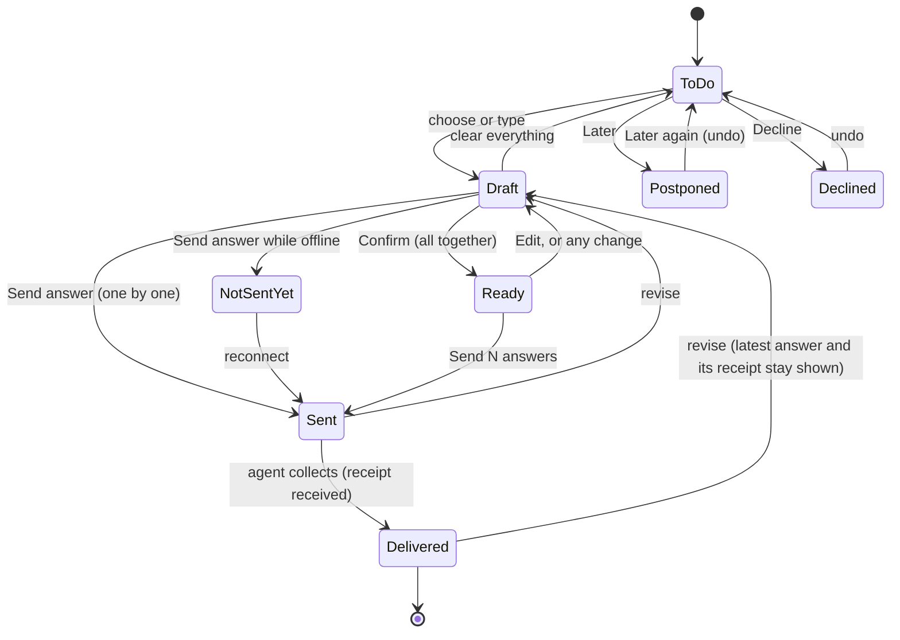
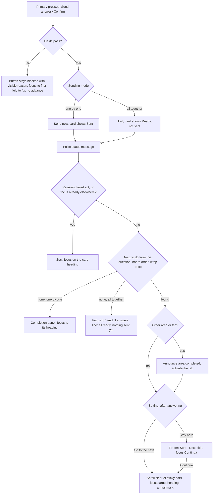

# The answering flow: UX/UI review report (Issue #168)

Version 1.1.0, 2026-11-14. Base: `main` at `3722202d`. Draft (Working documents: `drafts/`): it never overrides `docs/` or `openspec/`.

Changes since 1.0.0: records the PO's decisions of 2026-11-14 (section 1); direction B "Cabina" chosen, and what it obliges the implementation to settle (section 6.4); the Italian strings of section 4 accepted; palettes decided, with "Nordico" as the cool palette (section 7); D-6 becomes a check on a live session, filed as a chore (sections 2.2, 8.4); P0-6, P2-1, the slicing, the validation protocol and the traceability follow direction B (sections 8 to 10). Finding, divergence and P-item IDs are unchanged.

Readers: the Product Owner, who decides; the engineers who turn the decisions into OpenSpec changes.

Inputs, all in this folder: `assessment-1.0.0.md` (findings F-01 to F-26, divergences D-1 to D-6, constraints, evidence), `design-brief-1.0.0.md` (the shared behaviour and the two directions), `icons-and-theming-research-1.0.0.md`. Screenshots of today's board are in [`screenshots/current/`](screenshots/current/). Paths in code are under `packages/view/src/` unless absolute; EXP is `docs/ux-askboard-2026-10-27/EXPERIENCE.md`, DES is `DESIGN.md` beside it; "spec" is `openspec/specs/view-and-widgets/spec.md`, cited by requirement name.

## 1. Summary

**What is wrong today**

1. Pressing "Rispondi" leads nowhere: the card barely changes, nothing points to the next question, and keyboard focus falls to the page (F-01, F-02).
2. "Prossima aperta" sits far from where the user answered, can leave its target hidden under the sticky bottom bar, searches from a stale anchor, and appears twice in one question per view (F-03, F-04, F-07, F-15).
3. The delivery model is explained only in "Immediata", in a corner far from the button it governs; in "Su invio" the same "Rispondi" only marks the answer ready, silently (F-10, F-11, F-12, D-3).
4. "Seleziona le consigliate" is grouped with export and send, says nothing about what it did, and behaves differently in the two modes (F-16, F-17).
5. Nothing is announced to screen readers, nothing tells the user the board is finished, and Italian uses five forms of *inviare* with three meanings on one screen (F-05, F-21, F-24).

**What is proposed.** One ladder of answer states shown the same way everywhere (to do, draft, ready-not-sent, sent, delivered); after every answer, feedback first, then a clear way to the next question to do, found from the question just answered; a completion state that counts only what is true; plain mode names ("Una alla volta | Tutte insieme"); "Precompila le consigliate (N)" that only drafts and reports what it did; one polite live region; board keys through the key-table seam; reduced-motion alternatives. Two visual directions were mocked up to carry this behaviour: A "Guida" (the board leads, cards fold, a session bar at the bottom) and B "Cabina" (dense cockpit, outbox ledger in the left rail, the user presses "Continua"). The PO chose B. Lucide as the icon set; named palettes, each light and dark, plus high contrast.

**Decisions taken by the PO (2026-11-14)**

| # | Decision | Recommended in 1.0.0 | Outcome |
|---|---|---|---|
| 1 | Visual direction | Hybrid on A's frame (section 6.4) | **B "Cabina"**, against the recommendation. Section 6.4 lists what B obliges the implementation to settle |
| 2 | After an answer: advance by itself? | (c) a user setting "Dopo la risposta: Vai alla prossima \| Resta qui", default "Vai alla prossima" in "Una alla volta"; never when revising, when the act failed, or when the user already moved elsewhere | **(c) accepted.** B's mockup defaults to "Resta qui", with the "Continua" footer; the recommended default was "Vai alla prossima". The default is the one point left for the change's design to confirm with the PO. Either way the "Vai alla prossima" option amends EXP 241 and the spec "One question per view" ("answering SHALL NOT advance"); a "Resta qui" default keeps today's rule as the default behaviour |
| 3 | Renamed labels (section 4) | Adopt all, Italian marked "(to review)" | **All accepted, Italian strings as proposed** (no longer "to review") |
| 4 | "Precompila le consigliate" in "Tutte insieme" | (b) draft only in both modes | **(b) accepted**: draft only in both modes. Changes the spec "Select recommended" and "Submit" ("the selections of Select recommended left in place") |
| 5 | "Invia le risposte" in "Una alla volta" | Absent | **Absent**, not disabled. Changes EXP's Submit row ("Disabled in immediate delivery") |
| 6 | Board keys | The revised table of section 5.1 | **Accepted**: `N` / `Shift+N`, `Mod+Enter` on the question outside fields and widgets, no default key for the send |
| 7 | Icons | Lucide `1.73.0` or the latest at adoption, Tabler as the fallback | **Lucide, pinned** |
| 8 | Palettes | "Carta" plus one cool palette and "Contrasto"; contrast check reports first; user and project | **"Carta", one cool palette, "Grafite", "Contrasto"**; the contrast check reports first; set at user and project level. The cool palette is "Nordico" (section 7) |

Also accepted as proposed:

- **D-6** goes to a check on a live session with the architecture owner, before P1-3 (section 2.2).
- **Postpone** keeps today's behaviour: it reaches the agent following the delivery mode. The mockups' local marker is not adopted (section 6.3).
- **The completion panel never says the tab can be closed.**

Still open:

- The default of the after-answer setting (decision 2), to confirm with the PO in the change's design.
- D-6's outcome, which decides whether the ledger can replace the ask pill (section 6.4).
- The points direction B leaves to the implementation (section 6.4), among them where the one-question-per-view jump sits (P0-6) and the outline rail's width.
- The mockup strings that section 4 does not cover (section 4, last note).
- A default key for "Invia N risposte": none for now; the PO may approve one the key vocabulary leaves free.

## 2. Assessment

### 2.1 Findings

Evidence, screenshots and code lines for every row are in `assessment-1.0.0.md` §3. Severity: H high, M medium, L low.

| Theme | ID | Sev | Problem in one line | Principle / WCAG 2.2 |
|---|---|---|---|---|
| Progression | F-01 | H | Answering leads nowhere: no move, no pointer to the next question ([03](screenshots/current/03-sections-immediate-just-answered-it-light.png), [14](screenshots/current/14-one-per-view-immediate-just-answered-it-light.png)) | Visibility of system status; user control |
| Progression | F-02 | H | Focus drops to `<body>` after Answer and after Submit (the pressed button disables) | 2.4.3 Focus Order |
| Progression | F-03 | H | "Prossima aperta" focuses a heading left under the sticky bottom bar; no scroll ([04](screenshots/current/04-sections-after-next-open-it-light.png)) | 2.4.11 Focus Not Obscured (Minimum) |
| Progression | F-04 | M | The jump searches from the last jumped-to question, not from where the user is | Match with the real world; consistency |
| Progression | F-05 | M | No completion state: "0 aperte" and a green pill, nothing else ([25](screenshots/current/25-all-answered-top-it-light.png)) | Visibility; closure |
| Progression | F-06 | M | Finishing a tab hands off nowhere; the strip scrolls away ([12](screenshots/current/12-tabs-area-completed-it-light.png)) | Recognition over recall |
| Progression | F-07 | M | Two "Next open" buttons, ↓ and →, in one question per view ([13](screenshots/current/13-one-per-view-immediate-initial-it-light.png)) | Consistency and standards |
| Progression | F-08 | M | A question the agent adds silently redirects the jump | Visibility; 4.1.3 Status Messages |
| Progression | F-09 | M | A note-only "Rispondi" leaves no trace on the card | Visibility |
| Delivery | F-10 | H | The delivery model is explained far from "Rispondi", and not at all in "Su invio" ([16](screenshots/current/16-sections-submitted-initial-it-light.png), [17](screenshots/current/17-bottom-bar-submitted-it-light.png)) | Visibility; proximity |
| Delivery | F-11 | H | In "Su invio", "Rispondi" means "mark ready" and toggles silently; count drops while the pill stays "In attesa" ([18](screenshots/current/18-sections-submitted-one-ready-it-light.png)) | Match; consistency |
| Delivery | F-12 | M | Mode names do not say when: "Su invio" also reads "on Enter"; "Submitted" reads as a state | Match with the real world |
| Delivery | F-13 | M | "Invia le risposte" shown disabled in "Immediata" ([06](screenshots/current/06-bottom-bar-immediate-it-light.png)) | Consistency; disabled-primary anti-pattern |
| Delivery | F-14 | M | Ask pill, open count and receipts use three meanings of "done" | Visibility |
| Next open | F-15 | M | Elliptical label, far from the last click, wrong arrow when it wraps | Recognition over recall; Fitts |
| Select recommended | F-16 | M | Grouped with Snapshot and the send; no scope described | Proximity |
| Select recommended | F-17 | M | Different effect per mode, no count, no undo, focus stays ([19](screenshots/current/19-sections-submitted-after-select-recommended-it-light.png), [22](screenshots/current/22-sections-immediate-after-select-recommended-it-light.png)) | Visibility; user control; 4.1.3 |
| Select recommended | F-18 | L | "Accetta la consigliata" stays on answered cards, far from the option | Proximity; error prevention |
| Coherence | F-19 | M | The card's primary is about 1000px from its siblings and below the note | Proximity; Fitts |
| Coherence | F-20 | M | Disabled "Rispondi" hides its reason from sighted users ([23](screenshots/current/23-validation-error-it-light.png)) | 3.3.1 met at the field, not at the button |
| Coherence | F-21 | M | Italian verbs collide ("Rinvia", "Invia", "inviata", "Su invio"); "Altre azioni" hides "Rifiuta" | Consistency |
| Coherence | F-22 | L | The answered card looks almost like a merely selected one | Visibility; 1.4.1 on the card |
| Coherence | F-23 | L | The bottom bar reflows to two rows with the postponed warning ([07](screenshots/current/07-sections-postponed-warning-it-light.png)) | Stability of targets |
| Keyboard, SR, motion | F-24 | H | No status messages for the flow; the agent pill announces noise | 4.1.3 Status Messages |
| Keyboard, SR, motion | F-25 | L | No board-level keys (EXP Open Items 21) | Keyboard efficiency |
| Keyboard, SR, motion | F-26 | L | Reduced motion unaddressed (DES Open Items 1) | 2.3.3 Animation from Interactions (AAA, advisory) |

### 2.2 Divergences between documents and code

| ID | Documents | Code | Action |
|---|---|---|---|
| D-1 | One question per view: the jump is in the navigator **instead of** the header (EXP 235, DES 919) | Both show (`board.tsx:424`) | Fix the code (P0): one jump only. 1.0.0 kept it in the navigator, as EXP says; direction B keeps it in the header and gives the navigator only Previous and Next (section 6.4), so P0-6 keeps the header's and EXP 235 is amended instead. The spec "Counts and the next-open jump" (header jump on every board of two or more) then already matches |
| D-2 | The outline highlights the question in view (EXP 240) | It highlights the last question jumped to (`board.tsx:300-305`) | Fix with F-04 (P0) |
| D-3 | Helper text for both modes, the submitted one provisional (DES 931) | No submitted text (`bottom-bar.tsx:215-217`) | Fix (P0) |
| D-4 | Inter and JetBrains Mono, bundled (DES 839-841) | System stacks (`/tools/build/tokens.ts:4-11`) | Leave to P2 (typography of the chosen direction) |
| D-5 | Sticky header and bar carry `shadow-sm` (DES 892) | No shadow | Leave to P2 |
| D-6 | Ask pill "Answered" means every question "answered or declined, as received by the agent" (EXP 388) | "Con risposta" observed while every receipt still read "inviata" ([25](screenshots/current/25-all-answered-top-it-light.png)); the pill follows `board-host`'s recorded ask state (`board-view.ts:119-147`), the receipt follows AD-3's `received` (`question-state.ts:32-36`) | **Check on a live session with the architecture owner**, before P1-3 (below; PO, 2026-11-14) |

**D-6, the check.** The board shows two different meanings of "received" side by side. If the ask pill can turn "Con risposta" before the agent has collected the answers, the pill tells the user more than is true, against NFR-10 and AD-10; if the recorded ask state is by definition "received by the agent" in AD-10's sense, then the receipt's "inviata" is the stricter of the two and the words must say which is which. Either way the completion panel proposed here counts from the receipts' `received` and never from the pill. The screenshot harness never calls `collect`, so the observation is reproducible only in that harness. The PO's decision: run the check on a live session with the architecture owner before P1-3, filed as one `type:chore` Issue (`source:review`, areas `area:board` and `area:session`), not as a PO question. Direction B makes the outcome matter twice: B replaces the ask pill with the outbox ledger and the progress strip, which is sound only if the ledger's counts come from the receipts (section 6.4).

## 3. Proposed interaction flow

### 3.1 The state ladder

Every surface (card, outline, navigator markers, progress, completion) shows the same states, each as a shape or icon plus a text label, never colour alone (DES 764-773). A state is shown only when it is true (NFR-10, AD-10, AD-3).

| State | IT | EN | Icon (Lucide) | True when | Counts as open |
|---|---|---|---|---|---|
| To do | Da fare | To do | `circle` | Nothing confirmed | yes |
| Draft | Bozza | Draft | `pencil` | Something chosen or typed, not confirmed | yes |
| Ready, not sent | Pronta, non inviata | Ready, not sent | `package` | Confirmed in "Tutte insieme", waiting for the send | no (as today: Counting, EXP 397) |
| Not sent yet | Non ancora inviata | Not sent yet | `hourglass` | Confirmed while the connection is lost | no |
| Sent | Inviata | Sent | `send` | The board sent it; no receipt yet | no |
| Delivered | Consegnata all'agente | Delivered to the agent | `check-check` | AD-3's receipt says `received` | no |
| Postponed | Rimandata | Postponed | `clock` | Postponed, held or sent | yes |
| Declined | Rifiutata | Declined | `ban` | Declined | no |

Marks beside a state: New from the agent (`bell-dot`, "Nuova"), Recommended (`sparkles`, "Consigliata"), Blocked by a field (`circle-alert`).

A revision keeps the card's latest answer and its receipt visible until the revision itself is sent (spec "Revising an answer"). Field errors block the move out of Draft (spec "A field check blocks Answer").

### 3.2 After the primary button

"Next to do" order: a question the agent added and the user has not seen comes first only when the user is told why ("Nuova dall'agente"); then to-do, draft and postponed questions in board order, after the question just answered, wrapping once (fixes F-04). A postponed question is reached last in its pass, not skipped.

### 3.3 Flows

Each flow: trigger; card; status message (IT / EN); focus; scroll; what must **not** be implied. Direction B (decision 1): the card stays open and shows its state stripe; the setting "Dopo la risposta" picks between the "Continua" footer ("Resta qui") and the advance ("Vai alla prossima").

**3.3.1 Successful answer, "Una alla volta".** Trigger: "Invia risposta" or `Mod+Enter`. Card: answered look, state Sent with the chosen option summarised, "Modifica"; with "Resta qui", a footer "Inviata · Prossima: {title} {number}" with "Continua". The outbox ledger's "Inviate" count rises. Message: "Risposta inviata: {option}. Prossima: {title}, {n} di {m}." / "Answer sent: {option}. Next: {title}, {n} of {m}." Focus: "Continua" ("Resta qui") or the next to-do heading ("Vai alla prossima"). Scroll: target heading clear of both sticky bars (`scroll-margin` equal to their heights). Not implied: "delivered" until the receipt says so; the message never says the agent read it.

**3.3.2 Answer held in "Tutte insieme", then the send.** Trigger: "Conferma". Card: state "Pronta, non inviata" with `package` icon and "Modifica"; the ledger's "Pronte" count and the outbox's send button count rise. Message: "Risposta pronta, non inviata. {k} pronte. Prossima: {title}." / "Answer ready, not sent. {k} ready. Next: {title}." Focus and scroll as 3.3.1. Then "Invia {k} risposte": one command (spec "Submit"); each card turns Sent; message "{k} risposte inviate." / "{k} answers sent."; focus to the completion panel when nothing is left, else to the next to-do heading. Not implied: progress bar and outline never colour a held answer as sent; the ask pill does not move until the send (spec "Counts and the next-open jump", scenario "A ready answer does not move the pill").

**3.3.3 Validation error.** Trigger: a field fails its check, or `Mod+Enter` on a blocked card. Card: field error under the field (today); the primary stays disabled with its reason visible beside it, "Correggi prima {label}." / "Correct {label} first." (`question.entryHint`) or "Completa prima {label}." / "Complete {label} first." (`question.requiredHint`), with a link that focuses the field. Message: none while typing; on `Mod+Enter` or on a click on the reason, the same text, polite. Focus: the first field to fix, only on an explicit act. Scroll: that field clear of the bars. Not implied: no advance, no state change; a held answer whose field breaks loses "ready" and says so ("Non più pronta: correggi {label}.").

**3.3.4 The final question.** One by one: after the last send, the completion panel at the top of the content area: "Tutte le domande hanno una risposta. {s} inviate, {d} consegnate all'agente." / "Every question has an answer. {s} sent, {d} delivered to the agent." with counts updated as receipts arrive; focus to the panel's heading. All together: focus to "Invia {k} risposte" with the line "Tutte pronte: niente è stato ancora inviato." / "All ready: nothing has been sent yet."; the panel comes after the send. With postponed questions left: "Restano {p} rimandate. Chiudendo perdi questa richiesta." with "Vai alla prima"; the panel never says "complete". Not implied: never "the agent has your answers" unless every receipt is `received`; never "read"; never that the tab can be closed (PO, 2026-11-14).

**3.3.5 Postponed question.** Trigger: "Più tardi". Card: state Rimandata with `clock`; pressed again undoes (spec "Postpone"). Delivery: as today, the postpone follows the delivery mode and reaches the agent, held in "Tutte insieme" until the send (PO, 2026-11-14; the mockups' local marker is not adopted). Message: "Rimandata. Prossima: {title}." / "Postponed. Next: {title}." Focus: on the same card (EXP 537), on its footer's "Continua" with "Resta qui"; with "Vai alla prossima" the board advances as after an answer, since postponing is a decision to move on. The warning moves from the bottom bar into the progress area as a fixed-height line, so nothing reflows (F-23). Not implied: a postponed question is still to do; it keeps completion open.

**3.3.6 A question added by the agent.** Trigger: the agent's update. Card: the new card carries "Nuova". Message: a notice that never takes focus, "L'agente ha aggiunto 1 domanda: {title}." with "Vai" / "The agent added 1 question: {title}." with "Go". Focus: unchanged. Scroll: none. The next "Prossima da fare" goes there first and the arrival message says "Nuova dall'agente" / "New from the agent". The outline and the progress strip gain one entry in place; no advance is redirected while the user is mid-question. Short question numbers (D1, D2…) must not shift under the user (section 6.4).

**3.3.7 Revising an answer.** Trigger: "Modifica" or any edit on an answered card. Card: stays open with the latest answer and receipt shown, and the primary reads "Invia la modifica" / "Send the change" (one by one) or "Conferma" (all together); a received verdict asks first ("Inviare una nuova risposta?", `revision.confirmTitle`). Message on send: "Modifica inviata." / "Change sent." Focus: stays on the card. Scroll: none. No advance (brief §1.3 point 4).

**3.3.8 Note only.** Trigger: the primary with only a note. The button reads "Invia la nota" / "Send the note" when only a note is present, so the act is named. Card: the question stays To do, with a line under the prompt "Nota inviata {time}" / "Note sent {time}" (fixes F-09). Message: "Nota inviata; la domanda resta da fare." / "Note sent; the question is still to do." Focus: stays in the card. No advance. Not implied: never "answered" (spec "Open prompt", scenario "A note without an answer").

### 3.4 Across presentations

- **Sections.** As above. The arrival mark is a 2px accent edge on the card for 1.2 s.
- **Tabs.** The tab strip becomes sticky under the header. Leaving the last to-do question of a tab says "{area} completata" / "{area} completed" and activates the next tab with work; the completed tab shows a `check` and its count goes (fixes F-06).
- **One question per view.** One "Prossima da fare" only, in the header as direction B places it; the question navigator keeps "Domanda n di m", Previous and Next (fixes D-1 and F-07; amends EXP 235). Direction B keeps the left rail, with outline and outbox, in this presentation, which today has neither (section 6.4). "Continua" and "Vai alla prossima" make the same view change "Prossima da fare" makes today; the "Vai alla prossima" option amends EXP 241 and the spec "One question per view".
- **Single-question board.** No count, no jump, no switch, no Submit, no Prefill stay (EXP 93, spec "Single-question board"), so no outbox and no rail: it needs only the receipt on the card. Snapshot moves to the header tools with the bottom bar's removal. After the send: the card's state, the message "Risposta inviata." / "Answer sent.", and focus to the card heading; no "Continua" and no completion panel beyond the state, since one card is its own summary.

## 4. Wording

Today's strings are in `packages/view/src/strings/it-IT.ts` and `en-US.ts` under keys of `strings/keys.ts`. **The PO accepted every renamed label and every Italian string of this section as it stands on 2026-11-14** (decision 3); they no longer carry EXP Voice and Tone's "(to review)". New keys are suggestions, named for the engineers; none exists yet.

| Key today (it-IT line / en-US line) | Today IT / EN | Proposed IT (accepted) | Proposed EN | Why |
|---|---|---|---|---|
| `bar.delivery` (198 / 189) | Consegna / Delivery | Invio delle risposte | Sending answers | Names what the control governs |
| `bar.immediate` (199 / 190) | Immediata / Immediate | Una alla volta | One by one | Says when |
| `bar.submitted` (200 / 191) | Su invio / Submitted | Tutte insieme | All together | "Su invio" also reads "on Enter"; "Submitted" reads as a state |
| `bar.immediateHelp` (201 / 192) | Le risposte arrivano all'agente man mano che le dai. / Answers go to the agent as you give them. | Ogni risposta parte appena la invii. | Each answer goes to the agent as soon as you send it. | Names the act |
| new `bar.submittedHelp` (none, D-3) | none | Le risposte restano qui finché non premi «Invia le risposte». | Answers stay here until you press "Send answers". | Missing today |
| `question.answer` (117 / 111), one by one | Rispondi / Answer | Invia risposta | Send answer | The verb says it leaves now |
| `question.answer`, all together (new key) | Rispondi / Answer | Conferma | Confirm | It does not send |
| new, un-mark a held answer | (pressing Rispondi again) | Modifica | Edit | An explicit way back (F-11) |
| new, note only | Rispondi / Answer | Invia la nota | Send the note | Names the act (F-09) |
| `bar.submit` (211 / 199) | Invia le risposte / Submit | Invia {count} risposte (plural forms) | Send {count} answers | Carries the count; absent in "Una alla volta" (F-13) |
| `question.postpone` (118 / 112) | Rinvia / Postpone | Più tardi | Later | "Rinvia" also reads "send again" |
| `mark.postponed` (106 / 100), `state.postponedPart` (94 / 88) | Rinviata / Postponed | Rimandata, {count} rimandate | Postponed | Same root as "Più tardi" |
| `mark.unanswered` (103 / 97) | Senza risposta / Unanswered | Da fare | To do | One word for the list and the count |
| `mark.ready` (104 / 98) | Pronta / Ready | Pronta, non inviata | Ready, not sent | Fail closed in the label itself |
| `receipt.sent` (147 / 140), `receipt.delivered` (148 / 141) | inviata, consegnata all'agente / sent, delivered to the agent | Inviata, Consegnata all'agente | Sent, Delivered to the agent | Unchanged words, now a state label with an icon |
| `header.open` (30 / 27), `areas.open` (101 / 95) | {count} aperte / {count} open | {count} da fare (di cui {p} rimandate) | {count} to do ({p} postponed) | "Open" hid the postponed ones |
| `header.nextOpen` (31 / 28), `navigator.nextOpen` (116 / 110) | Prossima aperta ↓ / → | Prossima da fare (icon `arrow-right`, no glyph) | Next to do | One label, one place per presentation |
| `bar.selectRecommended` (206 / 197) | Seleziona le consigliate / Select recommended | Precompila le consigliate ({count}) | Prefill recommended ({count}) | Says it prepares, and how many |
| new, prefill result | none | {count} domande precompilate. Niente è stato inviato. · Annulla | {count} questions prefilled. Nothing was sent. · Undo | F-17 |
| `question.more` (119 / 113) | Altre azioni / More | Altro | More | Shorter; menu keeps "Spiega", "Rifiuta" |
| `question.acceptRecommended` (126 / 120) | Accetta la consigliata / Accept recommended | unchanged; on the recommended option's row, absent once answered | unchanged | F-18 |
| new, completion | none | Tutte le domande hanno una risposta. {s} inviate, {d} consegnate all'agente. | Every question has an answer. {s} sent, {d} delivered to the agent. | F-05 |
| new, area done | none | {area} completata | {area} completed | F-06 |
| new, setting | none | Dopo la risposta: Vai alla prossima \| Resta qui | After answering: Go to the next \| Stay here | Decision 2 |

Unchanged on purpose: `question.entryHint` ("Correggi prima {label}." / "Correct {label} first.", 130 / 124) and `question.requiredHint` (132 / 125), now shown visibly beside the primary. The ask pill strings (`state.*`) stay until D-6 is checked and direction B's ledger replaces the pill (section 6.4). The mode-switch dialog (`bar.switchTitle`, `bar.sendAndSwitch`) follows the new mode names: "Passare a «Una alla volta»?" / "Switch to "One by one"?".

Where B's mockup words a string differently, this table wins, since the PO accepted these strings and not the mockup's: the immediate helper reads "Ogni risposta parte appena la invii." (the mockup: "…appena la confermi."); the blocked primary's reason uses `question.entryHint` and `question.requiredHint` (the mockup: "Correggi: {label}", "Compila: {label}"); the completion line reads "Tutte le domande hanno una risposta. {s} inviate, {d} consegnate all'agente." (the mockup: "Tutte le risposte sono state inviate"). Two points for the change to settle with the PO, outside what was accepted: the strings the mockup adds and this table does not hold ("Continua", the ledger's "Bozze · Pronte · Inviate · Consegnate", "Indice", "Avanzamento", "Scegli un'opzione" for a question with nothing chosen); and the accepted submitted helper names «Invia le risposte» while the button now reads "Invia {count} risposte".

## 5. Keyboard, focus, screen reader, reduced motion

### 5.1 Keys

All board keys go through the key-table seam (`docs/as-built/keyboard-shortcuts-help.md`): a board-level key table registered like a widget's, its actions named in `packages/contract/src/keys/vocabulary.ts` where they are shared, read by the handler, the tooltips (`aria-keyshortcuts`, key caps), the keys panel and the generated `askboard-help` skill, and changeable in the user file's `keys` (which also satisfies WCAG 2.1.4 for the single-letter keys). `KEY_TABLES_ON_BOARD` (`contract/src/keys/board.ts`) gains the board table. A new board ignores keys until clicked (EXP 427); a key that answers or sends needs a modifier and never acts in a text field (EXP 533).

| Key | Action | Scope | Guard |
|---|---|---|---|
| `N` | Next to do | Board, focus outside text fields and outside a widget with its own table | Not in fields; IME composing ignored |
| `Shift+N` | Previous to do | Same | Same |
| `Mod+Enter` | Send answer / Confirm the question in focus | Focus on the question card's own controls (options, actions), not in a text field, not inside a widget | Modifier required; blocked card announces its reason |
| `Enter` on "Continua" | Continue (setting "Resta qui") | The focused button | Native button behaviour |
| none by default | Send all held | Board | Button only in the first slice |
| `?` | Keys panel (existing `keys.open`) | Board, outside fields | Existing rule |

Two of the brief's proposals collide with keys in force and are revised above:

- `Ctrl/Cmd+Shift+Enter` for "send all held" is `add.child` in the vocabulary (`vocabulary.ts:96` defines `mod` as `mod+shift`; `"add.child": keys(mod("Enter"))`). A board-level binding would shadow it inside a Tree, or confuse the keys panel. No default key for the send; the PO may approve one that the vocabulary leaves free.
- `Ctrl/Cmd+Enter` already sends in the follow-up composer (spec "Follow-up thread"). The question-level key therefore acts only outside text fields, so the composer keeps it.

### 5.2 Focus destinations

| Act | Focus goes to | Today |
|---|---|---|
| Send answer / Confirm, next found, advance on | Next to-do question's heading, scrolled clear of the bars | `<body>` (F-02) |
| Same, setting "Resta qui" | "Continua" in the card footer | `<body>` |
| Same, revision | The card's heading | `<body>` |
| Last question, one by one | Completion panel heading | `<body>` |
| Last question, all together | "Invia {k} risposte" | stays on "Rispondi" |
| Send N answers | Completion panel heading, or next to-do heading | `<body>` |
| Blocked primary, explicit act | First field to fix | none |
| Prefill | Stays on the button; the message is announced | stays |
| Undo of prefill | Prefill button | n/a |
| Later (postpone), Decline | The same card (EXP 537): its "Continua" with "Resta qui", the next heading with "Vai alla prossima" | heading |
| Next to do / Previous to do | Target heading, scrolled clear of the bars | heading, maybe obscured (F-03) |
| Agent adds a question | Unchanged (a notice never takes focus) | unchanged |
| User has moved focus into another card during the send | Unchanged | n/a |

### 5.3 Live-region messages

One polite region (`role="status"`) for the flow, outside the cards, text only; agent-written titles go in as text with the agent-label truncation and bidi isolation (EXP 233). Messages: answer sent; answer ready not sent (with count); note sent; postponed; declined; change sent; "{k} answers sent"; delivered count changes, batched to at most one message per 5 s; prefill result; prefill undone; area completed; all answered (one by one) / all ready, nothing sent (all together); question added; question removed by the agent (today plain text, `navigators.tsx:163-167`); a held answer lost its ready mark. The agent pill (`agent-pill.tsx:32`) keeps `role="status"` only for "waiting for your answer"; "working" changes stop being announced (F-24).

### 5.4 Reduced motion

| Transition | Default | Under `prefers-reduced-motion: reduce` |
|---|---|---|
| Scroll to the next question | Smooth, at most 250 ms | Instant jump |
| Arrival mark | Accent edge fading over 1.2 s | Static edge for 1.2 s, then removed |
| Outbox ledger count pulse | 150 ms scale | Count changes, no pulse |
| Progress segment fill | 150 ms colour | Instant |
| Agent "working" spinner | Rotates | Static icon (also `board-page/reading-panel.ts:69` `animate-pulse`, today ungated) |

All CSS, no animation library (chunk budget: about 22 KB of headroom on the shell chunk).

## 6. The two UI proposals

### 6.1 Mockups

- A "Guida": [`proposals/proposal-a-guida-1.0.0.html`](proposals/proposal-a-guida-1.0.0.html), screenshots [`proposals/screenshots/a/`](proposals/screenshots/a/).
- B "Cabina": [`proposals/proposal-b-cabina-1.0.0.html`](proposals/proposal-b-cabina-1.0.0.html), screenshots [`proposals/screenshots/b/`](proposals/screenshots/b/).

Both run the same nine-question board as the assessment, share sections 3 to 5, and differ only as below.

### 6.2 Comparison

Kept as the record of the comparison the PO decided on; section 6.4 says what holds for the implementation.

| Aspect | A "Guida" | B "Cabina" |
|---|---|---|
| Idea | The board leads, one decision at a time | Everything in view, the user drives |
| Layout | Left checklist by area; centre: question in hand open, answered ones folded to one line, to-do ones collapsed to their title; slim header (title, agent pill, theme, settings, Snapshot) | Dense three zones, no bottom bar; header with clickable progress strip, "N da fare", "Prossima da fare" with key cap, "Precompila (N)"; all cards of the area open, with a state stripe on the left edge |
| Where delivery lives | Sticky bottom session bar, right group: mode, helper line, "Invia N risposte" | Foot of the left rail, the "outbox": ledger "Bozze · Pronte · Inviate · Consegnate", mode, helper, "Invia N risposte" |
| Progress and next | Session bar, left: "3 di 9 · 6 da fare", segmented bar, "Prossima da fare", "Precompila (N)" | Header strip and buttons |
| After an answer | Card folds, next opens and scrolls into place, focus on its heading (setting can turn it off) | Footer "Inviata · Prossima: Cache" with focused "Continua"; nothing scrolls until the user continues (setting can turn advance on) |
| Density | Roomy: 14-15 px body, 8 px radii, large primary next to the options | Compact: 13 px body, 4 px radii, hairlines, monospace for IDs and counts, visible key hints |
| Palettes | Carta (today's, refined), Ardesia, Salvia, Contrasto | Grafite (dark first), Inchiostro, Nordico, Contrasto |
| Suits | Business manager first; engineer who wants rhythm | Engineer first; manager who wants the ledger |
| Rework against today's shell | `bottom-bar.tsx` becomes the session bar (layout and content change, same sticky slot); `board-header.tsx` loses count, jump and toggles group; `question-card.tsx` gains a folded state; `question-actions.tsx` primary moves beside the options; `board.tsx` advance and fold; `navigators.tsx` outline as checklist; `board-view.ts` next-to-do order; `markers.tsx` icons. **M-L** | `bottom-bar.tsx` removed, its content moved into a new outbox under the outline in `navigators.tsx`; `board-header.tsx` gains strip, jump, prefill; `question-card.tsx` stripe and footer; `board.tsx` "Continua"; `styles.ts` compact defaults. **M-L**, plus a home for the outbox where no outline exists |
| Risks | Auto-advance can surprise a user who wanted to re-read; folded cards hide context the agent wrote; amends EXP 241 if the default advances | The outline is absent in one question per view and on the single-question board (EXP "Outline navigator"), so the outbox needs a second home there; a 212 px rail is tight for a four-count ledger plus the mode and helper; more on screen for the occasional user |

### 6.3 Mockup verification notes

Each mockup is one self-contained HTML file (no network, system fonts, Lucide 1.73.0 paths inline) and works as a state machine on the nine-question board. Each builder drove its file with a Playwright script in Chromium and looked at the screenshots; the coordinator opened a sample of the screenshots of both.

| Item of the brief, §3 | A "Guida" | B "Cabina" |
|---|---|---|
| Transition after an answer, both modes | Card folds, next opens, focus on its heading ([02](proposals/screenshots/a/02-mid-transition-folding.png), [03](proposals/screenshots/a/03-just-advanced-one-by-one.png)) | Footer "Inviata · Prossima: …" with focused "Continua"; nothing scrolls until Enter ([02](proposals/screenshots/b/02-just-answered-continua-footer.png), [03](proposals/screenshots/b/03-after-continue-arrival.png)) |
| Held answers, then the send | [04](proposals/screenshots/a/04-held-with-send-button.png), [11](proposals/screenshots/a/11-all-ready-before-send.png), [12](proposals/screenshots/a/12-completion-after-send-all-together.png) | [10](proposals/screenshots/b/10-all-together-held-outbox.png), [12](proposals/screenshots/b/12-all-together-all-ready.png), [13](proposals/screenshots/b/13-all-together-after-send-completion.png) |
| Completion; a postponed question keeps it open | [08](proposals/screenshots/a/08-completion.png), [07](proposals/screenshots/a/07-completion-blocked-by-postponed.png) | [08](proposals/screenshots/b/08-completion-one-by-one.png), [07](proposals/screenshots/b/07-completion-blocked-by-postponed.png) |
| Validation error with the reason beside the primary | [05](proposals/screenshots/a/05-validation-error.png) | [04](proposals/screenshots/b/04-validation-error.png) |
| Prefill with count, message, undo | [06](proposals/screenshots/a/06-prefill-with-undo.png) | [05](proposals/screenshots/b/05-prefill-message-undo.png) |
| Simulated receipt (Inviata, then Consegnata all'agente) | Checked by the script | Checked by the script; the ledger counts pulse ([09](proposals/screenshots/b/09-completion-all-delivered.png)) |
| The agent adds a question | [13](proposals/screenshots/a/13-agent-added-notice.png), [14](proposals/screenshots/a/14-arrived-on-new-question.png) | [06](proposals/screenshots/b/06-agent-added-question.png) |
| One question per view | Folder `a/`, files 17 and 18 | [14](proposals/screenshots/b/14-one-per-view-initial.png), [15](proposals/screenshots/b/15-one-per-view-just-answered.png) |
| Four palettes, light and dark | Folder `a/`, files `20-*` | Folder `b/`, files `20-*` |
| IT and EN, annotations | [09](proposals/screenshots/a/09-completion-en.png), [19](proposals/screenshots/a/19-annotations-on.png) | [16](proposals/screenshots/b/16-just-answered-en.png), [17](proposals/screenshots/b/17-annotations-on.png) |
| Keys of section 5.1, focus visible, live region, reduced motion | Checked by the script | Checked by the script |

What the scripts reported: no console error and no network request; no horizontal overflow at 1280, 1440 and 1920; contrast at AA for the token pairs measured in all eight palette and scheme combinations of each mockup.

Not checked on either mockup: Firefox and WebKit, a real screen reader (only the live-region text was read), the Ctrl key on Linux, forced colours, and the contrast of every rendered element (only token pairs).

Choices the builders made where the brief was silent, to confirm or reject with the direction:

- **Postpone** is a marker on the board in both mockups, neither held nor sent. Today "Rinvia" follows the delivery mode and reaches the agent (assessment §1.1). **Decided (PO, 2026-11-14):** today's behaviour stays; the local marker is not adopted.
- **A**: one question per view also advances by itself (decision 2); "Prossima da fare" skips postponed questions until only those remain; with "Resta qui" the card stays open in its answered look; in "Ardesia" the agent hue moves toward violet to stay apart from the blue accent; in "Salvia" the success green is close to the accent, so states there rest on icon and text.
- **B**: the ask pill is gone, replaced by the outbox ledger and the progress strip (F-14, and it sidesteps D-6 only if the ledger counts come from the receipts); one question per view keeps the rail with outline and outbox, which today's presentation does not have; questions carry short numbers (D1, D2…) that shift when the agent adds one; a required empty field says "Compila: {label}".
- **Both**: revising an answer never advances; a declined question in "Tutte insieme" is held until the send.

### 6.4 Decision: B "Cabina"

The PO chose **B "Cabina"** on 2026-11-14. The review had recommended A's frame with B's ledger, "Continua" and density: A keeps the sticky bottom slot the product already has, needs no second home for sending on boards without an outline, and serves the occasional reader with one decision and one primary button at a time. The decision is B's layout as drawn: outbox in the left rail, no bottom bar, all cards of the area open with a state stripe, the progress strip and the jump in the header, compact density.

Direction B obliges the implementation to settle the following, drawn from the risks of 6.2 and the notes of 6.3. Each lands in the `answering-flow-visual` change (P2-1) unless marked otherwise.

1. **The outbox where today there is no outline rail.** In one question per view B's mockup keeps the left rail, with outline and outbox ([14](proposals/screenshots/b/14-one-per-view-initial.png), [15](proposals/screenshots/b/15-one-per-view-just-answered.png)); today's presentation has no outline there (EXP 92, EXP 240: "absent … in one question per view"). Adopting it changes the spec requirements "Presentations", "One question per view" and "Outline navigator", and EXPERIENCE.md's Presentations table, Outline navigator and Question navigator rows, in the same change. The single-question board has no switch and no Submit today (EXP 93, spec "Single-question board"), so it needs no outbox: only the receipt on the card.
2. **The rail's width.** DESIGN.md's `outline-rail` token is 212 px, too narrow for a four-count ledger, the mode switch, its helper and "Invia N risposte". B's mockup widened the rail to 268 px (300 px from a 1600 px viewport), which takes 56 px from the content at the 1280 px floor. The change sets the token in DESIGN.md and checks the longest Italian labels in the ledger at 1280 px.
3. **The bottom bar's removal.** `bottom-bar.tsx` goes, and its content moves: the delivery mode, its helper and the send to the outbox; "Precompila le consigliate" and "Prossima da fare" to the header; Snapshot to the header tools (on the single-question board too, where the bar held only Snapshot). Two things it holds today need a new place, which the mockup does not draw: the postponed warning (EXP 244; section 3.3.5 puts it in the progress area as a fixed-height line) and the line that says how many updates need a choice with its jump to the first (EXP Submit row), which belongs beside the send in the outbox. The two alert dialogs (mode switch, replacing a received verdict) stay as they are. EXP's Bottom action bar row ("Always visible") and DES Bottom action bar are rewritten.
4. **The ask pill.** B replaces the ask pill with the ledger and the progress strip (F-14); the agent pill stays. This is sound only if the ledger's counts come from the receipts (AD-3's `received`), never from the recorded ask state: it waits for the D-6 check (section 2.2). Until then the ask pill stays, and EXP Ask states and the spec scenario "A ready answer does not move the pill" are amended only once D-6 is settled.
5. **The one-question-per-view jump.** B shows "Prossima da fare" in the header on every presentation and gives the question navigator only "Domanda n di m", Previous and Next. P0-6 therefore keeps the header's jump and removes the navigator's, amending EXP 235 (section 2.2, D-1). If the change's design prefers EXP 235 as written, P0-6 inverts; either way there is one jump.
6. **Short question numbers.** B labels questions D1, D2… (Q1… in English) by board position, so an added or removed question renumbers the ones after it under the user, and the "Prossima: Cache D2" footer can name a stale number. The change decides: numbers fixed at first display (a new question takes the next free number, a removed one leaves a gap) or no numbers at all. Fixed numbers fit fail-closed best: a number the user has read never changes meaning.
7. **The setting's default.** B's mockup defaults "Dopo la risposta" to "Resta qui", with the "Continua" footer ([02](proposals/screenshots/b/02-just-answered-continua-footer.png)); the recommended default was "Vai alla prossima" (decision 2). The change's design confirms the default with the PO.
8. **What from A is not built.** The folded cards, the session bar, A's palettes "Ardesia" and "Salvia" (unless "Ardesia" replaces "Nordico", section 7), and the roomy density as a separate layout. The existing "Comoda" and "Compatta" densities stay; B's compact look becomes the defaults of `styles.ts`, and "Comoda" must still hold on B's layout.

Also from B's mockup, kept: the ledger "Bozze · Pronte · Inviate · Consegnate" with a dash for "Pronte" in "Una alla volta" ([10](proposals/screenshots/b/10-all-together-held-outbox.png)); "Invia N risposte" in the outbox only in "Tutte insieme", with the line "{k} risposte pronte: niente è stato ancora inviato."; the completion panel at the top of the content ([09](proposals/screenshots/b/09-completion-all-delivered.png)), whose title follows section 4, not the mockup; key caps on the main controls. In the completion screenshot "Prossima da fare" still shows with "0 da fare": the build hides it when nothing is left.

## 7. Icons and themes

**Icons (decided: Lucide, pinned; decision 7).** Adopt Lucide (`lucide-react`), pinned exactly (`1.73.0`, or the latest release at adoption, re-read from the registry), in `packages/view/package.json` only, and added to the spine's Stack table in the same change. Adoption rule: ISC (in the accepted list of `tools/check-licences.ts:45`), 25.7k stars, released 2026-11-14, not archived: passes. Import each icon by path (`lucide-react/icons/<name>`), never the barrel; one module, `packages/view/src/icons/index.ts`, re-exports AskBoard-named icons as a list and is shared (`tools/build/shared-modules.ts`) so the runtime is bundled once; a test fails on a barrel import. Cost measured: about 3 KB minified runtime plus about 320 B per icon; about 11 KB minified for 25 icons; record with `bun run build:view --record-sizes`. Licence: the package's `LICENSE` holds ISC and Feather's MIT text; the view build's notice pipeline ships it whole; confirm with `check:licences` in the adopting change. CSP-safe (`currentColor`, no inline style); `aria-hidden` by default. Dependabot: ignore Lucide patch releases (about one release a day). Fallback, only if Lucide fails the adoption rule when the change runs: Tabler (`@tabler/icons-react` `3.52.0`, MIT), same style, `aria-hidden` added by the module, which goes back to the PO. Vendoring the paths is possible but takes the notices out of the automatic pipeline. Key glyphs (⌘ ⇧ ⌥ ↩) stay text; markers keep their text labels; an icon never replaces a label (DES Do's and Don'ts). Closes DES Open Items 2.

**Palettes.** A `data-palette="<name>"` attribute on the view root beside `.dark` and `.comfortable`; `tools/build/tokens.ts` emits `:root[data-palette=x]` and `:root[data-palette=x].dark` per palette from a `palettes:` group in DESIGN.md's YAML, failing on a missing role or dark twin; the default palette stays on plain `:root`, so today's boards are unchanged. A `Palette` preference beside `ThemePreference` and `Density` (`packages/contract/src/schemas/configuration/index.ts`), `applyPalette` in `theme.ts`, a row in the quick toggles and Settings panel; canvas and diagram renderers rebuild on a palette switch as on a theme switch; a Snapshot carries only the palette in use. About 2.5 KB of CSS per palette. A high-contrast palette, chosen also by `prefers-contrast: more` under System, and a `forced-colors` CSS layer. Guard-rails: a contrast test per palette and scheme, reporting first (decision 8), the role-hue rules (agent indigo and change plum apart from every accent), never colour alone, the choice stored in AskBoard's settings file, never in browser storage (AD-8).

**Palettes decided (PO, 2026-11-14; decision 8).** Four palettes, each light and dark: "Carta", one cool palette, "Grafite", "Contrasto". The contrast check reports first and blocks later; the palette is set at user and project level, like the theme.

- **The cool palette is "Nordico"** (blue-grey, from B's mockup), chosen as the default of the pair because the direction is B and its tokens were drawn and measured on B's layout. "Ardesia" (A's mockup) is the alternative of the pair; the PO can still swap it before the `palettes` change.
- **"Carta" comes from the product today, and B's mockup did not draw it.** It is the default palette (plain `:root`, so today's boards are unchanged), but its tokens have only been seen on today's layout and on A's. The `palettes` change checks it on B's layout: hairline borders, the state stripes, the ledger's coloured counts and the compact density, in light and dark.
- "Grafite" is the dark-first palette; B's mockup opens in it, but the product's default stays "Carta" under the System scheme.
- "Salvia" and "Inchiostro" are not shipped: the first puts its accent too close to the success green, the second leaves selected and answered states resting on weight alone.

## 8. Prioritized improvements and acceptance criteria

Sizes: S up to two days, M up to a week, L more. Requirement names are those of `openspec/specs/view-and-widgets/spec.md`; "new:" marks a requirement to add.

### 8.1 P0: defects to fix now, whatever the direction

| ID | Findings | Acceptance criteria | Spec | UX docs | Size |
|---|---|---|---|---|---|
| P0-1 Focus after Answer and Submit | F-02 | **Given** sections, immediate, focus on "Answer" of question 1 **When** the user presses it **Then** focus is on a heading of the board, not `<body>`. **Given** submitted with two ready **When** Submit is pressed **Then** focus is not `<body>` | Modify "Answer sends at once", "Submit"; or new: "Focus after an answer" | EXP Accessibility Floor, Focus | S |
| P0-2 Jumps clear the sticky bars | F-03 | **Given** a 1280×800 board whose next open question's heading is under the bottom bar **When** "Next open" is pressed **Then** the heading's box lies wholly between the header's bottom and the bottom bar's top. Same for an upward wrap, for an outline jump, and in tabs | Modify "Counts and the next-open jump", "Outline navigator" | EXP Board chrome, Next-open jump | S |
| P0-3 Anchor and outline follow the user | F-04, D-2 | **Given** the user jumped to question 2, then scrolled to question 5 and answered it **When** "Next open" is pressed **Then** it reaches the first open question after 5. **Given** the user scrolls question 7 into view **Then** the outline marks question 7 `aria-current` | Modify "Counts and the next-open jump", "Outline navigator" | EXP Outline navigator, Next-open jump | M |
| P0-4 Status messages | F-24, F-08, F-17 | **Given** immediate **When** the user answers **Then** a polite status region holds a message naming the answer as sent and not as delivered. **Given** Select recommended filled 3 **Then** the region says 3. **Given** the agent adds a question **Then** the region announces it and focus does not move. **Given** the agent pill turns "working" **Then** nothing is announced | New: "Status messages for the answering flow" | EXP Accessibility Floor (new State messages item); closes part of Open Items 22 | M |
| P0-5 Helper text in both modes | D-3, F-10 | **Given** submitted delivery **Then** the bottom bar shows the submitted helper text in the ask's language, in en-US and it-IT | Modify "Delivery mode" | DES Bottom action bar (text no longer provisional); EXP Voice and Tone | S |
| P0-6 One next-open in one question per view | D-1, F-07 | **Given** one question per view **Then** the header shows the open count and the next-open button, and the question navigator shows Previous and Next and no next-open button (the place direction B gives it, section 6.4 item 5) | None: "Counts and the next-open jump" already puts the jump in the header on every board of two or more | EXP 235 and the Question navigator row (EXP 241) amended: the jump leaves the navigator | S |
| P0-7 Visible reason on a blocked Answer | F-20 | **Given** a pattern field holds `ab-1234` **Then** the text "Correct Email first." (the field's label) is visible beside the disabled "Answer" and is its description; activating it focuses the field | Modify "Answer names the field to fix" | DES Question card, actions | S |

### 8.2 P1: the shared flow (both directions)

| ID | Findings | Acceptance criteria (abridged; full set in the change) | Spec | UX docs | Size |
|---|---|---|---|---|---|
| P1-1 State ladder on every surface | F-11, F-14, F-22 | **Given** submitted **When** the user confirms **Then** card, outline and navigator read "Ready, not sent" with its icon, and the ask pill still reads "Waiting". **Given** a receipt `received` **Then** the card reads "Delivered to the agent" | Modify "Delivery receipt on the board", "Delivery mode", "Outline navigator" | EXP Counting, State Patterns; DES Markers | M |
| P1-2 After the primary: feedback, next, arrival | F-01, F-04, F-15 | **Given** immediate, sections, setting "Go to the next" **When** question 3 is answered **Then** question 4's heading has focus, lies clear of the bars, and the status names question 4. **Given** setting "Stay here" **When** question 3 is answered **Then** focus is on "Continue" in its footer, which names question 4, and nothing scrolls; **When** "Continue" is pressed **Then** question 4's heading has focus. **Given** a revision **Then** focus stays on the card. The setting's default is the one the change's design confirms with the PO (decision 2). **Given** reduced motion **Then** the scroll is instant | Modify "One question per view" (advance), "Counts and the next-open jump"; new: "After an answer" | EXP Board chrome, Question navigator; new Key Flow | L |
| P1-3 Completion | F-05 | **Given** the last question sent and one postponed **Then** the panel says 1 postponed remains and does not say complete. **Given** all sent, none collected **Then** it says "0 delivered to the agent" | New: "Completion" | EXP State Patterns, By surface | M |
| P1-4 Tabs hand-off | F-06 | **Given** tabs **When** the last to-do question of "Architettura" is answered **Then** "Architettura completed" is announced and "Rilascio" is active, the strip visible | Modify "Tabs" | EXP Area | S |
| P1-5 Wording and the two primaries | F-12, F-13, F-21, F-09 | **Given** all together **Then** the card's primary reads "Confirm" and Submit reads "Send 2 answers"; **Given** one by one **Then** Submit is absent, not disabled (decision 5). Strings as accepted in section 4 (decision 3). **Given** only a note **Then** the primary reads "Send the note" | Modify "Delivery mode", "Submit", "Open prompt", "Postpone" | EXP Voice and Tone; DES Submit, Delivery mode switch | M |
| P1-6 Prefill recommended | F-16, F-17, F-18 | **Given** 4 eligible **When** Prefill is pressed **Then** 4 drafts are filled, nothing is sent or marked ready (decision 4), the status says 4 with Undo, and the button is absent when none is left | Modify "Select recommended", "Submit", "Recommended option" | EXP Select recommended; DES Select recommended | M |
| P1-7 Board keys | F-25 | **Given** focus on a card's option **When** `Mod+Enter` **Then** the question is sent (one by one). **Given** focus in the composer **When** `Mod+Enter` **Then** the follow-up is sent, not the answer. **Given** a Tree has focus **When** `Mod+Shift+Enter` **Then** a child is added. The keys panel lists the board keys | Modify "Keyboard core"; "Key tables match the handlers" and "Keyboard shortcuts are discoverable" extended to the board | EXP Accessibility Floor (closes Open Items 21) | M |
| P1-8 Reduced motion | F-26 | **Given** `prefers-reduced-motion: reduce` **Then** no transition of section 5.4 runs longer than 0 ms | New: "Reduced motion" | DES Open Items 1 settled | S |

### 8.3 P2: the visual direction

| ID | Content | Spec | UX docs | Size |
|---|---|---|---|---|
| P2-1 Layout of direction B "Cabina" | The left rail with outline and, at its foot, the outbox (ledger, mode, helper, "Invia N risposte"), in sections, tabs and one question per view; `bottom-bar.tsx` removed and its content moved (section 6.4 item 3); the header's progress strip, "N da fare", "Prossima da fare" and "Precompila le consigliate (N)"; Snapshot in the header tools; all cards of the area open with the state stripe and the "Continua" footer; the primary beside the options (F-19), no bar that reflows (F-23); the rail width token; short question numbers settled (6.4 item 6); the ask pill replaced only after D-6; compact defaults with "Comoda" still holding; D-4, D-5 | Modify "Presentations", "One question per view", "Outline navigator", "Single-question board" (Snapshot's place), "Hover and focus feedback" where looks change | EXP Presentations, Board chrome (Outline navigator, Question navigator, Bottom action bar, Submit), Ask states if D-6 allows; DES Board chrome, Question card, Layout, `outline-rail` token, Bottom action bar | L |
| P2-2 Icon set | Lucide module, shared, glyphs replaced | none (no behaviour); spine Stack table | DES Open Items 2 settled; DES Do's and Don'ts | M |
| P2-3 Palettes and high contrast | `data-palette`, generator, preference, toggles, forced colors, contrast test | New: "Palettes" | DES Colors, Contrast | L |

### 8.4 Slicing into Issues and OpenSpec changes

The repository's rule is one finding per Issue (CLAUDE.md, Lifecycle), so P0 is several Issues delivered by one change.

| Change (suggested id) | Issues | Notes |
|---|---|---|
| `answering-flow-fixes` (P0) | One `type:defect` Issue each for P0-1 to P0-7 (`source:review`, `sev:H` for P0-1, P0-2, P0-4; `sev:M` for the rest), areas `area:board`, `area:keyboard` where keys or focus | Proposal cites each Issue; spec and EXP edits in the same change; browser tests in Chromium, Firefox, WebKit |
| `answering-flow-guidance` (P1-1 to P1-6, P1-8) | `Refs #168`; decisions 2 to 5 already recorded (PO, 2026-11-14) | Updates PRD where EXP 241 or Select recommended's meaning changes; its design confirms the after-answer default with the PO; area `area:board`, `area:i18n` |
| `board-keys` (P1-7) | One `type:feature` Issue, `area:keyboard` | Decision 6 recorded; through the key-table seam; regenerates `skills/askboard-help/` |
| `answering-flow-visual` (P2-1) | `Closes #168` | Direction B (decision 1); settles the points of section 6.4; ask pill replaced only if D-6 allows |
| `icon-set` (P2-2) | One `type:chore` Issue, `area:board` | Decision 7 recorded; can run in parallel with P1 |
| `palettes` (P2-3) | One `type:feature` Issue | Decision 8 recorded ("Carta", "Nordico", "Grafite", "Contrasto"; reporting contrast check; user and project); adds the `Palette` preference: configuration version bump (askboard-contract-versioning); checks "Carta" on B's layout |
| none | One `type:chore` Issue for D-6 (`source:review`, `area:board`, `area:session`): the check on a live session with the architecture owner | Before P1-3, whose counts depend on it, and before P2-1 replaces the ask pill |

Order: P0 now (P0-6 already in direction B's place for the jump); the D-6 check before P1-3; P1 next, since decisions 2 to 6 are recorded; P2 after P1, with `icon-set` before `answering-flow-visual`, since B uses the icons, and `palettes` after `answering-flow-visual` or with it, since "Carta" is checked on B's layout.

## 9. Validation with the PO

On the nine-question board of the assessment (three areas, four recommendations, one question with two text fields), in direction B: run on B's mockup first ([`proposals/proposal-b-cabina-1.0.0.html`](proposals/proposal-b-cabina-1.0.0.html)), then on the P1 build, then on the P2-1 build. Tasks 1 and 2 run once with each value of "Dopo la risposta"; their result feeds the default the change's design confirms with the PO (decision 2).

| # | Task | Observe | Pass |
|---|---|---|---|
| 1 | In "Una alla volta", answer D1 Database, then D2 Cache, with the mouse; once with "Resta qui", once with "Vai alla prossima" | Where the eye goes, whether the user finds "Continua", whether they scroll, what they say happened | Reaches the next question without searching; says "sent", not "the agent has it"; reads the ledger's "Inviate" rising |
| 2 | Same with the keyboard only (`Mod+Enter`, `Enter` on "Continua", `N`) | Focus after each act | Never lost; "Continua" or the next heading visible each time |
| 3 | Switch to "Tutte insieme" in the outbox, confirm three, then stop and ask: "Has the agent got them?" | The answer given; whether the user looks at the ledger | "No, not until I send"; points at "Pronte 3" |
| 4 | Send them with "Invia 3 risposte" in the outbox | Ledger, receipts, message | Counts move from "Pronte" to "Inviate"; "Consegnate" rises only with the receipt |
| 5 | Type `ab-1234` in the pattern field and try to answer | Whether the reason beside the primary is found | Fixed within one attempt, without help |
| 6 | "Precompila le consigliate", then "Annulla", in both modes | What the user thinks was sent or made ready | Says nothing was sent or made ready (decision 4); undo restores |
| 7 | Postpone one, finish the rest | Completion panel, ledger | User knows one remains and that closing loses the ask; nothing says the tab can be closed |
| 8 | Mockup control "the agent adds a question" | Notice, next jump, question numbers | Noticed; the redirect is understood; no number the user read changes meaning |
| 9 | Repeat 1 in one question per view and in tabs | Rail and outbox in one question per view, the one "Prossima da fare" in the header, tab hand-off | Same understanding as in sections; the user finds the send without a bottom bar |
| 10 | Switch palettes ("Carta", "Nordico", "Grafite", "Contrasto") and schemes, read a long Italian label in the rail | Legibility, truncation; "Carta" on B's layout (P2-1 build only, the mockup does not draw it) | No clipped labels in the rail or ledger at 1280 px; states readable in every palette |
| 11 | On a single-question board (P2-1 build), answer it | Card receipt, Snapshot in the header | No rail, no outbox; the receipt alone tells the state |

Open questions for the session: the default of "Dopo la risposta"; whether the business manager finds "Continua" or expects the board to move; whether the ledger's four counts are too many for the occasional user; whether the user notices the outbox at the foot of the rail without help.

## 10. Traceability

| Issue #168 checklist item | Report sections |
|---|---|
| An assessment of the current flow by a UX/UI expert, with the usability problems and their rationale | 2 (and `assessment-1.0.0.md`) |
| A proposed interaction flow and annotated mockups covering the controls and the transition | 3, 4, 6.1, 6.3; direction chosen: 6.4 |
| Defined behaviour for successful answering, held answers, validation errors and the final question; navigation never implies delivery when only held | 3.1 to 3.3 (each flow's "not implied") |
| Keyboard and focus behaviour, screen-reader feedback and a reduced-motion alternative | 5 |
| A prioritized set of improvements and acceptance criteria, validated with the PO on a multi-question board | 8, 9; the PO's decisions of 2026-11-14 in 1 |
| Two UI proposals on the current stack, and an icon library | 6, 7; direction B and Lucide decided (1, 6.4, 7) |
| "What is wanted": Consegna, Prossima aperta, Seleziona le consigliate, coherence of actions, themes beyond dark and light | 2.1 (by theme), 4 (accepted), 6.2, 6.4, 7 (palettes decided) |

PO decision to report section: 1 direction, 6.4 and 8.3; 2 after an answer, 3.2, 3.3, 5.2 and P1-2; 3 wording, 4 and P1-5; 4 prefill, P1-6; 5 the send in "Una alla volta", P1-5; 6 keys, 5.1 and P1-7; 7 icons, 7 and P2-2; 8 palettes, 7 and P2-3; D-6, 2.2 and 8.4; postpone, 3.3.5 and 6.3; completion wording, 3.3.4.

Not verified here: D-6 on a live session; the Lucide pin at adoption time; "Carta" on B's layout; B's mockup in Firefox and WebKit, with a real screen reader and in forced colours (section 6.3); the PO's validation session on B (section 9).
